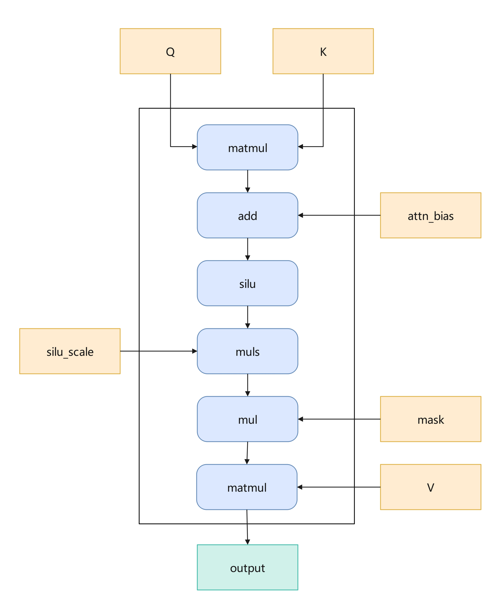

# RecOps Running Case Documentation

## Introduction

### What Is RecOps

RecOps is a set of custom operators for recommendation scenarios built on Ascend C by Rec SDK. It provides basic operator capabilities for framework components (`tf_rec_v1`, `tf_rec_v2`, `torch_rec_v1`, `torch_rec_v2`) and supports Atlas A2/A3/A5 devices.

**Core Positioning:**

- A custom operator set for recommendation scenarios built on Ascend C.
- Focused on fusing and accelerating key compute paths such as `Embedding`, `Attention`, and `Optimizer`.
- Supports mainstream recommendation frameworks such as `tf_rec` and `torch_rec`.

**Repository:** [RecSDK repository (GitCode)](https://gitcode.com/Ascend/RecSDK)

---

## Running Case

This case briefly introduces the HSTU_V1 forward operator `hstu_dense_forward` and how to compile and run it in an NPU environment.

### Introduction to the HSTU_V1 Forward Operator

**Hierarchical Sparse Transformer Unit (HSTU)** is a sparse attention fusion operator for recommendation scenarios. It fuses QK matrix multiplication, SiLU activation, scaling, mask application, and matrix multiplication with V into a single fused operator. This greatly reduces memory access overhead and kernel scheduling overhead, enabling high-performance training of recommendation models on Ascend NPUs.

In the HSTU_V1 version, we implement the `hstu_dense_forward` forward operator as the concrete Ascend NPU implementation of the HSTU fused operator. The following table compares the features of HSTU_V1 with NV HSTU_V3.

<table border="1" cellpadding="6" cellspacing="0" style="border-collapse: collapse; width: 100%; text-align: center; font-size:14px;">
  <thead>
    <tr>
      <th></th>
      <th>Feature</th>
      <th>Functionality</th>
      <th>ASCEND HSTU_V1 (Atlas A2/A3 Ascend950PR/DT)</th>
      <th>NV HSTU_V3 (Hopper, Ada, Ampere)<br>Releases/v25.11/7492d4b</th>
      <th>Description</th>
    </tr>
  </thead>
  <tbody>
    <tr>
      <td rowspan="13">HSTU forward features</td>
      <td rowspan="6">Basic attention functions</td>
      <td>Attention mechanism</td>
      <td>Supported</td>
      <td>Supported</td>
      <td>Implements the core part of HSTU Attention.<br>S = Q × K<sup>T</sup><br>P = silu(S)<br>O = P × V</td>
    </tr>
    <tr>
      <td>Multi-head attention (MHA)</td>
      <td>Supported</td>
      <td>Supported</td>
      <td>MHA: The number of query heads corresponds one to one with the number of key heads.</td>
    </tr>
    <tr>
      <td>Grouped-query attention (GQA)</td>
      <td>Supported</td>
      <td>Supported</td>
      <td>GQA: The number of query heads corresponds to the number of key heads in a many-to-one relationship.</td>
    </tr>
    <tr>
      <td>Variable-length sequence format</td>
      <td>Supported</td>
      <td>Supported</td>
      <td>Implements HSTU attention support for variable-length sequences.</td>
    </tr>
    <tr>
      <td>Floating-point calculation types</td>
      <td>Supports FP32, FP16, BF16</td>
      <td>Supports FP16, BF16</td>
      <td>The reference NV HSTU_V3 supports only FP16 and BF16 floating-point types.</td>
    </tr>
    <tr>
      <td>FP8 quantization types</td>
      <td>Supports <code>cast</code></td>
      <td>Supports <code>cast</code>,<br><code>per-block</code>,<br><code>per-head</code>,<br><code>per-batch</code>,<br><code>per-tensor</code></td>
      <td>FP8 quantization at the element, block, head, batch, and tensor levels.</td>
    </tr>
    <tr>
      <td rowspan="2">Relative attention bias</td>
      <td>Whether <code>rab</code> is passed in</td>
      <td>Supports passing <code>rab</code>,<br>or omitting <code>rab</code>.</td>
      <td>Supports passing <code>rab</code> in [b, n, s, s] format,<br>or omitting <code>rab</code>.</td>
      <td>Implements the relative bias part of HSTU attention.</td>
    </tr>
    <tr>
      <td>Support for <code>rab</code> broadcasting</td>
      <td>Not supported</td>
      <td>Supports passing <code>rab</code> in [b, 1, s, s] format.</td>
      <td>Implements the <code>rab</code> broadcast function.</td>
    </tr>
    <tr>
      <td rowspan="4">Mask</td>
      <td>Support no mask</td>
      <td>Supported</td>
      <td>Supported</td>
      <td>Bidirectional mask.</td>
    </tr>
    <tr>
      <td>Support causal mask</td>
      <td>Supported (context + history + target)</td>
      <td>Supported (context + history + target)</td>
      <td>The causal mask is built from <code>num_context</code>, <code>num_target</code>, and <code>target_group_size</code>. Any one of them can be <code>None</code>. For the specific parameter combinations, see the feature analysis.</td>
    </tr>
    <tr>
      <td>Support local mask</td>
      <td>Not supported</td>
      <td>Supported</td>
      <td>Local mask.</td>
    </tr>
    <tr>
      <td>Support arbitrary mask</td>
      <td>Not supported</td>
      <td>Supported</td>
      <td>User-defined mask parameters.</td>
    </tr>
    <tr>
      <td>Page</td>
      <td>Support Page feature</td>
      <td>Supported</td>
      <td>Supported</td>
      <td>Page feature: A KV cache optimization mechanism that manages Key-Value pairs in fixed-size pages for efficient memory utilization and allocation.</td>
    </tr>
  </tbody>
</table>

### Computing Principles

The mathematical expression is:

$$
HSTU(q, k, v, mask, attn\_bias, silu\_scale) = (Silu(qk^{T} + attn\_bias) \times silu\_scale \times mask)v
$$

Where Silu is the activation function and `silu_scale` is the scaling factor. The computation flow is shown in the following diagram:



Here, `muls` represents the multiplication with the scaling factor `silu_scale` after the Silu activation function.

### `hstu_dense_forward` Operator File Structure

```shell
-- hstu_dense_forward
   |-- c310
      |-- op_kernel                # Kernel-side implementation of the hstu_dense_forward operator for A5
      |-- run.sh                   # Installation script for the hstu_dense_forward operator for A5
   |-- onnx_plugin                 # Supports ONNX model conversion for hstu_dense_forward
   |-- v220
      |-- op_host                  # Host-side implementation of the hstu_dense_forward operator
      |-- op_kernel                # Kernel-side implementation of the hstu_dense_forward operator
      |-- pic                      # Operator implementation diagram
      |-- hstu_dense_forward.json  # Operator prototype configuration
      |-- run.sh                   # Installation script for the hstu_dense_forward operator for A2/A3
   |-- README.md                   # Operator documentation for hstu_dense_forward
```

### `hstu_dense_forward` Inputs and Outputs (Atlas A5 Training Series Products)

| Name                | Input/Output | Data Type                                        | Data Format                                 | Range                                                                                                     | Description                                                                                                              |
|-------------------|-------|---------------------------------------------|--------------------------------------|--------------------------------------------------------------------------------------------------------|-----------------------------------------------------------------------------------------------------------------|
| q                 | Input    | Tensor[float32/float16/bfloat16] | [B, S, N, D] | B∈[1, 2048]<br>S∈[1, 20480]<br>N∈[1, 16]<br>D∈[16, 512] and must be a multiple of 16                                       | B: `batch_size`, indicates the batch size.<br>S: `seq_len`, indicates the sequence length.<br>N: `head_num`, indicates the number of heads.<br>D: `head_dim`, indicates the dimension. |
| k                 | Input    | Same as `q`            | Same as `q` | Same as `q`                                                                                                     |                                                                          |
| v                 | Input    | Same as `q`           | Same as `q` | Same as `q`                                                                                                     | |
| mask              | Input    | Same as `q`            | [B, N, S, S]                         | NA                                                                                                     | S is the maximum sequence length of the model, `max_seq_len`.<br>Pass None when no mask is used.<br>N must stay consistent with `q`.                                                      |
| attn_bias         | Input    | Same as `q`            | [B, N, S, S]                         | NA                                                                                                     | S is the maximum sequence length of the model, `max_seq_len`.<br>Pass None when no attn_bias is used.<br>N must stay consistent with `q`.                                                |
| mask_type         | Input    | int                                         | NA                                   | 0: Use the built-in lower triangular mask. No mask needs to be passed in.<br>1: Use the built-in upper triangular mask. No mask needs to be passed in. Currently not supported.<br>2: Do not use a mask.<br>3: Use a custom mask. In this case, the user must define and pass in the mask. | NA                                                                                                              |
| max_seq_len     | Input    | int                                         | NA                                   | [1, 20480]                                                                                             | Indicates the maximum Q sequence length of the model.                                                                                                     |

| silu_scale        | Input    | float                                       | NA                                   | NA                                                                                                     | Supports a user-defined scaling factor. If not passed in, the default is 1/`max_seq_len`.                                                                   |
| attn_output       | Output   | Same as `q`            | Same as `q` | Same as `q`                                                                                                     | Same as `q`.                                                                                                              |
Notes:

* The B, S, N, and D dimension values cannot be 0. If any of them is 0, the operator input is empty and the operator does not execute.
* The B, S, and N parameters affect the device memory occupied by attn_bias and mask. Set the parameter values based on actual memory availability.

### Operating Environment Dependencies

#### Hardware Environment

| Hardware Model | Supported |
|---------|---------|
| Atlas A2 training series products | Yes |
| Atlas A3 training series products | Yes |
| Atlas A5 training series products | Yes |
| Atlas inference series products | Yes |

#### Software Dependencies

`gcc`: Version 11.2.0 recommended.

`cmake`: Version 3.22.6 recommended.

**Python**: Version 3.11.0 recommended.

**CANN**: Ascend CANN toolkit ([download](https://www.hiascend.com/cann/download)), version 9.0.0 recommended. Set the environment variables correctly:

```shell
source /usr/local/Ascend/ascend-toolkit/set_env.sh
```

Currently, two PyTorch version pairings are supported. Before calling the HSTU_V1 forward operator, install the matching software stack and the required operators. The detailed mappings are as follows:

| Version | PyTorch | TorchNPU |
|---------|---------|-----------|
| 1       | 2.6.0   | 2.6.0     |
| 2       | 2.7.1   | 2.7.1     |

### Single-Operator Usage Instructions

#### Source Code Download

```shell
git clone https://gitcode.com/Ascend/RecSDK.git
cd RecSDK
```

#### Operator Compilation

Enter the implementation directory of the HSTU_V1 forward operator (`cust_op/ascendc_op/ai_core_op/hstu_dense_forward`, A5 under `c310`, A2/A3 under `v220`) and run the compilation and deployment command. By default, this compiles and installs for the Atlas A2 training series product AI Core type.

To specify an AI Core type for compilation:

```shell
bash run.sh --ai-core ai_core-(soc_version)
```

On success, the terminal prints "SUCCESS" and the compiled operator is stored in `$ASCEND_OPP_PATH/vendors/hstu_dense_forward`.

> Obtaining `soc_version`: On the server where the Ascend AI processor is installed, run the `npu-smi info` command and check the `Name` column. If the `Name` value is `xxxyy` (without the `Ascend` prefix), prepend `Ascend` as the soc_version (for example, `Ascendxxxyy`); if the `Name` value already has the `Ascend` prefix, use it directly. The soc_version format is `Ascend` + chip model.

#### Operator Adaptation Layer Compilation

Enter the adaptation layer directory of the HSTU_V1 forward operator (`cust_op/framework/torch_plugin/torch_library/hstu`) and compile the operator adaptation layer.

```shell
bash build_ops.sh
```

After execution, the `libhstu_dense_ops.so` file is generated in the current `build` directory. To load the operator when calling it, run the following command:

```python
import torch
torch.ops.load_library("path/to/build/libhstu_dense_ops.so")  # Replace with the absolute path to the libhstu_dense_ops.so file
```

#### Single-Operator Running Case

`torch.ops.mxrec.hstu_dense` is the torch interface for the `hstu_dense_forward` operator. It supports eight basic parameters (`q`, `k`, `v`, `mask`, `attn_bias`, `mask_type`, `max_seq_len`, `silu_scale`) in the normal data format [B, S, N, D].

```python
import torch
import torch_npu
torch.ops.load_library("path/to/build/libhstu_dense_ops.so")  # Replace with the absolute path to the previously generated libhstu_dense_ops.so file

# MHA mode example [B, S, N, D]
batch_size = 2
seq_len = 256
num_heads = 8
head_dim = 64

# Generate data
q = torch.randn(batch_size, seq_len, num_heads, head_dim, dtype=torch.float16).npu()
k = torch.randn(batch_size, seq_len, num_heads, head_dim, dtype=torch.float16).npu()
v = torch.randn(batch_size, seq_len, num_heads, head_dim, dtype=torch.float16).npu()

output = torch.ops.mxrec.hstu_dense(
    q=q,
    k=k,
    v=v,
    mask=None,
    attn_bias=None,
    mask_type=0,        # 0: Use the built-in lower triangular mask. No mask needs to be passed in
    max_seq_len=256,
    silu_scale=1.0/256  # Default is 1/max_seq_len; explicitly pass the computed value here
)

# Output shape: [batch_size, seq_len, num_heads, head_dim]
print(output.shape)  # torch.Size([2, 256, 8, 64])
```

Notes:

* For details about the `hstu_dense_forward` operator, see the [operator documentation](../../../cust_op/ascendc_op/ai_core_op/hstu_dense_forward/README.md).
* For test cases of the `hstu_dense_forward` operator, see the [test case directory](../../../cust_op/test/hstu_dense/torch).
* For multi-operator compilation, see [multi-operator compilation](../../../cust_op/README.md). After compilation, you can directly call `libfbgemm_npu_api.so`.

### Common Error Solutions

| Error | Possible Cause | Solution |
|----------|----------|----------|
| Compilation fails with a large number of undefined symbols and linker errors | CANN environment variables not set | Run `source /usr/local/Ascend/ascend-toolkit/set_env.sh` |
| Compilation error: "[ERROR] environment variable ASCEND_CUSTOM_OPP_PATH=... is set and has multiple path in it" | The `ASCEND_CUSTOM_OPP_PATH` variable points to multiple paths | Run `unset ASCEND_CUSTOM_OPP_PATH` |
| Runtime error: "Q, K, V shape mismatch" | The `batch_size`, `seq_len`, or `head_num` of `q`/`k`/`v` tensors are inconsistent | Verify that the B, S, and N dimensions of `q`/`k`/`v` are identical |
| Runtime error: "Normal QKV should have 4 dimensions" | A 3D tensor was passed in normal format | The normal format requires the shape to be [B, S, N, D]. Check the input tensor dimensions. |
