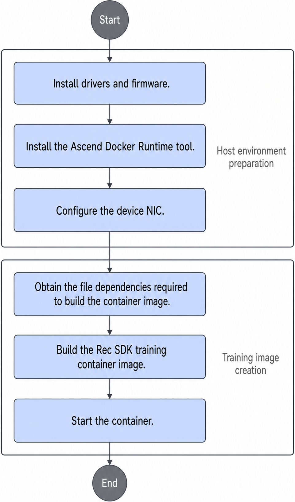

# Installation and Deployment

## Installation Instructions

- Rec SDK TensorFlow supports deployment of a development environment on a physical machine or in a container. You can choose either method based on service requirements.
- You are advised to install and run the software as a common user.

    >[!NOTE]
    >To view the installation history of Rec SDK TensorFlow, see [Viewing Rec SDK TensorFlow Installation and Uninstallation Records](../06_common_operations/common_operations.md#viewing-rec-sdk-tensorflow-installation-and-uninstallation-records).

## Installation Prerequisites

Before you install the Rec SDK TensorFlow software package, prepare the following environment dependencies and perform the listed actions. For details, see [Table 1](#table18461141184116).

**Table 1** Rec SDK TensorFlow environment dependencies
<a id="table18461141184116"></a>

|Dependency/Operation|Recommended Version|How to Obtain|
|--|--|--|
|CANN software package and TensorFlow Ascend adaptation plugin|CANN 9.0.0|<li>Refer to [CANN Quick Installation](https://www.hiascend.com/cann/download) to install the Ascend CANN software package (including the Toolkit and ops packages) and configure environment variables. </li><li>For the TensorFlow Ascend adaptation plugin, click [this link](https://gitee.com/ascend/tensorflow/releases/tag/tfa_v0.0.44_8.3.RC1). `npu_device-2.6.5*` is for TensorFlow 2.6.5. `npu_bridge-1.15.0*` is for TensorFlow 1.15.0.</li>|
|Ascend hardware product driver and firmware|Ascend HDK 26.0.RC1 and its patch versions|Click [this link](https://www.hiascend.com/developer/download/commercial/result?module=cann), configure the package in **Edit Resource Selection** under supporting resources on the left, filter the required software package, and obtain the package after you confirm the version information. For driver and firmware installation, see the [driver and firmware installation and upgrade guides](https://support.huawei.com/enterprise/en/ascend-computing/ascend-hdk-pid-252764743) that come with the hardware product.|
|Ascend Docker Runtime|MindCluster 7.3.0|See the **Installation** > **Installation Deployment** section of the *MindCluster Cluster Scheduling User Guide* for installation.|
|TensorFlow|TensorFlow 1.15.0 and TensorFlow 2.6.5|Obtain the source code from the [TensorFlow](https://github.com/tensorflow/tensorflow) repository. In Arm environments, TensorFlow does not provide the corresponding official wheel package. If you need to use it in Arm environments, you can obtain the Arm TensorFlow wheel package from [this link](https://ascend-repo.obs.cn-east-2.myhuaweicloud.com/MindX/OpenSource/python/index.html).<br>If the wheel package fails to be downloaded, copy the link and open it in a new tab page to complete the download.|
|Python 3.7.5|Python 3.7.5|Obtain the dependency software package from the [Python official website](https://www.python.org/).|

>[!NOTE]
>For open-source and third-party software that you integrate, track vulnerabilities and issues in the community and fix them in a timely manner. You can check the [CVE website](https://www.cve.org/) for known vulnerabilities in the corresponding open-source software version, and fix them by upgrading versions or applying patch packages.
>
>Before installing Rec SDK TensorFlow, you are advised to upgrade pip to the latest version to prevent dependency installation failures caused by an outdated pip version. Run the following command to upgrade pip:
>
>```bash
>pip3 install -U pip
>```

## Obtaining the Rec SDK TensorFlow Software Package

Refer to this section to obtain the Rec SDK TensorFlow software and verify the software digital signature.

If you need the Rec SDK TensorFlow source code, you can obtain it from the [source address](https://gitcode.com/Ascend/RecSDK/tree/develop). You can also build it yourself by following the procedure below.

### Installing from Source

Before you build the source code, follow the [CANN Software Installation Guide](https://www.hiascend.com/en-sg/document/detail/en/CANNCommunityEdition/latest/softwareinst/instg/instg_0000.html?OS=Ubuntu&InstallType=local) to install the CANN development kit software package. Then, follow the [TF Adapter Installation Guide](https://www.hiascend.com/en-sg/document/detail/en/TensorFlowCommunity/latest/migration/tfmigr1/tfmigr1_000009.html) to install the TensorFlow framework plugin package for Ascend adaptation.

1. Build environment dependencies:
   - Python3.7.5
   - GCC 11.2.0
   - CMake 3.22.6

2. Open-source dependencies:
   - [pybind11](https://github.com/pybind/pybind11/archive/refs/tags/v2.10.3.zip)
   - [securec](https://github.com/huaweicloud/huaweicloud-sdk-c-obs/archive/refs/tags/v3.23.9.zip)
   - [openmpi 4.1.5](https://download.open-mpi.org/release/open-mpi/v4.1/openmpi-4.1.5.tar.gz): Install it in the build environment according to the software documentation.
   - TensorFlow 1.15/2.6.5: Select the corresponding version as required.

   Place the compressed pybind11 (`>= 2.10.3`) and securec (`huaweicloud-sdk-c-obs-3.23.9.zip`) packages in the `opensource` directory at the same level as the RecSDK code.

3. Build method:

   Go to the Rec SDK code directory:
   - `setup.py`: This script is for internal use and builds the Rec SDK packages for both tf1 and tf2. You usually need only one of them. Therefore, you are advised to build with the following two scripts.
   - `setup_tf1.py`: Run `python3.7 setup_tf1.py bdist_wheel` to build the wheel package for TensorFlow 1. After the build succeeds, the wheel package is in the `build/mindxsdk-mxrec/tf1_whl` subdirectory.
   - `setup_tf2.py`: Run `python3.7 setup_tf2.py bdist_wheel` to build the wheel package for TensorFlow 2. After the build succeeds, the wheel package is in the `build/mindxsdk-mxrec/tf2_whl` subdirectory.

   To enable the dynamic expansion feature, go to the `RecSDK/cust_op/ascendc_op/ai_core_op/cust_op_by_addr` directory. Run `bash run.sh` to build and install the dynamic expansion operator package.

4. Test cases

   **Python Test Cases**

   Dependencies required to run the Python test cases:

   - pytest 7.1.1
   - pytest-cov 4.1.0
   - pytest-html

   To run the Python test cases, install the preceding dependencies and verify that the TensorFlow 1 environment can build the source code correctly. Then, go to the `RecSDK/training/tf_rec_v1/python/tests` directory and run the Python test cases with the following command:

   ```shell
   bash run_python_dt.sh
   ```

   **C++ Test Cases**

   Dependencies required to run the C++ test cases:

   - [googletest 1.8.1](https://github.com/google/googletest/archive/refs/tags/release-1.8.1.zip)
   - [emock 0.9.0](https://github.com/ez8-co/emock/archive/refs/tags/v0.9.0.zip)
   - [pybind11 v2.10.3](https://github.com/pybind/pybind11/archive/refs/tags/v2.10.3.zip)
   - [securec](https://github.com/huaweicloud/huaweicloud-sdk-c-obs/archive/refs/tags/v3.23.9.zip)

   Place the compressed googletest (`googletest-release-1.8.1.zip`), emock (`emock-0.9.0.zip`), pybind11 (`>= 2.10.3`), and securec (`huaweicloud-sdk-c-obs-3.23.9.zip`) packages in the `opensource` directory at the same level as the RecSDK code.

   To run the C++ test cases, install the preceding dependencies. Then, go to the `RecSDK/training/tf_rec_v1/src` directory and run the C++ test cases.

   In the TensorFlow 1 environment, run the following command:

   ```shell
   bash test_ut.sh tf1
   ```

   In the TensorFlow 2 environment, run the following command:

   ```shell
   bash test_ut.sh tf2
   ```

**Downloading the Software Package**

Refer to this section to obtain the required software package.

|Component|Software Package|Link|
|--|--|--|
|Rec SDK|`tf_rec_v1-*.tar.gz`|[Link](https://www.hiascend.com/en/developer/software/mindsdk/download)|

## Deploying the Development Environment in a Container

### Using a Container to Deploy the Development Environment

>[!NOTE]
>
>- If you use CentOS for configuration, including the host and the container, the `libstdc++` version must be later than `libstdc++.so.6.0.24`.
>- For security purposes, only non-root users can start and use containers.

You can deploy the Rec SDK TensorFlow development environment in a container by following the steps in [Figure 1](#fig2687191413442).

**Figure 1** Configuring the development environment in a container and building the training image<a id="fig2687191413442"></a>


**Key Steps**

1. Prepare the host environment.

    See [Installation Prerequisites](#installation-prerequisites) to deploy the host environment.

2. Obtain the training image and start the container. Refer to the [Ascend image repository](https://www.hiascend.com/developer/ascendhub) to build the base image and install Rec SDK TensorFlow.
3. If you need the dynamic expansion feature in the container, see [(Optional) Installing the On-Chip Memory Dynamic Expansion Operator Package](../06_common_operations/common_operations.md#optional-installing-the-on-chip-memory-dynamic-expansion-operator-package) to build and install the dynamic expansion operator package.
4. If you need the Hadoop distributed file system, refer to the [Hadoop official documentation](https://hadoop.apache.org/docs/r1.0.4/cn/quickstart.html) for environment deployment and cluster setup. Hadoop 2.7.5 is recommended.

    >[!NOTE]
    >After you deploy the environment according to the Hadoop official documentation, the owner of the `/usr/local/hadoop-2.7.5/sbin` directory in the environment is 20415, which is a non-root user. That owner can rename and create new files to replace executables in the root user's `PATH` environment variable, which creates a privilege escalation risk.

### Building a Rec SDK TensorFlow Training Image

Refer to the Dockerfiles in the [docker directory](https://gitcode.com/Ascend/RecSDK/tree/develop/docker) to build the training image. The directory contains the following files:

- `Dockerfile.26.1.0-cann9.1.0-ubuntu20.04-py3.7-tf`: TensorFlow training image based on Ubuntu 20.04
- `Dockerfile.26.1.0-cann9.1.0-openEuler22.03-py3.7-tf`: TensorFlow training image based on openEuler 22.03

When building the image, you can specify the chip architecture with `--build-arg CORE_TYPE=a2|a3|a5`.

## Configuring Environment Variables

[Table 1](#table126401659163820) describes the environment variables for Rec SDK TensorFlow. To use C/C++ compilation, such as when you compile operators written in C++, set the compilation environment variables. See [Table 2](#table20242918114315) for details.

**Table 1** Environment variables
<a id="table126401659163820"></a>

|Environment Variable|Meaning|Mandatory/Optional|Description|
|--|--|--|--|
|MXREC_LOG_LEVEL|Framework log level.|Optional|Value range: `INFO`, `DEBUG`, and `ERROR`. Default value: `INFO`.|
|TF_DEVICE|Indicates whether to perform table merging checks.|Optional|Value range: `NPU`, `GPU`, `CPU`, and `NONE`. Default value: `NONE`. <li>When the value is `GPU`, `CPU`, or `NONE`, table merging checks are not performed. </li><li>When the value is `NPU`, table merging checks are performed.</li>|
|AclTimeout|ACL timeout.|Optional|Value range: -1 to 2147483647 (the maximum value of `int32`). Default value: -1.|
|HD_CHANNEL_SIZE|Depth of the data channel processed by the CPU.|Optional|Value range: 2 to 8192. Default value: 40.|
|KEY_PROCESS_THREAD_NUM|Number of `KEY_PROCESS` threads.|Optional|Value range: 1 to 10. Default value: 6.|
|MAX_UNIQUE_THREAD_NUM|Maximum number of `UNIQUE` threads.|Optional|Value range: 1 to 8. Default value: 8.|
|FAST_UNIQUE|Indicates whether to use the in-house implemented optimized deduplication encoding algorithm.|Optional|Value range: 0 or 1. Default value: 0. Values outside the valid range cause unpredictable behavior. <li>0: Disabled. </li><li>1: Enabled.</li>|
|HOT_EMB_UPDATE_STEP|Hot embedding update step count.|Optional|Value range: 1 to 1000. Default value: 1000.|
|GLOG_stderrthreshold|glog log level.|Optional|Value range: -2 to 2. Default value: 0. <li>-2: TRACE </li><li>-1: DEBUG </li><li>0: INFO </li><li>1: WARNING </li><li>2: ERROR</li>|
|USE_COMBINE_FAAE|Controls whether to count statistics in merged tables.|Optional|Value range: 0 or 1. Default value: 0. Values outside the valid range cause unpredictable behavior. <li>If `USE_COMBINE_FAAE` is set to 0, statistics are counted separately. The count record for each table key is independent. </li><li>If `USE_COMBINE_FAAE` is set to 1, statistics are counted in merged tables. Multiple tables maintain one count record.</li>|
|CM_CHIEF_IP|IP address of the master node.|Optional|This parameter is mandatory when you use the non-ranktable mode.|
|CM_CHIEF_PORT|Listening port of the master node, for example, 60000.|Optional|This parameter is mandatory when you use the non-ranktable mode.<br><li>You can use the following command to specify a set of local reserved ports. The system reserves these ports and does not use them for other applications:<br>`sysctl -w net.ipv4.ip_local_reserved_ports=60000-60015`<br>Then set `CM_CHIEF_PORT` to a port in the range specified by the preceding command. </li><li>Check whether a port is occupied:<br>`netstat -anp \| grep <port_number>` <br>If the port is occupied, the process ID and process name that occupy the port are displayed.</li>|
|CM_CHIEF_DEVICE|Device ID of the master node.|Optional|Specifies the logical device ID of the statistics server in the master node.<br>Value range: 0 to (number of visible devices in the environment - 1). This parameter is mandatory when you use the non-ranktable mode. |
|CM_WORKER_IP|Current node IP address.|Optional|This parameter is mandatory when you use the non-ranktable mode.|
|CM_WORKER_SIZE|Number of devices that participate in cluster training.|Optional|Value range: 0 to 512. This parameter is mandatory when you use the non-ranktable mode.|
|RANK_TABLE_FILE|Communication set file used to configure Ascend chips.|Optional|Path of the collective communication file. Default value: `""`. This parameter is mandatory when you use the ranktable mode.|
|ASCEND_VISIBLE_DEVICES|Devices visible to the Ascend processor, which specify that the program uses only some of them.|Mandatory|Use the `ASCEND_VISIBLE_DEVICES` environment variable to specify the NPU devices used for training. You can run `ls /dev/ \| grep davinci*` to query the NPU devices on the host. Specify devices by serial number. Single values, ranges, and mixed forms are supported. For example:<li>`ASCEND_VISIBLE_DEVICES=0` mounts device 0 (`/dev/davinci0`) into the container. </li><li>`ASCEND_VISIBLE_DEVICES=1,3` mounts devices 1 and 3 into the container. </li><li>`ASCEND_VISIBLE_DEVICES=0-2` mounts devices 0 to 2, inclusive, into the container. This has the same effect as `ASCEND_VISIBLE_DEVICES=0,1,2`. </li><li>`ASCEND_VISIBLE_DEVICES=0-2,4` mounts devices 0 to 2 and device 4 into the container. This has the same effect as `ASCEND_VISIBLE_DEVICES=0,1,2,4`.</li>|
|RECORD_KEY_COUNT|Controls whether to record keys and their count values.|Optional|Value range: 0 or 1. Default value: 0. Values outside the valid range cause unpredictable behavior. <li>0: Do not record key and count information. </li><li>1: Record key and count information.</li>|
|LCAL_COMM_ID|Specifies the master node for LCAL metadata exchange.|Optional|Based on socket communication. Format: `ip_address:port`. If you do not specify it, the communication master node defaults to the process corresponding to the smallest rank ID of the current task, and the default port is 10067.|
|LCCL_DETERMINISTIC|Controls whether to enable LCCL deterministic computation.|Optional|Default value: 0, which means LCCL deterministic computation is disabled.<br>If you need deterministic computation, set the value to 1. The GatherUss operator then ensures ordered computation.<br>Values outside the valid range cause unpredictable behavior.|
|USE_SHM_SWAP|PCIe throughput improvement.|Optional|Value range: 0 or 1. Default value: 0. Values outside the valid range cause unpredictable behavior. <li>0: Disables this feature. </li><li>1: Enables this feature.</li>|
|HUGE_TLB_ENABLE|Huge page memory.|Optional|Value range: 0 or 1. Default value: 0. Values outside the valid range cause unpredictable behavior. <li>0: Disables this feature. </li><li>1: Enables this feature.</li>|
|SSD_SAVE_COMPACT_LEVEL|Compression level when data is saved to SSDs.|Optional|Value range: 0 to 2. Default value: 2. <li>0: No compression. </li><li>1: Compresses only files that exceed the threshold. </li><li>2: Compresses all files.</li>|

>[!NOTE]
>Rec SDK TensorFlow depends on the `OMPI_COMM_WORLD_SIZE`, `OMPI_COMM_WORLD_LOCAL_SIZE`, and `OMPI_COMM_WORLD_RANK` environment variables in distributed training and inference scenarios started by OpenMPI. OpenMPI launchers inject these environment variables automatically. Therefore, you do not need to inject them manually.

**Table 2** C++ build environment variables
<a name="table20242918114315"></a>

|Environment Variable|Meaning|Mandatory/Optional|Description|
|--|--|--|--|
|CC|C language compiler|Mandatory|Set it to `gcc`.|
|CXX|C++ language compiler|Mandatory|Set it to `g++`.|

## Upgrade

If you need to upgrade the current version of Rec SDK TensorFlow to the latest version, upload the latest Rec SDK software package to the installation environment, then run a command in the directory that contains the software package. See the following commands:

- When you upgrade Rec SDK TensorFlow to a new version, you must uninstall the old version first.

    ```bash
    pip3 uninstall mx_rec -y
    ```

- Use the `--upgrade` option to upgrade Rec SDK TensorFlow.

    ```bash
    pip3 install --upgrade mx_rec-{version}-py3-none-{arch}.whl
    ```

`{version}` indicates the version number, and `{arch}` indicates the OS architecture.

## Uninstallation

If you need to remove the Rec SDK TensorFlow software package, run the following command:

```bash
pip3 uninstall mx_rec -y
```

To uninstall the dynamic expansion operator, see the uninstallation instructions in [(Optional) Installing the On-Chip Memory Dynamic Expansion Operator Package](../06_common_operations/common_operations.md#optional-installing-the-on-chip-memory-dynamic-expansion-operator-package).
