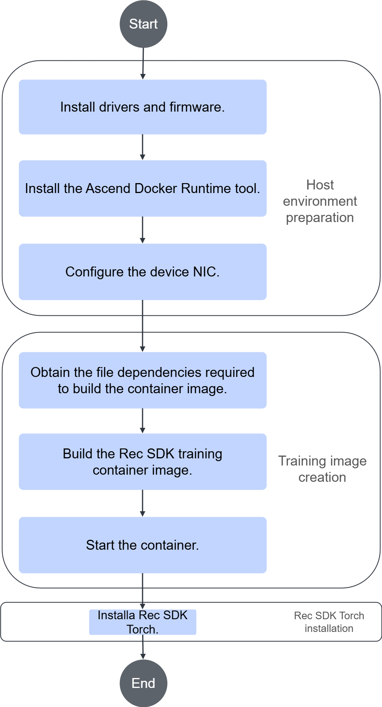

# Installation and Deployment

## Installation Instructions

### Version Mapping<a id="section146113514599"></a>

Rec SDK Torch currently supports two compatible version combinations. When you install the software later, install the package that matches the corresponding combination.

| Version Combination | Python | PyTorch | TorchNPU | fbgemm_gpu | fbgemm_ascend | rec_cust_ops | Rec SDK Torch |
| ---- | ------ | ---------- | -------- | ----------- | :------------- | :----------- | ------------- |
| Option 1 | 3.11+ | 2.7.1+cpu | 2.7.1 | 1.2.0+cpu | 1.2.0 | 2.7.1 | 1.2.0 |
| Option 2 | 3.11+ | 2.10.0+cpu | 2.10.0 | 1.5.0+cpu | 1.5.0 | 2.10.0 | 1.5.0 |

> [!NOTE]
>
> - PyTorch is a deep learning training framework. For details, see the [PyTorch documentation](https://docs.pytorch.org/docs/stable/index.html).
> - TorchNPU is an extension plugin that adapts the PyTorch framework to NPU devices. For details, see [TorchNPU](https://gitcode.com/Ascend/pytorch).
> - fbgemm_gpu is an acceleration library that TorchRec depends on. For details, see [fbgemm_gpu](https://github.com/pytorch/FBGEMM).
> - fbgemm_ascend is an acceleration library on the Ascend platform. For details, see [fbgemm_ascend](https://gitcode.com/Ascend/fbgemm-ascend).
> - rec_cust_ops is the Rec SDK Torch custom operator library on the Ascend platform. For details, see [rec_cust_ops](https://gitcode.com/Ascend/RecSDK/blob/develop/cust_op/README.md).

### Dependency Software Description

This section declares the dependency software list and installation methods in advance. For detailed installation steps, see [Installing Rec SDK Torch](#installing-rec-sdk-torch) below and select the software as needed.

**Dependency Overview**

The following table lists the software dependencies at each layer. Except for the host machine layer, all other layers are in the container.

| Layer | Component | Dependencies | Description |
| ---------- | --------------- | ----------------------------------- | ---------------- |
| **Application layer** | Rec SDK Torch recommendation framework package | hybrid_torchrec, torchrec_embcache | Rec SDK Torch component|
| **Custom operator layer** | Packages related to custom operators | rec_cust_ops, fbgemm_ascend | Custom operator implementation |
| **Adaptation layer** | TorchRec Ascend registration package | torchrec (NPU-adapted version) | NPU-adapted version of TorchRec |
| **Dependency layer** | TorchRec dependency | fbgemm_gpu | Underlying acceleration library that TorchRec depends on |
| **Framework layer** | Training framework | PyTorch, TorchNPU | Deep learning training framework |
| **Enablement layer** | NPU enablement | CANN | Underlying NPU support |
| **Host machine layer** | Host machine dependencies | NPU firmware, drivers, and device configuration | Basic hardware-level dependencies |

#### Host Machine Dependencies

Rec SDK Torch runs in an NPU environment. The following table describes the host machine dependency software. If the host machine does not have the required software installed, install it as described.

| Dependency/Operation | Recommended Version | How to Obtain/Installation Instructions |
| --------------------- | ------------------------ | -------------------------------------------------------------------------------------------------------------------------------------------------------------------------------------------------------------------------------------------------------------------- |
| Ascend hardware product driver | Ascend HDK 26.2.0 | See [CANN Quick Installation](https://www.hiascend.com/cann/download) to install the Ascend NPU driver and configure environment variables. |
| Ascend Docker Runtime | MindCluster 7.3.0 | If Docker is not installed on the host machine, install Docker by following the [Docker community or official documentation](https://docs.docker.com/engine/install/).<br>See the **Installation** > [Installation Deployment](https://www.hiascend.com/document/detail/en/mindcluster/730/clustersched/dlug/dlug_installation_009.html) section of the *MindCluster Cluster Scheduling User Guide* to download and install the Ascend Docker Runtime package. |

#### Container Training Framework Dependencies

| Dependency/Operation | Recommended Version | How to Obtain/Installation Instructions |
| ------------------ | ----------- | ---------------------------------------------------------------------------------------------------------------------------------------------------------------------------------------------------------------------------------------------------------------------------- |
| CANN package | CANN 9.2.0 | See [CANN Quick Installation](https://www.hiascend.com/cann/download) to install the Ascend CANN software package, including the Toolkit and ops packages, and configure environment variables. |
| PyTorch and TorchNPU | 2.7.1/2.10.0 | This is container dependency software. If it is not installed in the container, install it in the container.<br>For versions 2.7.1 and 2.10.0, go to the [TorchNPU 2.7.1/2.10.0 download](https://www.hiascend.com/developer/software/ai-frameworks/pytorch/download?versionId=175&ids=89dda9ba9de741349efa03687a487678%2C96%2C108%2C1%2C6%2C177%2C) page to obtain them.<br>When installing, select the corresponding installation command based on the PyTorch version, Python version (Python 3.11 is recommended), and CPU architecture.<br>If you need to uninstall it, run the `pip3 uninstall -y torch_npu torch` command. |

> [!NOTE]
> Before you install Rec SDK Torch, you are advised to upgrade pip to version 25.0.1 to avoid dependency installation failures caused by an outdated pip version. You can run the following command to upgrade pip:
>
> ```bash
> pip3 install pip==25.0.1
> ```

#### Container Training Acceleration Library Dependencies<a id="section146113514600"></a>

The native TorchRec framework depends on the fbgemm_gpu library. When you run in an NPU environment, install the CPU version of fbgemm_gpu.

Because the CPU version cannot be installed through `requirements` dependencies, you must install it manually and specify the installation source.

Install the matching fbgemm_gpu package according to the [Version Mapping](#version-mapping).

| Software Version | Installation Command |
| --------- | ---------------------------------------------------------------------------- |
| 1.2.0+cpu | `pip3 install fbgemm_gpu==1.2.0+cpu -i https://download.pytorch.org/whl/cpu` |
| 1.5.0+cpu | `pip3 install fbgemm_gpu==1.5.0+cpu -i https://download.pytorch.org/whl/cpu` |

### Rec SDK Torch Package Description

The following table lists the Rec SDK Torch packages:

| Name | Description |
| ------------------------ | ---------------------------------------- |
| torch_rec_v1-*.tar.gz | Rec SDK Torch one-click installation and deployment package, which also includes the Rec SDK Torch recommendation framework package and the TorchRec Ascend registration package |
| rec_cust_ops | Rec SDK Torch custom operator package and the PyTorch framework adaptation layer |
| fbgemm_ascend | fbgemm custom operator package and the PyTorch framework adaptation layer |

> When you use the rec_cust_ops and fbgemm_ascend operator packages, they automatically detect the NPU chip version with the `npu-smi info` command and load the operator package for the corresponding chip version. If automatic detection fails, they load the operator package for Atlas 950PR&950DT products by default. In this case, if the current environment does not use Atlas 950PR&950DT products, you can set the `SOC_VERSION` environment variable to specify the NPU chip version. Example: `export SOC_VERSION=Ascend910B`. For the values of the `SOC_VERSION` environment variable, see [Configuring Environment Variables](#configuring-environment-variables).

## Installing Rec SDK Torch

You can install the Rec SDK Torch software package in one of the following three ways:

- Option 1: Install using an image.
  - Configure the host machine, build the image, and install the Rec SDK Torch software package in the container. This option describes the full process for configuring the host environment, building the base container image, running the container, and installing the Rec SDK Torch software package.
  - **This is the recommended option.**
- Option 2: Install from source.
  - Install the Rec SDK Torch software package in the **container**. The host environment has already been configured, and you have entered the Docker container. This option describes how to install the Rec SDK Torch software package by building from source.
  - If the Docker container image you use was not built by referring to [Build the base image](../../../../../docker/OVERVIEW.md#building-images-locally), **incompatibilities may exist in basic software versions such as `cmake` and `glibc`**.
- Option 3: Install offline.
  - Install the Rec SDK Torch software package in the **container**. The host environment has already been configured, and you have entered the Docker container. This option describes how to install the Rec SDK Torch software package and the custom operator package by downloading the release binary package.
  - If the Docker container image you use was not built by referring to [Build the base image](../../../../../docker/OVERVIEW.md#building-images-locally), **incompatibilities may exist in basic software versions such as `cmake` and `glibc`**.

To view the historical installation records of the Rec SDK Torch software package, see [Viewing Rec SDK Torch Installation and Uninstallation Records](../06_common_operations/common_operations.md).

> [!NOTE]
> For open-source and third-party software that you integrate, track vulnerabilities and issues in the community and fix them in a timely manner. You can check the [CVE website](https://www.cve.org/) for known vulnerabilities in the corresponding open-source software version, and fix them by upgrading versions or applying patch packages.

### Installing Using an Image

#### Brief Steps

1. Configure the host machine environment.
2. Build the base image.
3. Start the Docker container.
4. Install Rec SDK Torch.

#### Process Flowchart

For container-based deployment of Rec SDK Torch, see [Figure 1](#fig1345216415476) for the process flowchart.

**Figure 1** Development environment configuration and training image build inside the container<a id="fig1345216415476"></a>



#### Detailed Steps

1. Configure the host machine environment

   See [Host Machine Dependencies](#host-machine-dependencies) to complete the host machine environment configuration.
2. Create the base training image.<a id="section104919392501"></a>

   You can directly download the prepared base training image. See the **Image Download** tab in the [Ascend image repository](https://www.hiascend.com/developer/ascendhub/detail/66155ae6a2f34eff9142f069612da088) to download an image of version **26.1.0 or later**. Images of version 26.1.0 and later have Rec SDK Torch and related dependencies installed. If you do not need to update them, you can skip the subsequent **Installing Rec SDK Torch**, **Installing from Source**, and **Installing Offline** sections and directly perform the **Verifying the Installation** section.

   Examples of the Docker commands for obtaining an image from the [Ascend image repository](https://www.hiascend.com/developer/ascendhub/detail/66155ae6a2f34eff9142f069612da088) are as follows:

   - To obtain the Ubuntu image: `docker pull swr.cn-south-1.myhuaweicloud.com/ascendhub/recsdk:26.1.0-cann9.1.0-910b-ubuntu22.04-py3.11-pt`
   - To obtain the openEuler image: `docker pull swr.cn-south-1.myhuaweicloud.com/ascendhub/recsdk:26.1.0-cann9.1.0-910b-openeuler22.03-py3.11-pt`

   You can also create the base training image manually. See the **PyTorch Image** section in [Building the Base Image](../../../../../docker/OVERVIEW.md#building-images-locally) to create the image.

   When you create the base image, the dependency software in [Container Training Framework Dependencies](#container-training-framework-dependencies) and [Container Training Acceleration Library Dependencies](#container-training-acceleration-library-dependencies) is installed at the same time. This includes CANN, PyTorch, TorchNPU, and fbgemm_gpu. You can skip the **dependency software installation** step when you install Rec SDK Torch later.
3. Run the container.<a id="TOPIC_0000002302389300"></a>

   Create the `run_docker.sh` startup script as follows:

   ```bash
   #!/bin/bash
   container_name=$1
   image_name=$2
   docker run \
   -it \
   --name ${container_name} \
   --shm-size="300g" \
   -m 300g \
   -v /etc/localtime:/etc/localtime:ro \
   -e ASCEND_VISIBLE_DEVICES=0-7 \
   -v /etc/ascend_install.info:/etc/ascend_install.info:ro \
   -v /usr/local/Ascend/driver:/usr/local/Ascend/driver:ro \
   ${image_name} \
   /bin/bash
   ```

   > [!NOTE]
   > The following describes some of the parameters:
   >
   > - `-m 300g` sets the maximum amount of memory that can be used in the container to 300 GB. Adjust it as required.
   > - `-e ASCEND_VISIBLE_DEVICES=0-7` mounts NPU devices `device0` to `device7` from the server into the container. Adjust it as required.
   > - `image_name` is the image name. The parameter value is in the `REPOSITORY:TAG` format. For example, the version 26.1.0 image name for Atlas 800T A2 in the [Ascend image repository](https://www.hiascend.com/developer/ascendhub/detail/66155ae6a2f34eff9142f069612da088) is `swr.cn-south-1.myhuaweicloud.com/ascendhub/recsdk:26.1.0-cann9.1.0-910b-ubuntu22.04-py3.11-pt`.

   Run the following command to create a container and enter it:

   ```shell
   bash run_docker.sh container_name image_name
   ```

   > [!NOTE]
   >
   > 1. In the preceding command, the Docker container runs in the foreground. The container stops after you exit the interactive session. For more information about Docker containers, see the [Docker community documentation](https://docs.docker.com/).
   > 2. **Refresh the environment variables in the container.** If the image used to create the container was downloaded from the Ascend image repository or manually built by referring to [Building the Base Image](../../../../../docker/OVERVIEW.md#building-images-locally), and its version is 26.1.0 or later, see [Refresh Environment Variables](../03_quick_start/quick_start.md#refresh_container_env) to manually refresh the environment variables in the container after you enter it.
   > 3. If you need to update dependency software versions in the container, see the instructions in [Container Training Framework Dependencies](#container-training-framework-dependencies) and [Container Training Acceleration Library Dependencies](#container-training-acceleration-library-dependencies). Uninstall the dependency software first and then reinstall it.
4. Install the Rec SDK Torch software package.

   To install Rec SDK Torch, refer to [Installing from Source](#installing-from-source) or [Installing Offline](#installing-offline) below, and skip the dependency software installation step in those sections. The related dependencies are already installed when you create the base image.

### Installing from Source

This option assumes that the host machine environment has already been configured and that you have entered the Docker container.

1. Install dependency software.

   See the instructions in [Container Training Framework Dependencies](#container-training-framework-dependencies) and [Container Training Acceleration Library Dependencies](#container-training-acceleration-library-dependencies) to install the dependency software in the container.
2. Install the TorchRec Ascend registration package.<a id="source_build_torchrec_npu"></a>

   The TorchRec Ascend registration package adapts NPU devices based on the TorchRec source code. You can build the registration package using the patch file provided by Rec SDK Torch and a fixed branch of the TorchRec source code.

   See the [README](https://gitcode.com/Ascend/RecSDK/blob/develop/training/torch_rec_v1/torchrec_npu/README.md) for source build and installation.
3. Install the Rec SDK Torch recommendation framework package.<a id="source_build_hybrid_torchrec"></a>

   Build and install the package by running the following commands:

   ```bash
   git clone https://gitcode.com/ascend/RecSDK.git
   cd RecSDK/training/torch_rec_v1/hybrid_torchrec
   bash build_whl.sh
   cd dist
   pip3 uninstall -y hybrid_torchrec
   pip3 install hybrid_torchrec-*.whl
   pip3 install -r requirements.txt
   pip3 uninstall -y torchrec_embcache
   pip3 install torchrec_embcache-*-py3-none-linux*.whl
   ```

4. Install packages related to custom operators.<a id="install_custom_op"></a>

   **Building custom operator packages from source takes a long time. You are advised to first refer to [Installing Custom Operator Packages Offline](#install_custom_op_by_download) to install the operator packages.** If you modify the code of the corresponding operators, refer to the rest of this section to build and install them from source.

   a) **Install the fbgemm_ascend operator package**

   fbgemm_ascend is a third-party dependency of Rec SDK Torch. See [Building fbgemm_ascend](https://gitcode.com/Ascend/fbgemm-ascend/blob/main/README.md#源码编译与安装) to build and install it from source.

   b) **Install the rec_cust_ops operator package**

   Download the [Rec SDK](https://gitcode.com/Ascend/RecSDK) source code, and then build and install the operator-related packages by running the following commands:

   ```bash
   # Configure the CANN environment variables
   source /usr/local/Ascend/ascend-toolkit/set_env.sh
   # Pull the third-party module (some operators depend on CATLASS)
   git submodule update --init --recursive
   # Build the operator package
   cd RecSDK/cust_op
   RECSDK_BUILD_VERS=A2 bash build_whl.sh
   # Install the operator package
   pip3 uninstall -y rec_cust_ops
   pip3 install rec_cust_ops*.whl
   ```

   The rec_cust_ops operator package is built for Atlas A2 training products by default. For more build and installation instructions, see [Building and Installing rec_cust_ops](https://gitcode.com/Ascend/RecSDK/blob/develop/cust_op/README.md#build_recsdk_cust_ops).

### Installing Offline

This option assumes that the host machine environment has already been configured and that you have entered the Docker container.

The installation steps for this option are similar to those in [Installing from Source](#installing-from-source). The difference is that you can obtain the Rec SDK Torch one-click installation and deployment package directly from the release, without building it from source.

1. Install dependency software.

   See the instructions in [Container Training Framework Dependencies](#container-training-framework-dependencies) and [Container Training Acceleration Library Dependencies](#container-training-acceleration-library-dependencies) to install the dependency software in the container.
2. Install the Rec SDK Torch one-click installation and deployment package.

   **Downloading the Software Package**

   Refer to this section to obtain the required software package.

   | Component | Software Package | Link |
   | ---------------------- | ------------------------ | -------------------------------------------------- |
   | Rec SDK Torch one-click installation and deployment package | torch_rec_v1-*.tar.gz | [Release download page](https://gitcode.com/Ascend/RecSDK/releases) |

   > [!NOTE]
   > 1. The current Rec SDK one-click installation and deployment package is built with Python 3.11. **Install and use it in the same Python version environment.** If you need to use it in another Python version environment, see [Install the Rec SDK Torch one-click installation and deployment package](#source_build_hybrid_torchrec) and build it from source.
   > 2. The Rec SDK Torch one-click installation and deployment package contains the TorchRec Ascend registration package (the NPU-adapted version of torchrec) and the Rec SDK Torch recommendation framework packages (hybrid_torchrec and torchrec_embcache). When you use this package, the torchrec, hybrid_torchrec, and torchrec_embcache subpackages cannot be queried directly with the `pip3` command, but you can import and use them directly in Python scripts.
   > 3. The Rec SDK Torch one-click installation and deployment package supports the PyTorch 2.7.1 and 2.10.0 version combinations. During installation, the matching software package is installed automatically based on the PyTorch version in the current environment.
   > 4. Because the Rec SDK Torch one-click installation and deployment package bundles software packages for multiple version combinations, the package uses a unified release version number (that is, `{version}` in the subsequent installation commands). This number differs from the software package version number in the **Rec SDK Torch** column of the [Version Mapping](#version-mapping) table, such as 1.2.0 and 1.5.0, which is normal. After installation, the Rec SDK Torch version actually installed is the one that corresponds to the PyTorch version of the current environment in [Version Mapping](#version-mapping).

   **Software Package Hash Verification**

   To prevent the software package from being maliciously tampered with during transmission or storage, download both the software package and its `.sha256sum` file to the same directory, and run the following command to verify the integrity of the package:

   ```bash
   # Replace FILE_NAME with the software package file name
   sha256sum -c FILE_NAME.sha256sum
   ```

   **Installing the Software Package**

   Upload the downloaded package into the Docker container. You can do this in either of the following ways:
   - Method 1: When you start the container, mount a host machine directory into the container and place the downloaded package in that directory so the container can access it.

     To mount the host machine directory into the Docker container, add the following parameter when you [run the container](#TOPIC_0000002302389300). Replace `dir1` with the directory you need to mount:

     ```bash
     -v /dir1:/dir1
     ```

   - Method 2: On the host machine, use the `docker cp` command to copy the package into the container.

     Example of the `docker cp` command:

     ```bash
     docker cp host_file_path container_name:container_file_path
     ```

     Here, `host_file_path` is the file path on the host machine. `container_name` is the name of the Docker container into which you want to copy the file. `container_file_path` is the file path inside the Docker container.

   Install the build dependencies:

   ```bash
   pip3 install wheel "setuptools<70.0.0"
   ```

   Run the following command to install:

   ```shell
   # If it is already installed, uninstall it first
   pip3 uninstall -y torch_rec_v1
   # Install the software package. The -v parameter displays detailed installation information, and --no-build-isolation disables build isolation and installs the package directly in the current environment
   pip3 install torch_rec_v1-{version}-{arch}.tar.gz -v --no-build-isolation
   ```

   In the installation command, `{version}` indicates the version number, and `{arch}` indicates the OS architecture. Replace them with the actual package name.

   During installation, **dependency packages are installed at the same time. Ensure that the network remains connected.** If the network is unavailable, downloading dependency packages may time out and the installation may fail. On the first installation, the process may take 5 to 10 minutes, depending on the number of dependency packages missing from the environment.

3. Install packages related to custom operators.<a id="install_custom_op_by_download"></a>

   First determine the option (Option 1 or Option 2) according to the [Version Mapping](#version-mapping), run `uname -m` in the container to confirm the system architecture, and then download the corresponding fbgemm_ascend and rec_cust_ops software packages from the following table and install them by referring to the subsequent commands.

   | Version Combination | Architecture | fbgemm_ascend Download Link | rec_cust_ops Download Link | Remarks |
   | -------- | ---- | ---------------------- | --------------------- | ---- |
   | Option 1 | x86_64 | [fbgemm_ascend-1.2.0-cp311-cp311-linux_x86_64.whl](https://gitcode.com/Ascend/fbgemm-ascend/releases/download/v26.1.0-1.2.0/fbgemm_ascend-1.2.0-cp311-cp311-linux_x86_64.whl) | [rec_cust_ops-2.7.1-cp311-cp311-linux_x86_64.whl](https://gitcode.com/Ascend/RecSDK/releases/download/v26.2.0-beta.1/rec_cust_ops-2.7.1-cp311-cp311-linux_x86_64.whl) | Compatible with PyTorch 2.7.1/fbgemm_gpu 1.2.0 |
   | Option 1 | aarch64 | [fbgemm_ascend-1.2.0-cp311-cp311-linux_aarch64.whl](https://gitcode.com/Ascend/fbgemm-ascend/releases/download/v26.1.0-1.2.0/fbgemm_ascend-1.2.0-cp311-cp311-linux_aarch64.whl) | [rec_cust_ops-2.7.1-cp311-cp311-linux_aarch64.whl](https://gitcode.com/Ascend/RecSDK/releases/download/v26.2.0-beta.1/rec_cust_ops-2.7.1-cp311-cp311-linux_aarch64.whl) | Compatible with PyTorch 2.7.1/fbgemm_gpu 1.2.0 |
   | Option 2 | x86_64 | [fbgemm_ascend-1.5.0-cp311-cp311-linux_x86_64.whl](https://gitcode.com/Ascend/fbgemm-ascend/releases/download/v26.1.0-1.5.0/fbgemm_ascend-1.5.0-cp311-cp311-linux_x86_64.whl) | [rec_cust_ops-2.10.0-cp311-cp311-linux_x86_64.whl](https://gitcode.com/Ascend/RecSDK/releases/download/v26.2.0-beta.1/rec_cust_ops-2.10.0-cp311-cp311-linux_x86_64.whl) | Compatible with PyTorch 2.10.0/fbgemm_gpu 1.5.0 |
   | Option 2 | aarch64 | [fbgemm_ascend-1.5.0-cp311-cp311-linux_aarch64.whl](https://gitcode.com/Ascend/fbgemm-ascend/releases/download/v26.1.0-1.5.0/fbgemm_ascend-1.5.0-cp311-cp311-linux_aarch64.whl) | [rec_cust_ops-2.10.0-cp311-cp311-linux_aarch64.whl](https://gitcode.com/Ascend/RecSDK/releases/download/v26.2.0-beta.1/rec_cust_ops-2.10.0-cp311-cp311-linux_aarch64.whl) | Compatible with PyTorch 2.10.0/fbgemm_gpu 1.5.0 |

   > The preceding operator packages are all built with Python 3.11. **Install and use them in the same Python version environment.** If you need to install and use them in another Python version environment, see [Building fbgemm_ascend](https://gitcode.com/Ascend/fbgemm-ascend/blob/main/README.md#源码编译与安装) and [Building rec_cust_ops](https://gitcode.com/Ascend/RecSDK/blob/develop/cust_op/README.md#build_recsdk_cust_ops) to build them from source.

   Upload the downloaded software packages into the container (for the method, see the preceding step), and run the following commands to install them:

   ```shell
   # Uninstall the installed operator packages
   pip3 uninstall -y fbgemm_ascend rec_cust_ops
   # Install the fbgemm_ascend operator package
   pip3 install fbgemm_ascend-*.whl
   # Install the rec_cust_ops operator package
   pip3 install rec_cust_ops*.whl
   ```

## Verifying the Installation

You can verify that Rec SDK Torch installed successfully by running existing test cases or models.

**UT Verification**

After you download the source code of the Rec SDK repository, go to the `RecSDK/training/torch_rec_v1/hybrid_torchrec/test/dt` directory and run `bash test_all.sh` for verification.

**Model Single-Device Verification**

See the **Building the Model** and **Model Training Startup** sections in [Quick Start](../03_quick_start/quick_start.md#building-the-model) to build a model and start single-device training.

**Model Multi-Device Verification**

See the **Building the Model** and **Model Training Startup** sections in [Quick Start](../03_quick_start/quick_start.md#building-the-model) to build a model and start multi-device training.

**Framework ST Test Case Verification (Optional)**

> The framework ST test cases build multiple small models for verification, including model building and dataset generation. They take a long time (more than 30 minutes). You can perform this verification as required.

For the hybrid_torchrec test case list and instructions for running the tests, see [README](../05_api/00_README.md).

For the torchrec_embcache test case list and instructions for running the tests, see [README](../05_api/00_README.md).

After you run the ST test cases, if `xx passed` is displayed and `xx failed` is not displayed, the test cases passed.

## Configuring Environment Variables

[Table 1](#table126401659163820) describes the environment variables for Rec SDK Torch.

**Table 1** Environment variables <a id="table126401659163820"></a>

| Environment Variable | Meaning | Mandatory/Optional | Description |
| ----------------------------------- | --------------------------------------------------- | ----- | ---------------------------------------------------------------------------------------------------------------------------------------------------------------------------------------------------------------------------------------------------------------------------------------------------------------------------------------------------------------------------------------- |
| INPUT_DIST_THREADS | Number of concurrent threads in the thread pool that Rec SDK Torch uses for bucketization tasks. | Optional | The value is an integer. The default value is 6. The value range is [1, 12]. |
| POST_INPUT_THREADS | Number of concurrent threads in the thread pool that Rec SDK Torch uses for hash deduplication tasks. | Optional | The value is an integer. The default value is 6. The value range is [1, 12]. |
| MASTER_ADDR | IP address of the master node in distributed training. | Optional | The value is an IPv4 address. Use 127.0.0.1 in a single-machine environment. In a multi-machine environment, change it to an IPv4 address that supports multi-machine communication. |
| MASTER_PORT | Listening port in distributed training. | Optional | The value is an integer. The value range is [0, 65520]. |
| LOCAL_RANK | NPU rank of the current process on the local machine. | Optional | The value is an integer. The value range is [0, `world_size`-1]. |
| WORLD_SIZE | Number of devices that participate in training. | Optional | The value is an integer. The value range is [1, 8]. |
| ASCEND_VISIBLE_DEVICES | Devices visible to the Ascend processor, which specify that the program uses only some of them. | Mandatory | Use the `ASCEND_VISIBLE_DEVICES` environment variable to specify the NPU devices used for training. You can run `ls /dev/ \| grep davinci *` to query the NPU devices on the host. Specify devices by serial number. Single values, ranges, and mixed forms are supported. For example:<ul><li>`ASCEND_VISIBLE_DEVICES=0` mounts device 0 (`/dev/davinci0`) into the container. </li><li>`ASCEND_VISIBLE_DEVICES=1,3` mounts devices 1 and 3 into the container. </li><li>`ASCEND_VISIBLE_DEVICES=0-2` mounts devices 0 to 2, inclusive, into the container. This has the same effect as `ASCEND_VISIBLE_DEVICES=0,1,2`. </li><li>`ASCEND_VISIBLE_DEVICES=0-2,4` mounts devices 0 to 2 and device 4 into the container. This has the same effect as `ASCEND_VISIBLE_DEVICES=0,1,2,4`.</li></ul> |
| ASCEND_OPP_PATH | Root directory of the operator library. | Mandatory | This variable is set when you run the CANN environment variable configuration script. You are advised not to modify it. The default value is `/usr/local/Ascend/cann/opp`. |
| GLOO_SOCKET_IFNAME | gloo communication NIC configuration. | Optional | Run the `ifconfig` or `ip a` command to view the NIC name on the server. `lo` is recommended. In a multi-machine environment, change it to a NIC name that supports multi-machine communication.|
| ENABLE_FAST_HASHMAP | Indicates whether to enable the fast hash table. | Optional | The value is a string. `true`, `yes`, and `1` enable the function. Other values disable the function. The default value is `false`. |
| EMB_MEMORY_POOL_SIZE | Size of the embedding memory pool for the fast hash table. | Optional | The value is an integer. The default value is 102400. The value range is [1, 200000]. |
| FAST_HASHMAP_RESERVE_BUCKET_NUM | Number of reserved buckets in the fast hash table. | Optional | The value is an integer. The default value is 2097152. The value range is [128, 4294967291]. |
| EMB_MEMORY_POOL_THREAD_NUM | Number of threads that process the embedding memory pool of the fast hash table. | Optional | The value is an integer. The default value is 4. The value range is [1, 1024]. |
| EMBCACHE_SIZE_ON_DEVICE_MEM | On-chip memory embedding cache size, in bytes. | Optional | The value is an integer. The default value is 17179869184 (16 GB). The value range is [1, available device memory]. |
| DO_EC_LOCAL_UNIQUE | Indicates whether to enable EC local unique for the multi-level cache mode. | Optional | The value is a string. `true`, `1`, and `yes` enable the function. Other values disable the function. The default value is `false`. |
| LOCAL_UNIQUE_PARALLEL_BATCH_NUM | Number of batches processed in parallel by local unique in `EmbCacheTrainPipelineSparseDist`. | Optional | The value is an integer. The default value is 2. The value range is [1, 24]. |
| ENABLE_PARALLEL_GLOBAL_UNIQUE | Indicates whether to enable parallel global unique processing. | Optional | The value is a string. `1` enables the function. Other values disable the function. The default value is 0, indicating that the function is disabled. |
| GLOG_stderrthreshold | Log level of the multi-level cache C++ module. | Optional | The value is an integer. The default value is 1 (WARN). Value range:<ul><li>-2: TRACE</li><li>-1: DEBUG</li><li>0: INFO</li><li>1: WARN</li><li>2: ERROR</li></ul> |
| SOC_VERSION | When the fbgemm_ascend and rec_cust_ops operator packages are loaded, they automatically detect the NPU chip version in the environment and load the operators for the corresponding chip version. If automatic detection fails, you can set this environment variable to specify the operators for the corresponding chip version to load. | Optional | The value is a string. There is no default value. There is no fixed value range. When you set the value, refer to the following:<ul><li>`Ascend910B`: The operator packages load the operators for Atlas A2 training products.</li><li>`Ascend910_93`: The operator packages load the operators for Atlas A3 training products.</li><li>`Ascend950`: The operator packages load the operators for Atlas 950PR&950DT products.</li><li>Other values: The operator packages load the operators for Atlas 950PR&950DT products.</li></ul> |

## Uninstallation

If you need to remove the Rec SDK Torch software package and the TorchRec Ascend registration package, run the following commands to uninstall them based on the installation method.

- **If the package was installed using the one-click installation and deployment package (offline installation):**

    ```bash
    # Uninstall the Rec SDK Torch main package and the TorchRec Ascend registration package together
    pip3 uninstall torch_rec_v1 -y
    ```

- **If the package was installed from source:**

    ```bash
    # Uninstall the Rec SDK Torch recommendation framework package
    pip3 uninstall hybrid_torchrec -y
    pip3 uninstall torchrec_embcache -y
    # Uninstall the TorchRec Ascend registration package
    pip3 uninstall torchrec -y
    ```

If you need to remove the Rec SDK Torch custom operator-related packages, run the following commands, where:

- The default installation path for custom operators in CANN is `/usr/local/Ascend/cann/opp/vendors/`
- When you uninstall custom operators, delete the folder in the `vendors` path whose name matches the custom operator. You can view the Rec SDK custom operator directory in [ai_core_op](https://gitcode.com/Ascend/RecSDK/tree/develop/cust_op/ascendc_op/ai_core_op).

```bash
# Uninstall for source build installation
# Example of the command to uninstall an operator. Only some examples are listed here. The uninstall commands for other operators are similar
rm -rf /usr/local/Ascend/cann/opp/vendors/asynchronous_complete_cumsum
rm -rf /usr/local/Ascend/cann/opp/vendors/backward_codegen_adagrad_unweighted_exact
rm -rf /usr/local/Ascend/cann/opp/vendors/permute2d_sparse_data
rm -rf /usr/local/Ascend/cann/opp/vendors/split_embedding_codegen_forward_unweighted
# Uninstall libfbgemm_npu_api.so
PACKAGE_PATH=$(python3 -c "import sysconfig; print(sysconfig.get_path('purelib'))")
if [ -d "$PACKAGE_PATH" ]; then
  cd ${PACKAGE_PATH}
  rm -rf libfbgemm_npu_api.so
else
  echo "no site-packages"
fi

# Uninstall for installation using a release package
pip3 uninstall rec_cust_ops -y
pip3 uninstall fbgemm_ascend -y
```

## Upgrading

If you need to upgrade the current version of Rec SDK Torch to the latest version, upload the latest Rec SDK Torch software package to the installation environment, then run a command in the directory that contains the software package. See the following commands:

1. When you upgrade Rec SDK Torch to a new version, you must uninstall the old version first. For details, see [Uninstallation](#uninstallation).
2. Reinstall Rec SDK Torch by referring to [Installing Rec SDK Torch](#installing-rec-sdk-torch).
