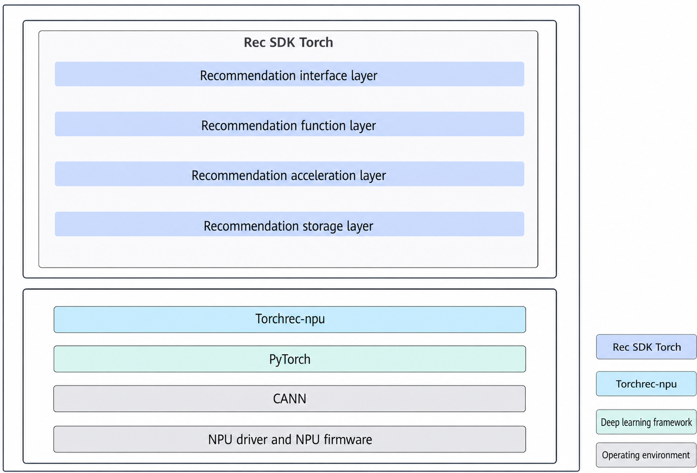

# Introduction

Rec SDK Torch is a recommendation system training framework built on PyTorch and TorchRec. Leveraging the Ascend NPU and CANN heterogeneous computing architecture, it provides high-performance distributed training capabilities for large-scale sparse-feature embedding tables in search, recommendation, and advertising scenarios.

## Core Terms

|Term|Description|
|------|------|
|NPU|Neural Processing Unit, a neural network processor. An Ascend AI processor used to execute computation tasks related to deep learning.|
|CANN|Compute Architecture for Neural Networks. The Ascend computing architecture, a heterogeneous computing architecture developed by Huawei for Ascend AI processors. It provides operator libraries and runtime support for deep learning.|
|PyTorch|An open-source deep learning framework that provides dynamic computation graphs, automatic differentiation, and a rich set of neural network modules. It is widely used for model training and inference.|
|TorchRec|A recommendation system library based on PyTorch that provides distributed training capabilities for large-scale sparse-feature embedding tables, including core components such as sparse tables, optimizers, and pipelines.|
|Embedding|A technique that maps discrete features (for example, user IDs and item IDs) to low-dimensional dense vectors. It is a core method for representing feature semantics in recommendation systems.|
|Sparse table (Embedding Table)|A data structure used to store embedding vectors of large-scale sparse features (for example, user IDs and item IDs).|
|embedding_dim|The number of columns in a sparse table, that is, the dimension of the embedding vector of each feature.|
|num_embeddings|The number of rows in a sparse table, that is, the maximum number of features.|
|JaggedTensor|A data structure that holds sparse IDs and feature lengths. The number of feature IDs in each sample can differ.|
|KeyedJaggedTensor|Adds feature name keys to JaggedTensor to distinguish different feature groups.|
|Pooling|An operation that aggregates multiple embedding vectors of the same feature into one vector. It supports SUM (sum), MEAN (average), and NONE (no pooling).|
|pipeline|The training pipeline used to iterate over datasets and perform training. It can execute operations in the training process that have no dependencies in parallel to improve training efficiency.|
|Full-device memory mode|All sparse table data is stored in NPU memory, and training uses [HybridTrainPipelineSparseDist](./api/pipeline_apis.md#hybridtrainpipelinesparsedist) as the pipeline.|
|Multi-level cache mode|Sparse table data is distributed between CPU memory and NPU memory. Training uses [EmbCacheTrainPipelineSparseDist](./api/pipeline_apis.md#embcachetrainpipelinesparsedist) as the pipeline, supporting larger embedding tables.|
|EmbeddingBagCollection (EBC)|A sparse table with pooling that automatically aggregates multiple embeddings of the same feature after lookup. The full-device memory mode uses [HashEmbeddingBagCollection](./api/table_creation_apis.md#hashembeddingbagcollection), and the multi-level cache mode uses [EmbCacheEmbeddingBagCollection](./api/table_creation_apis.md#embcacheembeddingbagcollection).|
|EmbeddingCollection (EC)|A sparse table without pooling that returns the original embedding list after lookup. The multi-level cache mode uses [EmbCacheEmbeddingCollection](./api/table_creation_apis.md#embcacheembeddingcollection).|
|Row-wise/row_wise|A row-wise table sharding strategy that assigns different rows of a sparse table to different NPUs.|
|Data-parallel/data_parallel|A data-parallel table sharding strategy in which each NPU keeps a complete replica of the sparse table.|
|meta device|A virtual device type in PyTorch used to defer actual memory allocation. When creating a sparse table, specifying `meta` builds the model structure first and defers actual memory allocation until `DistributedModelParallel` shards the table.|
|Admission (Admit)|Controls whether new feature IDs are added to a sparse table. Low-frequency features can be filtered using a repetition-count threshold or an impression/click score threshold.|
|Eviction (Evict)|Removes feature IDs that have not been accessed for a long time or have low scores from the sparse table to control the memory usage of the table.|

## Overview

Rec SDK Torch provides the following functions:

- Basic model training functions:
    - Rec SDK supports single-node, single-device training and single-node, multi-device distributed training.
    - Models developed based on Torch are supported.

- Recommendation-specific functions:

    Based on the sparse table solution, Rec SDK Torch provides the essential functions required for recommendation, such as non-affine operator offloading and hash mapping.

- Large-scale sparse table functions:

    Rec SDK Torch supports row-wise distributed sparse table sharding.

**Key Features**

Rec SDK Torch provides capabilities such as hash mapping, row-wise table sharding, EC/EBC lookup modes, pipeline lookup, lookup fusion operators, and multi-level cache.

- Hash mapping

    Torch provides `nn.Embedding` for dense ID lookup. In recommendation scenarios, most raw feature IDs are discrete, which makes direct lookup inconvenient. A common practice is to convert discrete IDs to table row indexes. To support this, Rec SDK Torch provides hash mapping to map discrete IDs to embedding table row indexes without requiring users to convert IDs in advance.

- Row-wise sharding

    When embeddings are sharded across different tables, Rec SDK Torch partitions embeddings by row and uses a modulo-based bucketing strategy to determine the bucket position of an embedding in the table from the remainder of its ID.

- EC/EBC lookup modes

    EC lookup corresponds to the native Torch `nn.Embedding` function. For multiple specified IDs, it performs a lookup and outputs the lookup results directly.

    EBC lookup corresponds to the native Torch `nn.EmbeddingBag` function. For multiple specified IDs, it performs pooling by summing or averaging during lookup.

- Pipeline lookup

    A Rec SDK Torch lookup task consists of multiple subtasks, including communication, CPU computation, and NPU computation. Rec SDK Torch provides a pipeline lookup method so that these subtasks can run in parallel and fully use hardware computing power.

- Lookup fusion operator

    Rec SDK Torch provides lookup operators with fused gradient calculation and optimizer logic to improve lookup performance.

- Multi-level cache

    Stores sparse table data using a combination of device memory and host memory (DDR) to support larger sparse tables.

For details, see [Functions and Features](./migration_and_training.md#functional_features_description).

## Software Architecture

**Figure 1** Software architecture

Built upon TorchRec, mainstream recommendation frameworks, CANN, and diverse hardware and network architectures, Rec SDK Torch addresses the specific requirements of search, recommendation, and advertising model training. It provides high-performance, streamlined APIs designed for ease of use, enabling Ascend AI Processors to achieve highly efficient training for search, recommendation, and advertising models.

**Table 1** Modules in the architecture diagram

|Rec SDK Torch Module|Description|
|--|--|
|Recommendation API layer|Provides easy-to-use APIs to simplify customer onboarding and reduce migration costs. Supports large-scale customer growth.|
|Recommendation function layer|Provides core capabilities to meet customer requirements.|
|Recommendation acceleration layer|Provides core components to build performance competitiveness and offer superb performance for the entire system.|
|Recommendation storage layer|Supports distributed storage of sparse tables.|
|TorchRec-npu|Ascend adaptation layer for open-source TorchRec.|

## Supported Hardware and OSs

**Table 2** Supported products
<table border="1">
  <tr>
    <th>Product</th>
    <th>Architecture</th>
    <th>OS Version</th>
  </tr>
  <tr>
    <td rowspan="2">
Atlas 800T A2 training server

Atlas 200T A2 Box16 heterogeneous subrack
</td>
    <td>x86_64</td>
    <td>Debian version: 12 CentOS version: 7.6</td>
  </tr>
  <tr>
    <td>Arm</td>
    <td>openEuler version: 22.03</td>
  </tr>
  <tr>
    <td>Atlas 800T A3 SuperPoD server</td>
    <td>Arm</td>
    <td>openEuler version: 22.03</td>
  </tr>
</table>
