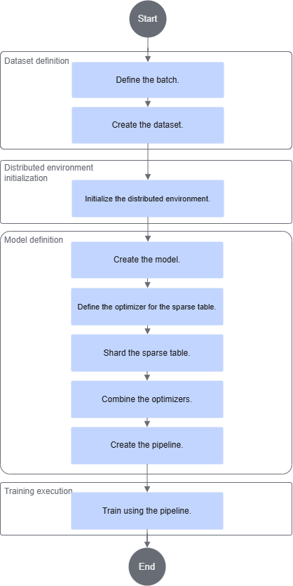

# Quick Start<a name="ZH-CN_TOPIC_0000002302229552"></a>

## Before You Start<a name="ZH-CN_TOPIC_0000002336268801"></a>

This section provides a basic recommendation model example to guide you through quickly building a recommendation model with Rec SDK Torch.

## Environment Preparation

### Preparing the Basic Image

See the **Image Download** tab page in the [Ascend image repository](https://www.hiascend.com/developer/ascendhub/detail/9faeb4847b3e419f81b78a4d0ed574b5). **Based on the environment architecture**, obtain the prebuilt **latest running image** (version 26.0.0* or later).

The image already contains Rec SDK Torch and related software packages. The software versions are as follows:

| Software | PyTorch | TorchNPU | torchrec | fbgemm_gpu | hybrid_torchrec | torchrec_embcache |
|----------|---------|----------|----------|------------|-----------------|-------------------|
| Version  | 2.6.0   | 2.6.0    | 1.1.0+npu | 1.1.0      | 1.1.0           | 1.1.0             |

### Starting the Container

Create a startup script `run_docker.sh` with the following content (the following startup command is for reference only. Mount directories as needed):

```shell
#!/bin/bash
container_name=$1
image_name=$2
free_devices=$(npu-smi info | grep 'No running processes found in NPU' | grep -o '[0-9]\+' | paste -sd ',' -)

if [ -z "${free_devices}" ]; then
    echo "No free devices! Stop docker running."
    exit 1
fi

docker run \
-it \
--name "${container_name}" \
-e ASCEND_VISIBLE_DEVICES="${free_devices}" \
--shm-size="300g" \
-m 300g \
-v /etc/localtime:/etc/localtime:ro \
-v /etc/ascend_install.info:/etc/ascend_install.info:ro \
-v /usr/local/Ascend/driver:/usr/local/Ascend/driver:ro \
"${image_name}" \
/bin/bash
```

Some parameters:

- `free_devices`: Detects the currently idle NPU device IDs.
- `-m 300g`: Sets the memory size available in the container. You can configure it based on actual requirements.
- `-e ASCEND_VISIBLE_DEVICES="${free_devices}"`: Mounts the idle NPU devices on the server to the container. You can configure it based on actual requirements.
- `image_name`: Image name in the `REPOSITORY:TAG` format. For example, the x86 image of version 26.0.0 in the [Ascend image repository](https://www.hiascend.com/developer/ascendhub/detail/9faeb4847b3e419f81b78a4d0ed574b5) is named `swr.cn-south-1.myhuaweicloud.com/ascendhub/rec_sdk-torch:26.0.0_debian12-x86`.

Run the following command to create a container:

```shell
bash run_docker.sh <container_name> <image_name>
```

### Refreshing Environment Variables in the Container<a id="refresh_container_env"></a>

```shell
# Enable CANN environment variables
source /usr/local/Ascend/cann/set_env.sh
# Activate the Python virtual environment if it exists. To exit the Python virtual environment after use, run the deactivate command
[ -f /opt/buildtools/torch_v1_pt2.6.0/bin/activate ] && source /opt/buildtools/torch_v1_pt2.6.0/bin/activate
```

> [!NOTE]
> Images of version 26.1.0 or later in the [Ascend image repository](https://www.hiascend.com/developer/ascendhub/detail/9faeb4847b3e419f81b78a4d0ed574b5) include a built-in Python virtual environment that must be activated before use. Rec SDK Torch and related dependencies are preinstalled in the virtual environment. Images of version 26.0.0 do not include a Python virtual environment.

### Verifying Environment Availability

Run the following command. If NPU device information is displayed, the environment is available:

```shell
npu-smi info
```

> [!NOTE]
>
> The container startup command in the preceding section starts the container in non-privileged mode. If other containers also mount the same NPU device, the NPU device in the current container becomes unavailable, and running `npu-smi info` reports an error: "dcmi model initialized failed, because the device is used. ret is -8020".
>
> In this case, stop other containers to ensure that the environment is available. Alternatively, **modify the container startup command** to change the `ASCEND_VISIBLE_DEVICES` parameter value and mount only the available NPU devices. You can set the `ASCEND_VISIBLE_DEVICES` parameter in either of the following formats: `ASCEND_VISIBLE_DEVICES=0,1,2,3` or `ASCEND_VISIBLE_DEVICES=0-1`.

## Building the Model

**Figure 1** Model creation process<a name="fig55046491373"></a>


The key Rec SDK Torch interfaces are described as follows:

|Interface|Description|
|--|--|
|[HashEmbeddingBagConfig](./api/table_creation_apis.md#hashembeddingbagconfig)|Configures a sparse table, including its size, dimensions, and other settings.|
|[HashEmbeddingBagCollection](./api/table_creation_apis.md#hashembeddingbagcollection)|Creates a sparse table based on the configuration information.|
|[get_default_hybrid_sharders](./api/subtable_apis.md#get_default_hybrid_sharders)|Obtains sharders, which provide sharding policies for sparse tables in distributed training scenarios.|
|[HybridTrainPipelineSparseDist](./api/pipeline_apis.md#hybridtrainpipelinesparsedist)|Creates a pipeline and iterates the dataset through the pipeline for training.|

Create a `main.py` script and add the following content (for the implementation of each step in the model creation process, see the code comments in the script):

```python
import logging
import itertools
import os
from dataclasses import dataclass
from typing import Iterator

import torch
import torch.distributed as dist
import torch_npu
from hybrid_torchrec import HashEmbeddingBagCollection, HashEmbeddingBagConfig
from hybrid_torchrec.distributed.hybrid_train_pipeline import (
    HybridTrainPipelineSparseDist,
)
from hybrid_torchrec.distributed.sharding_plan import get_default_hybrid_sharders
from torch.utils.data import DataLoader
from torch.utils.data.dataset import IterableDataset
from torchrec import KeyedJaggedTensor, JaggedTensor
from torchrec import PoolingType
from torchrec.distributed import DistributedModelParallel
from torchrec.distributed.planner import (
    EmbeddingShardingPlanner,
    Topology,
    ParameterConstraints,
)
from torchrec.distributed.types import ShardingEnv
from torchrec.optim.keyed import CombinedOptimizer, KeyedOptimizerWrapper
from torchrec.optim.optimizers import in_backward_optimizer_filter
from torchrec.optim.apply_optimizer_in_backward import apply_optimizer_in_backward
from torchrec.streamable import Pipelineable


logging.getLogger().setLevel(logging.INFO)
FEAT_NAMES = [["phone", "clothes"], ["user"]]
TABLE_NAMES = ["product", "user"]
EMBEDDING_DIMS = [1024, 1024]
NUM_EMBEDDINGS = [10240, 10240]
ID_RANGES = [1024, 1024, 1024]
BATCH_SIZE = 32
BATCH_NUM = 20

# 1. Define Batch
@dataclass
class Batch(Pipelineable):
    sparse_features: KeyedJaggedTensor
    labels: torch.Tensor

    def __init__(self, sparse_features, labels) -> None:
        self.sparse_features = sparse_features
        self.labels = labels

    def to(self, device: torch.device, non_blocking: bool = False) -> "Batch":
        return Batch(
            sparse_features=self.sparse_features.to(device, non_blocking=non_blocking),
            labels=self.labels.to(device, non_blocking=non_blocking),
        )

    def record_stream(self, stream: torch_npu.npu.streams.Stream) -> None:
        self.sparse_features.record_stream(stream)
        self.labels.record_stream(stream)

    def pin_memory(self) -> "Batch":
        return Batch(
            sparse_features=self.sparse_features.pin_memory(),
            labels=self.labels.pin_memory(),
        )


# 2. Define the dataset
class RandomRecDataset(IterableDataset[Batch]):
    def __init__(self, batch_size, batch_num, feat_names, id_ranges):
        super().__init__()
        self.index = 0
        self.names = list(itertools.chain.from_iterable(feat_names))
        self.id_ranges = id_ranges
        self.data = [self.generate_one_batch(batch_size) for i in range(batch_num)]

    def generate_one_batch(self, batch_size) -> Batch:
        torch.manual_seed(1)
        input_dict = {}
        for name, id_range in zip(self.names, self.id_ranges):
            ids = torch.randint(0, id_range, (batch_size,))
            lengths = torch.ones(batch_size).long()
            input_dict[name] = JaggedTensor(values=ids, lengths=lengths)
        kjt_tensor = KeyedJaggedTensor.from_jt_dict(input_dict)
        label = torch.randint(0, 2, (batch_size,))
        return Batch(kjt_tensor, label)

    def __iter__(self) -> Iterator[Batch]:
        return iter(self.data)

    def __len__(self) -> int:
        return len(self.data)


# 3. Initialize the distributed environment variables
def set_distribute_env():
    rank = int(os.environ.get("LOCAL_RANK", 0))
    torch.npu.set_device(rank)
    os.environ["MASTER_ADDR"] = "127.0.0.1"
    os.environ["MASTER_PORT"] = "6000"
    os.environ["GLOO_SOCKET_IFNAME"] = "lo"
    dist.init_process_group(backend="hccl")


# 4. Define the model
class TestModel(torch.nn.Module):
    def __init__(self, table_names, feat_names, embed_dims, num_embeds):
        super().__init__()
        table_configs = []

        for table_name, feat_name, dim, num_embed in zip(
            table_names, feat_names, embed_dims, num_embeds
        ):
            config = HashEmbeddingBagConfig(
                name=table_name,
                embedding_dim=dim,
                num_embeddings=num_embed,
                feature_names=feat_name,
                pooling=PoolingType.SUM,
            )
            table_configs.append(config)

        self.ebc = HashEmbeddingBagCollection(device="npu", tables=table_configs)
        self.input_dim = sum([len(f) * d for f, d in zip(feat_names, embed_dims)])
        self.linear = torch.nn.Linear(self.input_dim, self.input_dim)

    def forward(self, batch: Batch):
        result = self.ebc(batch.sparse_features)
        result: torch.Tensor = result.values()
        result = self.linear(result)
        # Use sum to simulate the loss function, which may differ from actual usage scenarios
        loss = result.sum()
        return loss, result


def create_ddp(test_model):
    host_gp = dist.new_group(backend="gloo")
    world_size = dist.get_world_size()
    rank = dist.get_rank()
    host_env = ShardingEnv(world_size=world_size, rank=rank, pg=host_gp)
    hybrid_sharder = get_default_hybrid_sharders(host_env=host_env)
    constraints = {
        table_name: ParameterConstraints(
            sharding_types=["row_wise"], compute_kernels=["fused"]
        )
        for table_name in TABLE_NAMES
    }

    planner = EmbeddingShardingPlanner(
        topology=Topology(world_size=world_size, compute_device="npu"),
        constraints=constraints,
    )

    plan = planner.collective_plan(test_model, hybrid_sharder, dist.GroupMember.WORLD)
    logging.info(plan)
    ddp_model = DistributedModelParallel(
        test_model, device=torch.device("npu"), plan=plan, sharders=hybrid_sharder
    )
    return ddp_model


def invoke_main():
    set_distribute_env()
    device = torch.device("npu")
    # Create the dataset
    dataset = RandomRecDataset(BATCH_SIZE, BATCH_NUM, FEAT_NAMES, ID_RANGES)
    data_loader = DataLoader(
        dataset,
        batch_size=None,
        batch_sampler=None,
        pin_memory=True,
        prefetch_factor=32,
        pin_memory_device="npu",
        num_workers=4,
    )
    # Create the model
    test_model = TestModel(TABLE_NAMES, FEAT_NAMES, EMBEDDING_DIMS, NUM_EMBEDDINGS)

    # 5. Define the optimizer for the sparse table
    embedding_optimizer_class = torch.optim.Adagrad
    optimizer_kwargs = {"lr": 0.001, "eps": 0.1}
    apply_optimizer_in_backward(
        embedding_optimizer_class,
        test_model.ebc.parameters(),
        optimizer_kwargs=optimizer_kwargs,
    )

    # 6. Shard the sparse table
    ddp_model = create_ddp(test_model)

    # 7. Combine the optimizers
    dense_optimizer = KeyedOptimizerWrapper(
        dict(in_backward_optimizer_filter(ddp_model.named_parameters())),
        lambda params: torch.optim.Adagrad(params, lr=0.1),
    )
    optimizer = CombinedOptimizer([ddp_model.fused_optimizer, dense_optimizer])

    # 8. Create the pipeline
    pipeline = HybridTrainPipelineSparseDist(
        ddp_model, optimizer, device, execute_all_batches=True
    )

    # 9. Train using the pipeline
    batched_iterator = iter(data_loader)
    for i in range(BATCH_NUM):
        logging.info("step %s done", i)
        pipeline.progress(batched_iterator)
    logging.info("demo done")


if __name__ == "__main__":
    invoke_main()

```

## Model Training Startup

Start single-device training:

```shell
WORLD_SIZE=1 RANK=0 python3 main.py
```

Start multi-device training (2 devices):

```shell
torchrun --rdzv-backend=c10d --rdzv-endpoint=localhost:6000 --nnodes=1 --nproc-per-node=2 main.py
```

Expected duration: 1 to 2 minutes.

Expected output: After training ends, `demo done` is displayed, indicating that model training is complete.

> [!NOTE]
> Model training occupies port 6000. If a message indicates that the port is already in use, change the port number in the `main.py` script or the startup command (for multi-device training) to another unused port.

## Advanced Development

1. Rec SDK Torch supports migrating and adapting open-source Torch recommendation models. For examples of migrating the open-source DLRM (DCNv2) model to Rec SDK Torch, see the [DLRM (DCNv2) model migration example](https://gitcode.com/Ascend/RecSDK/blob/develop_examples_and_tools/torch_examples/dlrm/README.md).
2. For other Rec SDK Torch features, see the [API Description](./api/api_description.md).
