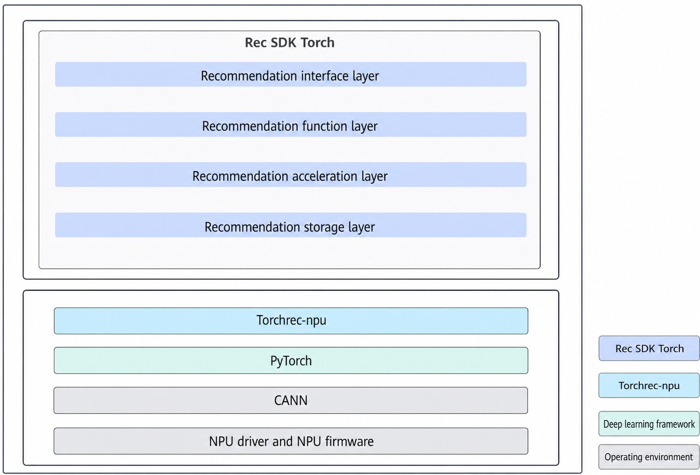

# Introduction

## Software Architecture

**Figure 1** Software architecture


Built upon TorchRec, mainstream recommendation frameworks, CANN, and diverse hardware and network architectures, Rec SDK Torch addresses the specific requirements of search, recommendation, and advertising model training. It provides high-performance, streamlined APIs designed for ease of use, enabling Ascend AI Processors to achieve highly efficient training for search, recommendation, and advertising models. Table 1 describes the modules.

**Table 1** Modules in the architecture diagram

|Rec SDK Torch Module|Description|
|--|--|
|Recommendation API layer|Provides easy-to-use APIs to simplify customer access and support service growth.|
|Recommended function layer|Provides core capabilities to meet customer requirements.|
|Recommendation acceleration layer|Provides core components to build performance competitiveness and offer superb performance for the entire system.|
|Recommendation storage layer|Supports distributed storage of sparse tables.|
|TorchRec-npu|Ascend adaptation layer for open-source TorchRec.|

## Functions and Features

Rec SDK Torch provides the following functions:

- Basic model training functions:
- Rec SDK supports single-node, single-device training and single-node, multi-device distributed training.
- Models developed based on Torch are supported.

- Recommendation-specific functions:

    Based on the TorchRec and `dynamic_emb` dynamic sparse table solution, Rec SDK Torch provides complete embedding capabilities for search, recommendation, and advertising scenarios. It is compatible with `EmbeddingCollection` and `EmbeddingBagCollection` and supports row-wise distributed sharding and hash mapping. It provides two-level caching with on-chip memory and Storage to accelerate access to large tables. It implements admission and eviction policies such as TIMESTAMP, STEP, and CUSTOMIZED based on `score_strategy`. It also supports full checkpoints (DynamicEmbDump/DynamicEmbLoad) and score-threshold-based incremental export (incremental_dump). The underlying high-performance Hierarchical Key-Value (HKV) storage library and the custom operator extension `dynamic_emb_extensions` drive these capabilities, balancing ease of use and training throughput.

- Large-scale sparse table functions:

    Rec SDK Torch supports row-wise distributed sparse table sharding.

**Key Features**

Based on the TorchRec and `dynamic_emb` dynamic sparse table solution, Rec SDK Torch provides basic capabilities such as hash mapping, row-wise table sharding, dynamic sparse table expansion and eviction, and high-performance custom operators for recommendation training scenarios.

The following describes four core functional features and their typical usage. For interface details, see [API List](../05_api/00_README.md) and [Migration and Training](../04_migration_and_training/migration_and_training.md).

### `EmbeddingCollection` and `EmbeddingBagCollection`

Rec SDK Torch is compatible with the native TorchRec embedding modules. It uses the corresponding sharders to replace static embedding tables with dynamic sparse tables, supporting two typical recommendation scenarios: Sequence Embedding and Pooled Embedding.

**Table 2** Correspondence between embedding modules and sharders

|TorchRec Module|Sharder|Sharded Module|Typical Scenario|
|--|--|--|--|
|EmbeddingCollection|DynamicEmbeddingCollectionSharder|ShardedDynamicEmbeddingCollection|Sequence Embedding. Outputs variable-length sequence embeddings (pooling_mode=NONE).|
|EmbeddingBagCollection|DynamicEmbeddingBagCollectionSharder|ShardedDynamicEmbeddingBagCollection|Pooled Embedding. Pools the IDs in a feature using sum/mean and outputs fixed-dimension vectors.|

Both types of modules use `DynamicEmbTableOptions` to configure dynamic table behavior (capacity, eviction policy, score policy, whether caching is enabled, and so on). They work with `DynamicEmbeddingShardingPlanner` and `DistributedModelParallel` to implement row-wise distributed sharding.

**`EmbeddingCollection`** is suitable for scenarios that need to retain the embedding corresponding to each ID, such as multi-value discrete features and sequence recommendation. The sharder `DynamicEmbeddingCollectionSharder` adapts the native TorchRec process to support dynamic table index deduplication (`use_index_dedup`).

**`EmbeddingBagCollection`** is suitable for scenarios such as CTR prediction and recall, in which multiple IDs in a feature must be aggregated before being fed into a DNN. The sharder `DynamicEmbeddingBagCollectionSharder` connects `BatchedDynamicEmbeddingBag` through `RwPooledDynamicEmbeddingSharding` to perform distributed pooled lookup under row-wise sharding.

Example:

```python
from torchrec.modules.embedding_modules import EmbeddingCollection, EmbeddingBagCollection
from dynamic_emb import (
    DynamicEmbeddingCollectionSharder,
    DynamicEmbeddingBagCollectionSharder,
    DynamicEmbTableOptions,
    DynamicEmbScoreStrategy
)

# Sequence Embedding
ec = EmbeddingCollection(tables=table_configs, device="npu")
ec_sharder = DynamicEmbeddingCollectionSharder(fused_params=fused_params, use_index_dedup=True)

# Pooled Embedding
ebc = EmbeddingBagCollection(tables=embedding_bag_configs, device="npu")
ebc_sharder = DynamicEmbeddingBagCollectionSharder(fused_params=fused_params)

table_options = DynamicEmbTableOptions(
    max_capacity=max_capacity,
    score_strategy=DynamicEmbScoreStrategy.TIMESTAMP,
    caching=False,
)
```

### Multi-Level Cache

Multi-level caching provides a storage architecture with an **on-chip memory hot data layer and a full-data Storage cold data layer**, which accelerates access to high-frequency keys when NPU on-chip memory is limited and stores the full data in the larger-capacity Storage (HKV or external storage).

**Enabling Conditions and Configuration**

Set `caching=True` in `DynamicEmbTableOptions` and configure `local_hbm_for_values` properly (the number of on-chip memory bytes allocated to the cache). When caching is enabled, you can also configure `external_storage` to specify a custom Storage backend (for example, an in-memory dictionary). In this case, `caching=True` is required.

|Configuration Item|Description|
|--|--|
|caching|Whether to enable two-level storage. The default value is False.|
|local_hbm_for_values|On-chip memory size (in bytes) available to the cache. The Planner usually infers it automatically based on device memory.|
|external_storage|Optional. A custom Storage class. If not specified, HKV is used as Storage.|

**Data Access Process When Caching Is Enabled**

During forward lookup in training, the system first searches the cache (the `KeyValueTable` on on-chip memory). If the lookup misses, the system searches the source Storage or initializes the entry and writes the result back to the cache. During backward updates, the system updates gradients in the cache first. Keys that miss the cache are written back to Storage. When the cache is full, entries are evicted according to the eviction policy, and the evicted keys and values are automatically written to Storage to ensure that no data is lost.

**Supporting Capabilities**

- **Flush and reset**: Before a full save, the system automatically flushes the cache data to Storage. You can call `reset_cache_states()` to clear the hot data in the cache.
- **Limitation**: Caching and prefetch currently support only `EmbeddingCollection` (pooling_mode=NONE). `EmbeddingBagCollection` does not support caching.

Example:

```python
table_options = DynamicEmbTableOptions(
    max_capacity=1024 * 1024,
    caching=True,
    local_hbm_for_values=100 * 1024 * 1024,  # Reserve 100 MB of on-chip memory for the cache
    score_strategy=DynamicEmbScoreStrategy.TIMESTAMP,
)
```

### Admission and Eviction Strategy Based on `score_strategy`

When a dynamic sparse table reaches full capacity, it must evict low-frequency or unimportant keys to accommodate new features. Rec SDK Torch uses **`score_strategy`** to control how the score of each key is generated and updated. A smaller score makes a key more likely to be evicted when the table is full. `score_strategy` is configured per table in `DynamicEmbTableOptions` and automatically mapped to the `evict_strategy` of the underlying HKV.

**Table 3** score_strategy policy description

|Policy|Enumeration Value|Score Source|set_score Required|Mapped evict_strategy|Typical Scenario|
|--|--|--|--|--|--|
|TIMESTAMP|0|NPU device timestamp, automatically updated in each forward pass.|No|LRU|Default policy. Approximates LRU with zero configuration.|
|STEP|1|Each forward pass increments the table-level step by 1, and all keys in the same batch share the same step.|No|CUSTOMIZED|Evicts by training step. When used with prefetch, the score must increase monotonically.|
|CUSTOMIZED|2|User-defined. Set manually before each forward pass.|Yes|CUSTOMIZED|Incremental saving and custom eviction logic.|
|LFU|3|Each forward pass passes score=1, and HKV accumulates the access frequency.|No|LFU|Evicts the least frequently used keys first.|

**How It Works**

- **TIMESTAMP**: Calls `GetSystemCycle` of the NPU to obtain a timestamp as the score. The underlying kLru policy is handled by the internal LRU mechanism of HKV. During dump/load, the scores are transformed based on timestamps for persistence.
- **STEP and CUSTOMIZED**: During find/insert, an explicit score is passed to HKV, and the eviction order is determined by the score value.
- **LFU**: Each access passes an incremental score, and HKV accumulates the access frequency per key. Entries with the lowest frequency are evicted.

**`set_score`/`get_score`**

`get_score` returns the current scores of the dynamic embedding tables in the model as a score dictionary. `set_score` sets scores for the dynamic embedding tables in the model and supports only the CUSTOMIZED policy. For details, see [set_score](../05_api/05_dump_load_apis.md#set_score).

```python
from dynamic_emb import set_score, get_score

# Get the current score of each table
score_info = get_score(model)

# Set the current score of each table
set_score(model, {"model.embedding": {"user_table": 200}})
```

> **Note**: The score passed to `set_score` cannot be 0, and you are advised to increase it monotonically. If the new score is smaller than the old score, a warning is issued.

### Full Save and Incremental Save

Rec SDK Torch provides two complementary sparse table persistence capabilities: **full save** for checkpoints and resumption of interrupted training, and **incremental save** for exporting newly added or updated key-value pairs by score threshold during training.

**Table 4** Comparison between full save and incremental save

|Dimension|Full Save|Incremental Save|
|--|--|--|
|Entry API|DynamicEmbDump/DynamicEmbLoad|incremental_dump + set_score/get_score|
|Output|Writes to the file system.|Returns in-memory (keys, values) tensors, which the service must persist itself.|
|Scope of saving|All key-value pairs in the table.|Entries whose score is greater than or equal to the threshold (newly added or updated since the last save).|
|Typical scenario|Checkpoints, resumption of interrupted training, and loading on different devices.|Periodically exporting incremental features during training.|

**Full Save (`DynamicEmbDump`/`DynamicEmbLoad`)**

The interfaces identify `ShardedDynamicEmbeddingCollection` and `ShardedDynamicEmbeddingBagCollection` in the model wrapped by DMP and write the sharded data of each rank to the file system in parallel. For each table, the interfaces generate binary files of keys, values, and scores as well as a meta JSON file (rank 0 writes the optimizer parameters and `evict_strategy`). Saving the optimizer state is optional. When caching is enabled, the system automatically flushes the cache to Storage before saving.

```python
from dynamic_emb import DynamicEmbDump, DynamicEmbLoad

DynamicEmbDump(save_dir, model, optim=True, allow_overwrite=False)
DynamicEmbLoad(save_dir, model, optim=True)
```

**Incremental Save (`incremental_dump`)**

Leveraging the monotonically increasing scores, the interface exports all entries whose **score is greater than or equal to the score threshold at the last save**. After training for several steps, call `incremental_dump` with the value returned by `get_score()` as the threshold. The interface returns the keys and values on the host side and the updated scores for the next incremental export or `set_score`. In multi-device scenarios, the matching results on each rank are aggregated through collective communication. When caching is enabled, the data in the cache and Storage is merged.

```python
from dynamic_emb import get_score, set_score
from dynamic_emb.distributed.incremental_dump import incremental_dump

undump_score = get_score(model)["model.embedding"]
ret_tensors, ret_scores = incremental_dump(
    model,
    score_threshold={"model.embedding": undump_score},
    pg=pg,
)
undump_score = ret_scores["model.embedding"]
```

For details about the saving and loading interfaces, see [Saving and Loading APIs](../05_api/05_dump_load_apis.md).

## Supported Hardware and OSs

**Table 5** Supported products

|Product|Architecture|OS Version|
|--|--|--|
|Atlas 950PR products|<li>x86_64</li><li>Arm</li>|<li>Debian 12</li><li>Ubuntu 22.04</li><li>openEuler 22.03</li>|
