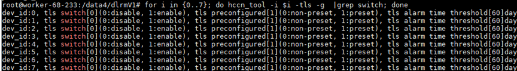

# FAQ<a name="ZH-CN_TOPIC_0000001579847284"></a>

## HCCL Cluster Communication Fails During Multi-Node Training<a name="ZH-CN_TOPIC_0000001795546622"></a>

**Symptom<a name="section964994911912"></a>**

HCCL cluster communication fails.

**Possible Causes<a name="section1581817491790"></a>**

- The NPU device IP addresses on the nodes in the multi-node cluster cannot ping each other.
- The TLS configurations of the NPU devices on the nodes in the multi-node cluster differ.
- Other causes

**Solution<a name="section181445017916"></a>**

1. Check whether the NPU device IP addresses on the nodes in the multi-node cluster can ping each other. Take a two-node cluster (nodes A and B) with 8 devices on each node as an example.
    1. Query the device IP address of node A:

        ```bash
        for i in {0..7}; do hccn_tool -i $i -ip -g ; done
        ```

    2. On node B, ping the device IP address of node A:

        ```bash
        hccn_tool -i 0 -ping -g address 192.x.x.x
        ```

        Here, 192.x.x.x is the device IP address of rank 0 on node A, and 0 specifies that the rank 0 device on node B pings the corresponding IP address.

        If the command output contains `0.00% packet loss`, the ping is successful. If the ping fails, check the network configuration of the environment.

        >[!NOTE]
        >If the device IP address is configured for IPv6, the command for querying the device IP address differs from that for pinging the device IP address. For example:
        > - Query the device IP address:
        >
        > ```bash
        > for i in {0..7}; do hccn_tool -i $i -ip -inet6 -g; done
        > ```
        >
        > - Ping a specified device IP address:
        >
        > ```bash
        > hccn_tool -i 0 -ping -inet6 -g ipv6_address x:x:x:x
        > ```

2. Check whether the TLS configurations of the NPU devices on the nodes in the multi-node cluster are the same.

    Run the following command on both nodes to check whether the configurations are the same:

    ```bash
    for i in {0..7}; do hccn_tool -i $i -tls -g  |grep switch; done
    ```

    If the configurations differ, modify the TLS configuration.

    

3. For other collective communication issues, refer to the "Fault Diagnosis" chapter in the [HCCL Collective Communication Library](https://www.hiascend.com/document/detail/en/CANNCommunityEdition/910beta3/API/hcclug/docs/en/user_guide/hccl_intro.md).

## Error Importing the `dynamic_emb_extensions` Custom Operator Package<a name="ZH-CN_TOPIC_0000001809551534"></a>

**Symptom<a name="section964994911912"></a>**

When you use the `dynamic_emb_extensions` operator library to call a custom operator, an error is reported: `ImportError: libdynamic_emb_op_npu.so: cannot open shared object file: No such file or directory`.

**Possible Causes<a name="section1581817491790"></a>**

The custom operator library `dynamic_emb_extensions.cpython-*.so` and the dynamic libraries it depends on, such as `libdynamic_emb_op_*.so`, are copied to the Python `site-packages` directory. However, the default search path of the Linux dynamic linker does not include `site-packages`. Therefore, you need to add the `site-packages` path to the `LD_LIBRARY_PATH` environment variable so that the dynamic linker can correctly find and load the required shared libraries.

**Solution<a name="section181445017916"></a>**

Add the Python `site-packages` path to the `LD_LIBRARY_PATH` environment variable.

```bash
export LD_LIBRARY_PATH=$(python3 -c "import sysconfig; print(sysconfig.get_path('platlib'))"):$LD_LIBRARY_PATH
```
