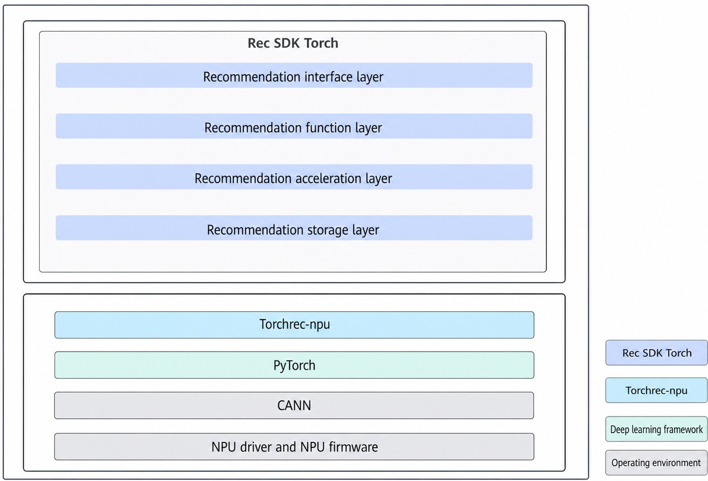

# Introduction

## Functions and Features

Rec SDK Torch provides the following functions:

- Basic model training functions:
- Rec SDK supports single-node, single-device training and single-node, multi-device distributed training.
- Models developed based on Torch are supported.

- Recommendation-specific functions:

    Based on the Rec SDK Torch dynamic sparse table solution, Rec SDK Torch provides the essential functions for recommendation, such as hash mapping, dynamic sparse table expansion, and dynamic sparse table operators implemented based on the high-performance Hierarchical Key-Value (HKV) storage acceleration library.

- Large-scale sparse table functions:

    Rec SDK Torch supports row-wise distributed sparse table sharding.

**Key Features**

Rec SDK Torch provides features such as hash mapping, row-wise table sharding, dynamic sparse table expansion and eviction, and dynamic sparse table operators.

- Hash mapping

    Torch provides `nn.Embedding` for dense ID lookup. In recommendation scenarios, however, most raw feature IDs are discrete and cannot be directly used for table lookup. Therefore, based on dynamic sparse tables, Rec SDK Torch provides the hash mapping function, which maps discrete feature keys to storage addresses in real time without requiring you to convert IDs into consecutive values in advance.

- Row-wise table sharding

    When embeddings are sharded across different tables, Rec SDK Torch partitions embeddings by row and uses a modulo-based bucketing strategy to determine the bucket position of an embedding in the table from the remainder of its ID.

- Dynamic sparse table expansion and eviction

    Rec SDK Torch supports elastic expansion of sparse tables. The system automatically allocates space when new features arrive. When space usage reaches the threshold, the eviction policy built into the operator automatically cleans up low-frequency inactive features, ensuring efficient use of storage resources.

- Dynamic sparse table operators

    Rec SDK Torch provides the deeply optimized custom high-performance operator extension `dynamic_emb_extensions`, which greatly improves training throughput compared with native Torch implementations.

## Software Architecture

**Figure 1** Software architecture

Built upon TorchRec, mainstream recommendation frameworks, CANN, and diverse hardware and network architectures, Rec SDK Torch addresses the specific requirements of search, recommendation, and advertising model training. It provides high-performance, streamlined APIs designed for ease of use, enabling Ascend AI Processors to achieve highly efficient training for search, recommendation, and advertising models. Table 1 describes the modules.

**Table 1** Modules in the architecture diagram

|Rec SDK Torch Module|Description|
|--|--|
|Recommendation API layer|Provides easy-to-use APIs to simplify customer access and support service growth.|
|Recommendation function layer|Provides core capabilities to meet customer requirements.|
|Recommendation acceleration layer|Provides core components to build performance competitiveness and offer superb performance for the entire system.|
|Recommendation storage layer|Supports distributed storage of sparse tables.|
|TorchRec-npu|Ascend adaptation layer for open-source TorchRec.|
