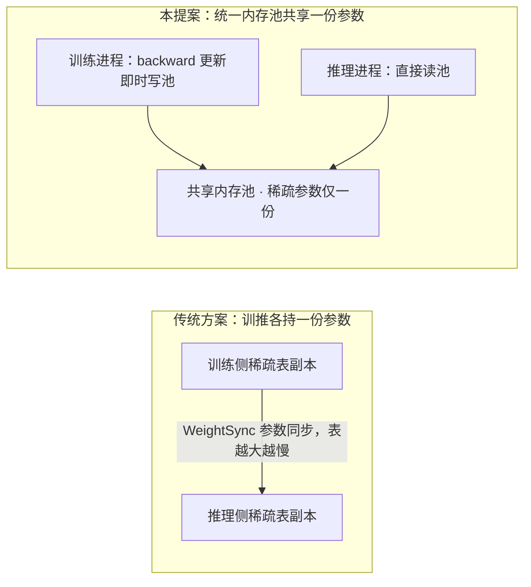
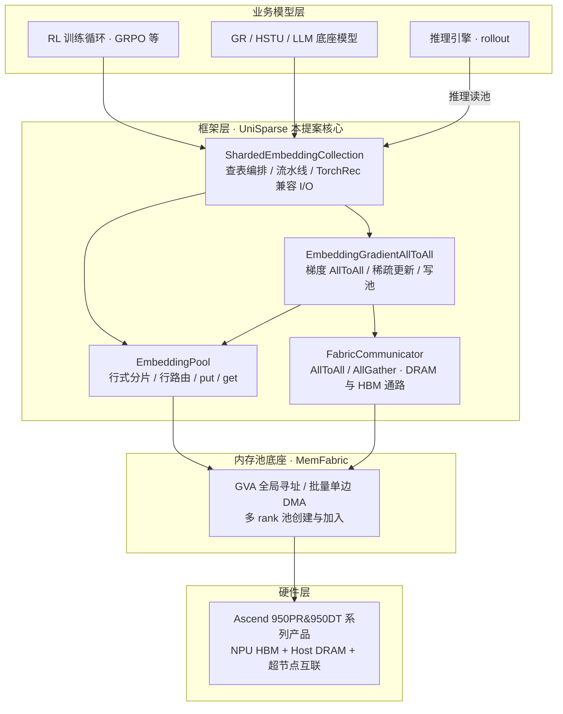
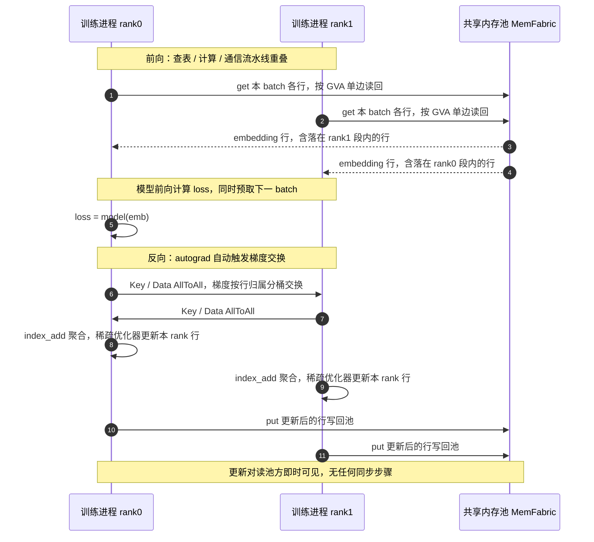
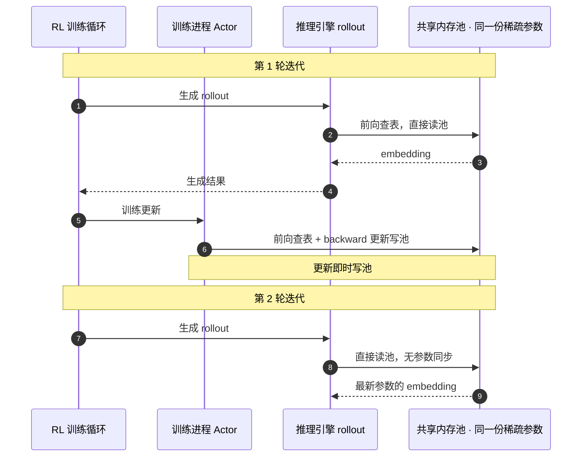

# 基于统一内存池的稀疏训练框架

**状态 (Status):** Draft

**作者 (Authors):** @[pluto1314](https://gitcode.com/pluto1314) @[Ascend/RecSDK](https://gitcode.com/Ascend/RecSDK)

**创建日期 (Created):** 2026-10-20

**更新日期 (Updated):** 2026-10-20

**相关 Issue/PR:** 暂无

---

# 1. 概述

## 1.1 简介

生成式推荐中强化学习后训练将逐渐成为行业趋势，训练与推理两侧都需要访问超大稀疏 Embedding 表。本提案提出统一稀疏池化的稀疏训练框架 UniSparse：基于 MemFabric 将超节点的 Host DRAM 与 NPU HBM 组成共享内存池，稀疏 Embedding 参数在池中只保留一份，按行分片、全局地址寻址；训练侧前向通过单边读写跨 rank 查表，反向在 autograd 中自动完成梯度聚合、稀疏优化器更新并即时写池；推理侧直接读池，训推共享同一份稀疏参数，从机制上消除训推各持一份稀疏表的存储成本和训推之间的参数同步通信。

## 1.2 动机

**使用场景 / 用例**

- 生成式推荐模型（GR/HSTU/LLM 底座）的强化学习后训练（GRPO 等）：训练进程与推理引擎（rollout）交替运行，两侧都要查同一批稀疏特征表。
- 超大稀疏表的分布式训练：数百 GB 到 TB 级 Embedding 表按行分片在多 rank，训练中每个 batch 只触碰表中极小一部分行。
- 训推共卡部署：训练与推理复用同一组算力，要求稀疏参数在两侧即时一致。

**当前痛点**

- 存储成本高：常见强化学习方案中，训练侧与推理侧在各自 DRAM 中分别维护一份完整稀疏表，训推共卡时甚至同机双份，TB 级参数下内存开销翻倍。
- 通信成本高：训推参数同步（WeightSync）需要在每次 rollout 前把训练更新的稀疏权重同步给推理侧，表越大同步越慢，训练等待时间长。
- 传统参数服务（PS）方案：推理侧拉取参数走 RPC，延迟高，服务侧仍是多副本缓存，本质问题没有解决。

传统方案与本提案的对比如下：



**必要性与用户价值**

- 一份池化参数：训推共享同一份稀疏表，存储成本接近减半。
- 训推零同步：训练更新在 backward 内即时写池，推理直接读池，rollout 前不再需要稀疏表同步步骤。
- 前向零集合通信：查表按"行所在 rank 的全局地址 + 单边 DMA"直接读取，不需要对端 rank 参与，跨 rank 访问无额外同步开销。

**不做此提案的影响**

基于强化学习的生成式推荐后训练在昇腾上只能沿用双份参数加显式同步的方案，内存与同步成本随稀疏表规模线性恶化，超大稀疏表场景难以落地，生成式推荐训推一体的路线缺少关键支撑。

## 1.3 目标

**目标**

构建统一稀疏池化的稀疏训练框架，核心能力包括：

1. 统一稀疏池：基于 MemFabric 共享内存池的稀疏表存储，行式分片、全局地址（GVA）寻址、单边 DMA 读写，支持 DRAM/HBM 通路。
2. 分布式稀疏训练：与 TorchRec 兼容的 I/O（KeyedJaggedTensor 输入、JaggedTensor 输出），查表/计算/通信流水线，梯度 AllToAll 聚合、稀疏优化器更新、更新即时写池。
3. 训推共享：训练进程与推理进程共享同一池化稀疏参数，训练更新对推理侧即时可见，无需参数同步。
4. 通信原语：基于池通路（DRAM/HBM）的 AllToAll/AllGather，以及必要的集合通信 fallback。

构建框架测试用例，基于测试用例跑通（池构建、分布式训练与梯度校验、训推共享可见性、通信原语）。

**非目标**

- 无性能要求，不做专项性能优化与调优。
- 训推共享以框架接口与测试用例验证为准；与具体强化学习框架、推理引擎的业务级集成（含适配层抽取、上游框架 patch 收敛）不在本期验收范围，作为后续演进方向。
- 不做动态哈希表、变长特征、SSD 分层存储等扩展特性。

**约束说明**

- 依赖 MemFabric 共享内存池与超节点互联能力（GVA 单边读写）。
- 单边 DMA 接口非线程安全，框架内对池访问统一做串行化封装。
- 稀疏表为定长行存储（行数 × embedding_dim × dtype），按 row-wise 均匀分片；动态表结构不在本期范围。

# 2. 用例分析

本提案构建框架级测试用例作为场景用例：

- 功能点：
  1. 池化稀疏表构建：多 rank 共享内存池初始化与加入、建表、权重初始化批量写池；
  2. 分布式查表训练：KeyedJaggedTensor 输入 → 跨 rank 单边读池 → embedding 输出 → loss backward → 梯度 AllToAll → 稀疏更新写池，梯度与权重一致性校验；
  3. 训推共享：推理侧读池结果与训练侧一致；训练更新写池后，推理侧读取立即得到新值；
  4. 通信原语：DRAM/HBM 通路上 AllToAll/AllGather 的正确性。
- 关键性能指标：功能正确，无性能要求。
- 安全隐私要求：无敏感数据处理，池为单作业专用，无跨作业数据面。
- DFX 要求：
  - 兼容性：输入输出与 TorchRec EmbeddingCollection 兼容（KeyedJaggedTensor 输入、Dict[str, JaggedTensor] 输出），存量模型代码替换查表层的成本低。
  - 可维护性：遵循 RecSDK 编码规范，接口注释覆盖率 100%，核心代码单元测试覆盖率≥80%。
  - 可测试性：分布式用例支持单机多卡先行验证，torchrun 启动，接入 CI。
  - 可靠性：单边读写与集合通信的约束（非线程安全、空桶 rank 也必须参与集合通信、非法全局地址校验）在框架内封装并文档化。
- 使用限制 / 约束：
  - 硬件依赖 MemFabric 池化能力，首选 Ascend 950DT 系列产品。
  - 定长行式分片表，row-wise 一种分片策略。

# 3. 方案设计

## 3.1 总体方案

### 3.1.1 整体设计思路

自底向上分四层构建框架：

1. 内存池底座：MemFabric 共享内存池。配置存储（config store）协调多 rank 池的创建与加入，池内地址构成全局虚拟地址（GVA）空间，提供批量单边 DMA 拷贝接口（Host/Local NPU 与全局池之间的批量搬运）。
2. 稀疏池层：定义 EmbeddingPool 抽象接口（init_table/put/get/get_weight），由 MemFabric 后端实现：逻辑表按行均匀分片到各 rank 的池段，行路由将全局行 ID 映射为"目标 rank + 段内偏移"的 GVA 地址；查表按行批量单边读回 NPU，写回反向执行。
3. 分布式训练层：ShardedEmbeddingCollection 编排查表与流水线（查表/计算/通信重叠，预取下一 batch）；EmbeddingGradientAllToAll（autograd Function）在 backward 中按行归属分桶做 Key/Data AllToAll、聚合梯度、执行稀疏优化器更新并写回池；Key 交换、barrier 等同步类操作退化为集合通信。
4. 训推共享层：推理侧通过同一池的 GVA 地址直接读稀疏参数；训推共卡场景下训练与推理复用同一池与查表实例，训练更新即时写池，推理读池即刻可见。

### 3.1.2 系统架构

整体架构采用分层设计，从上到下分为业务层、框架层、内存池底座和硬件层：



| 层级 | 职责 | 关键组件 |
| :--- | :--- | :--- |
| 业务模型层 | 生成式推荐模型与后训练 | GR/HSTU/LLM 底座、强化学习训练循环、推理引擎 |
| 框架层（本提案核心） | 统一稀疏池化训练 | EmbeddingPool、ShardedEmbeddingCollection、EmbeddingGradientAllToAll、FabricCommunicator |
| 内存池底座 | 共享内存池基础设施 | MemFabric：GVA 全局寻址、单边 DMA、超节点互联 |
| 硬件层 | 昇腾 NPU 硬件 | NPU HBM、Host DRAM、超节点互联 |

针对本提案，核心在于框架层的池化稀疏表与训推共享机制。

## 3.2 技术选型

| 备选方案 | 优势 | 劣势 | 不选择理由 |
| :--- | :--- | :--- | :--- |
| 方案 1：训推各持参数 + 权重同步（WeightSync） | 与现有训练/推理框架解耦，实现直接 | 稀疏表双份存储；每次 rollout 前同步成本随表规模线性增长，训练等待 | 存储翻倍与同步成本正是本提案要解决的问题 |
| 方案 2：参数服务（PS）集中管理 | 参数单份集中，逻辑清晰 | 查走 RPC/网络，延迟高；PS 是带宽瓶颈；推理侧仍需本地缓存副本 | 不满足训推低延迟共享的诉求 |
| 方案 3：统一内存池共享（选定方案） | 参数单份；单边读写免同步；前向零集合通信；训推天然一致 | 依赖池化软硬件栈；进程接入与生命周期管理复杂 | - |

## 3.3 功能与性能设计

采用 "统一稀疏池 + 分布式稀疏训练 + 训推共享" 构建框架：

1. 统一稀疏池：行式分片稀疏表在共享池中全局寻址，put/get 单边读写。
2. 分布式稀疏训练：autograd 内自动完成梯度聚合与稀疏更新，更新即时写池。
3. 训推共享：推理侧读池与训练侧同源，零参数同步。

### 3.3.1 统一稀疏池模块

**目标**：提供 EmbeddingPool 抽象接口与 MemFabric 后端实现。

- 池生命周期：配置存储协调多 rank 创建/加入共享内存段，池容量按表规模（行数 × 行字节，按容量粒度对齐）计算，支持 DRAM 池段与可选的 HBM 通信段；
- 表构建：为每张逻辑表在各 rank 的 GVA 段内分配偏移，权重在 NPU 上分批初始化后整块写入池；
- 行路由：全局行 ID → 目标 rank + 段内行偏移 → GVA 地址，路由规则与分片规划一致；
- 数据面：`get` 按行批量单边读回 NPU tensor，`put` 反向写回，均为批量 DMA，框架内串行化调用。

### 3.3.2 分布式稀疏训练模块

**目标**：提供与 TorchRec 兼容的分布式稀疏查表与训练能力。

- `ShardedEmbeddingCollection`：KeyedJaggedTensor 输入 → 各表查表 → `Dict[str, JaggedTensor]` 输出，I/O 形态与 TorchRec EmbeddingCollection 对齐；
- 流水线：查表/计算/通信重叠，按 batch 预取下一批 embedding，掩盖跨 rank 读延迟；
- `EmbeddingGradientAllToAll`（autograd Function）：backward 中按行归属分桶，Key/Data AllToAll（DRAM/HBM 通路可选）交换梯度，对端 `index_add_` 聚合后执行稀疏优化器更新（首期稀疏 SGD），更新结果写回池，并刷新预取缓存；
- 分片规划：row-wise ShardingPlan 与配套 planner，规划结果决定行路由表。

一次训练 step 中，各 rank 与共享池的交互时序如下：



### 3.3.3 训推共享模块

**目标**：训练与推理共享同一份池化稀疏参数。

- 推理侧接入：推理进程通过同一共享池的 GVA 地址读稀疏参数，查表走同一套 EmbeddingPool 接口；训推共卡场景下，训练与推理复用同一池与查表实例，推理前向关闭流水线与自动更新即可；
- 即时可见性：训练更新以行为单位写池，写完成后推理侧读池立即得到新值，无需任何同步步骤；
- 一致性边界：以行写为可见性单位，文档明确行内更新的可见性语义。

以强化学习一轮迭代为例，训推交替执行、共享同一份池化参数的时序如下：



### 3.3.4 通信模块

**目标**：提供池通路上的集合通信原语。

- `FabricCommunicator`：AllToAll/AllGather，支持 DRAM 与 HBM 两种通路，供梯度交换与 Key 交换使用；
- 集合通信 fallback：barrier、元数据交换等同步类操作使用框架原生集合通信实现。

### 3.3.5 验收标准

1. 验收方式：构建框架测试用例，基于测试用例跑通（池构建、分布式训练与梯度校验、训推共享可见性、通信原语），无性能要求。
2. 验收硬件：首选 Ascend 950DT 系列产品。

## 3.4 安全隐私与DFX设计

### 3.4.1 安全隐私设计

本提案无敏感数据处理逻辑，稀疏表内容为模型参数与特征 ID，池为单作业专用、无跨作业共享数据面，无需额外的安全隐私管控措施，遵循 RecSDK 现有安全规范。

### 3.4.2 DFX 设计

#### 3.4.2.1 兼容性

1. I/O 兼容：输入 KeyedJaggedTensor、输出 JaggedTensor，与 TorchRec 生态对齐；对 torchrec 的依赖仅限稀疏张量结构定义，采用惰性加载规避其底层库的传递依赖。
2. 软件配套：torch/torch_npu 配套版本、torchrec 及 MemFabric 组件版本在发布说明中明确。

#### 3.4.2.2 可维护性

1. 代码规范：遵循 RecSDK 编码规范，接口注释覆盖率 100%，核心代码单元测试覆盖率≥80%。
2. 模块化设计：稀疏池、分布式训练、通信原语、训推共享四个模块解耦，接口稳定后可独立迭代。

#### 3.4.2.3 可测试性

1. 分层测试：通信原语与池数据面提供单 rank/多 rank 单测；训练与训推共享提供多卡分布式用例，torchrun 启动，接入 CI。
2. 梯度校验：训练用例内置梯度与更新后权重的一致性校验，不依赖人工比对。

#### 3.4.2.4 可靠性

1. 底层约束封装：单边 DMA 非线程安全由框架内锁串行化，空桶 rank 必须参与集合通信等约束在框架层保证，不暴露给用户。
2. 防御性校验：全局地址合法性、表容量越界等在接口层校验并给出明确错误码。

## 3.5 编程与调用设计

### 3.5.1 编程模型基本设计

**开发环境设计**：

| 类别 | 具体内容 |
| ---- | -------- |
| 硬件环境 | 首选 Ascend 950DT 系列产品 |
| 软件环境 | torch 及配套 torch_npu、CANN；torchrec（仅稀疏张量结构）；MemFabric 内存池组件 |

**开发约束**：参考"开发环境设计"；稀疏表为定长行式分片结构。

**可验收设计**：构建框架测试用例并跑通，无性能要求。

### 3.5.2 接口定义与设计

框架核心接口围绕 EmbeddingPool 与 ShardedEmbeddingCollection 组织，典型用法如下（接口以实际发布为准）：

```python
from unisparse.modules.embedding_configs import EmbeddingConfig
from unisparse.distributed import ShardedEmbeddingCollection
from unisparse.memory_pool import LocalCPUPool

# 1. 构建共享池并建表（多 rank 通过配置存储加入同一池）
pool = LocalCPUPool(pool_config)
table_cfg = EmbeddingConfig(num_embeddings=..., embedding_dim=..., feature_names=[...])
pool.init_table(table_cfg, sharding_plan)

# 2. 训练：查表前向，backward 内自动完成梯度 AllToAll、稀疏更新与写池
sec = ShardedEmbeddingCollection(tables=[table_cfg], pool=pool)
emb = sec(kjt)                    # KeyedJaggedTensor → Dict[str, JaggedTensor]
loss = model(emb)
loss.backward()                   # 更新已写回共享池

# 3. 推理（训推共卡场景复用同一 pool/sec 实例，直接读池，无需参数同步）
with torch.no_grad():
    infer_emb = sec.forward(kjt, use_pipeline=False)
```

### 3.5.3 编程手册设计

- 章节参考：安装部署（含 MemFabric 环境准备）、快速上手、池配置说明、API 清单、训推共享使用指引、FAQ 等。
- 形式：随 RecSDK 社区发布，Markdown + 示例代码。

# 4. 缺点和风险

| 风险类型 | 具体描述 | 应对措施 |
| -------- | -------- | -------- |
| 硬件环境依赖 | 框架强依赖 MemFabric 池化能力与超节点互联，环境可用性影响验收节奏 | 提前锁定验收环境 |
| 底座版本配套 | MemFabric 组件接口仍在演进，存在接口变更与非线程安全等约束 | 锁定配套版本；框架内串行化封装隔离底层约束；建立版本差异跟踪 |
| 一致性风险 | 训练写池与推理读池并发时，行级更新的可见性边界需要明确 | 以行为单位写池并在文档明确可见性语义；测试用例覆盖训推交替执行场景 |
| 生态依赖 | torchrec 的底层传递依赖在 NPU 环境的可用性 | 仅引用 torchrec 稀疏张量结构并做惰性加载，规避传递依赖 |
| 框架复杂度 | 流水线状态机、双通路通信（DRAM/HBM）、分布式时序增加调试难度 | 分布式流程与时序文档化；分模块单测先行；提供 profiling 手段定位各阶段耗时 |
| 业务集成复杂度 | 与强化学习框架/推理引擎的业务级集成涉及对上游框架的侵入修改 | 本期以框架能力与测试用例为验收边界；业务集成作为后续演进，规划独立适配层收敛侵入面 |

# 5. 现有技术

参考项目 / 社区设计：

**[TorchRec](https://github.com/pytorch/torchrec)**：推荐领域稀疏训练的事实标准，提供了 KeyedJaggedTensor 数据结构、row-wise 分片与梯度 AllToAll 的成熟设计。

**verl / vLLM 训推共卡方案**：强化学习后训练中训练与推理共卡复用算力的代表性实践。

**MemFabric**：昇腾内存池基础组件，提供全局虚拟地址与单边 DMA 能力，是本提案的池化底座。

借鉴与差异：

| 参考项目 | 借鉴点 | 差异点 |
| -------- | ------ | ------ |
| TorchRec | 1. KeyedJaggedTensor 等稀疏数据结构；<br />2. row-wise 分片与梯度 AllToAll 机制；<br />3. EmbeddingCollection 的 I/O 形态 | 1. 参数存放：各 rank 本地显存 → 共享内存池全局寻址；<br />2. 前向查表：本地/集合通信 → 单边 DMA 直读；<br />3. 训推关系：不共享 → 共享同一份参数零同步 |
| verl / vLLM 训推共卡 | 训推交替复用算力的工程实践与权重交付流程 | 稀疏权重靠显式同步（WeightSync），本提案以共享池从机制上消除同步 |
| MemFabric | GVA 全局寻址、批量单边 DMA、池生命周期管理 | 本提案在其上构建稀疏表组织、路由、训练与训推共享语义 |

# 6. 未解决问题

- 推理进程跨进程组独立部署（非共卡场景）时，池的发现与加入机制。
- 池化参数的 checkpoint 与故障恢复方案。
- 多作业共享同一池时的隔离与配额机制。
- HBM 通路的启用条件与收益评估（首期以 DRAM 池为主）。

---

附录

**参考资料链接：**

1. RecSDK 开源仓库：https://gitcode.com/Ascend/RecSDK
2. TorchRec 官方仓库：https://github.com/pytorch/torchrec
3. 生成式推荐与强化学习后训练相关公开资料：https://github.com/NVIDIA/recsys-examples

**术语表：**

| 术语 | 定义 |
| ---- | ---- |
| MemFabric | 昇腾共享内存池基础组件，将多机/多卡的 DRAM 与 HBM 组成统一池，提供全局虚拟地址与单边 DMA |
| GVA | 全局虚拟地址（Global Virtual Address），池内资源的全局寻址空间，任一 rank 可直接以 GVA 访问远端数据 |
| 单边 DMA | 一侧发起、无需对端 CPU 参与的远程内存读写，跨 rank 查表的基础通路 |
| 稀疏表 / Embedding 表 | 推荐模型中以特征 ID 为行索引的巨大参数表，训练中每个 batch 只触碰其中一小部分行 |
| row-wise 分片 | 将稀疏表按行区间均匀切分到各 rank 的分片策略 |
| KJT（KeyedJaggedTensor） | TorchRec 定义的核心稀疏数据结构，按 key 组织变长特征序列 |
| AllToAll | 集合通信原语，各 rank 之间按归属交换数据，用于梯度与 Key 的交换 |
| 训推共享 | 训练进程与推理进程访问同一份池化参数，更新即时可见、无需同步 |
| 超节点 | 多节点通过高速互联组成的计算资源池，池化与单边访问的物理基础 |

**文档更新计划：**暂无
