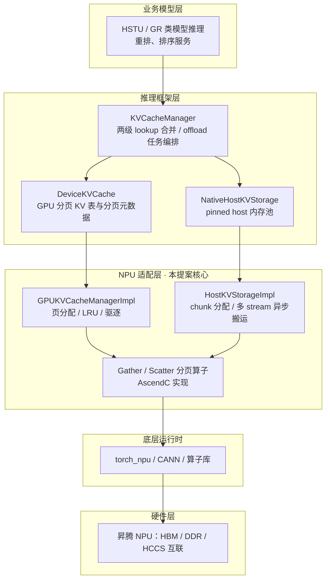
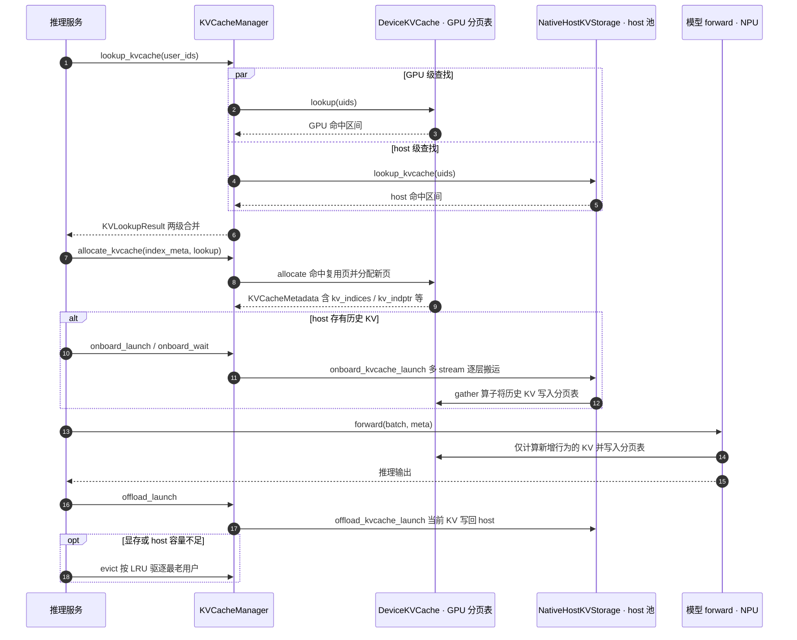
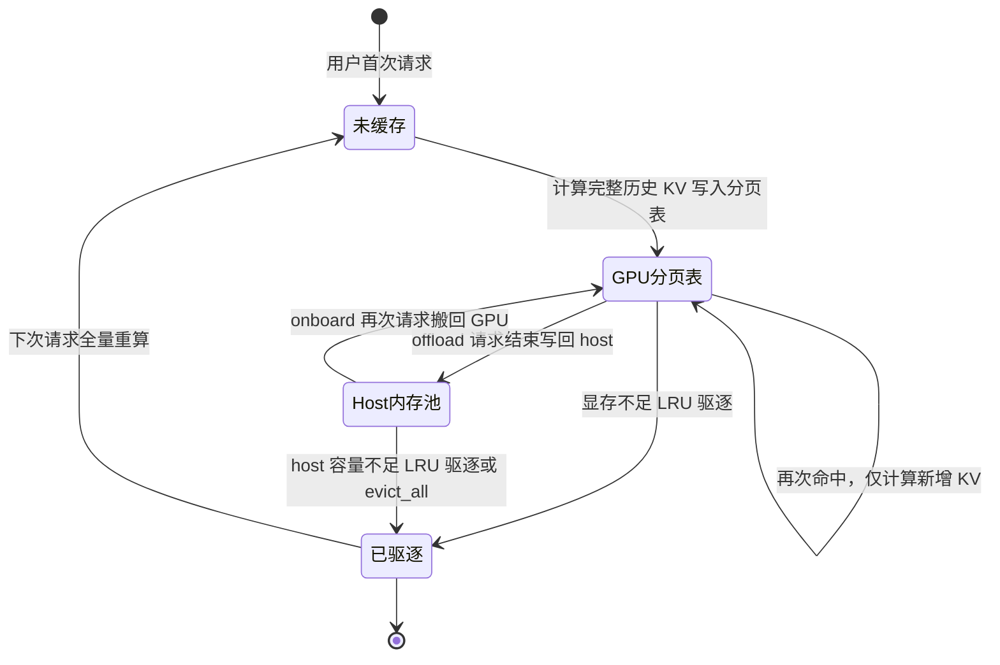

# 推荐领域三方库KVCacheManager支持

**状态 (Status):** Draft

**作者 (Authors):** @[pluto1314](https://gitcode.com/pluto1314) @[Ascend/RecSDK](https://gitcode.com/Ascend/RecSDK)

**创建日期 (Created):** 2026-10-20

**更新日期 (Updated):** 2026-10-20

**相关 Issue/PR:** 暂无

---

# 1. 概述

## 1.1 简介

[recsys-examples](https://github.com/NVIDIA/recsys-examples) 仓库（v26.06）中的 [recsys_kvcache_manager](https://github.com/NVIDIA/recsys-examples/tree/v26.06/corelib/recsys_kvcache_manager) 是面向生成式推荐模型（HSTU 类）推理的 KV Cache 管理库，提供 LLM 兼容的 KV 缓存、存储与查找能力。本提案将该库的社区 API 100% 支持到昇腾平台：对齐其 Python API 与语义，将底层 CUDA C++ 实现（GPU 分页 KV 表管理、host 分层存储、分页 gather/scatter kernel）替换为基于 torch_npu/CANN/AscendC 的 NPU 实现，使依赖该库的生成式推荐推理链路能够在昇腾平台运行，为 RecSDK 生成式推荐推理方案补齐 KV Cache 管理这一基础组件。

## 1.2 动机

**使用场景 / 用例**

生成式推荐模型（HSTU/GR 类）把用户行为序列作为序列输入做类 Transformer 推理，注意力计算的 K/V 状态随用户历史长度线性增长。推理服务中：

- 同一用户短时间内会被多次请求（刷新、多路召回、重排），其历史 KV 可以跨请求复用；
- GPU 显存放不下全量用户的 KV，需要 GPU 显存与 host 内存的分层管理：请求结束后把 KV offload 到 host，下次请求再 onboard 回 GPU，显存不足时按 LRU 驱逐；
- KV 查找按 user ID 进行：推荐场景用户行为序列因人而异、几乎没有公共前缀，LLM 推理常用的 token 前缀缓存在推荐场景基本失效，必须以用户为粒度管理 KV。

典型调用流程：`lookup_kvcache(user_ids)` 查询 GPU/host 两级命中情况 → `allocate_kvcache` 为用户分配分页 KV 表页 → `onboard_launch/onboard_wait` 把 host 侧 KV 异步搬回 GPU → 模型 forward 只计算新增行为对应的 KV 并写入分页表 → `offload_launch` 把当前 KV 写回 host → 空间不足时 `evict` 驱逐。

**当前痛点**

- recsys_kvcache_manager 的核心逻辑（分页 KV 表管理、LRU、host 存储异步搬运、分页 gather/scatter）以 CUDA C++ 扩展和 CUDA kernel 实现，无法在昇腾平台运行；上层生成式推荐推理链路（如 recsys-examples 中的 HSTU 推理）依赖该库，整条链路在昇腾上存在断点。
- RecSDK 当前没有等价的 KV Cache 管理组件，用户在昇腾上做生成式推荐推理时 KV 无法复用，长历史用户的重复计算开销大、推理时延高。
- 用户自行适配需要同时掌握 CUDA 扩展语义、分页 KV 机制和昇腾算子开发，门槛高、周期长。

**必要性与用户价值**

- 完成 100% API 支持后，依赖该库的推荐推理代码不需要修改调用方式即可运行在昇腾平台，可复用社区已有的推理链路与测试用例，迁移成本低。
- 用户级 KV 复用直接消除重复计算：对高频用户，历史 KV 只需计算一次，后续请求只算增量，推理时延与算力消耗均有明显收益。

**不做此提案的影响**

RecSDK 在生成式推荐推理侧缺少 KV Cache 管理能力，HSTU/GR 路线的推理方案在昇腾平台不完整，长行为序列用户的推理成本居高不下，生成式推荐生态竞争力受损。

## 1.3 目标

**目标**

- 基于 recsys-examples v26.06 tags 的 [recsys_kvcache_manager](https://github.com/NVIDIA/recsys-examples/tree/v26.06/corelib/recsys_kvcache_manager) 社区 API，完成 100% 支持，对外接口与社区保持一致。
- 支持对应社区测试用例（native host 存储后端路径）在昇腾平台通过。

**非目标**

- 不支持 FlexKV 场景：FlexKV 后端（分布式 KV 服务，CPU/SSD/远端分层存储）不在本期支持范围，host 存储仅支持 native 后端（pinned host 内存）。
- 与 FlexKV 绑定的 torch.export/AOTI 导出路径不在本期范围。
- 仅做功能适配，无性能要求，不做针对 NPU 的专项性能优化。

**约束说明**

- host 存储后端支持 native（pinned host 内存）与 nop（不启用 host 存储）两种，不支持 FlexKV。
- 沿用社区库的实例约束：每个 device 仅允许一个 GPU KVCache manager 和一个推理实例。
- CUDA 侧的 stream/event 异步语义在 NPU 上以多 stream 加 event 等价实现，onboard/offload 的 launch/wait/cancel、逐层同步行为对齐社区语义。
- KV dtype 支持 bf16/fp16，与社区一致。

# 2. 用例分析

本提案使用社区测试用例作为场景用例：

- 功能点：KVCacheManager 的完整生命周期——配置构造（from_config）、按 user_id 的两级 lookup、分页表 allocate、onboard/offload 异步分层搬运、LRU 驱逐（evict/evict_all）、调试接口 put/get，以及 GPU 分页表元数据（kv_cache_table/kv_indices/kv_indptr/kv_last_page_len 等）的正确性。
- 关键性能指标：功能适配，无性能要求。
- 安全隐私要求：无敏感数据处理，用户 ID 与 KV 张量均在用户环境内流转，无需额外安全隐私管控。
- DFX 要求：
  - 兼容性：Python API 与社区 v26.06 版本一致，上层推理代码无需修改调用方式。
  - 可维护性：遵循 RecSDK 编码规范，接口注释覆盖率 100%，核心代码单元测试覆盖率≥80%。
  - 可测试性：基于社区测试用例进行测试，并对高优接口进行自动化测试。
  - 可靠性：host 存储失败策略（fail_open/fail_close）、onboard/offload 超时与取消行为与社区一致。
- 使用限制 / 约束：
  - 不支持 FlexKV 后端及依赖它的 export/AOTI 路径。
  - 每 device 单 GPU manager、单推理实例。
  - `allocate_kvcache` 为同步阻塞语义，与社区一致。

# 3. 方案设计

## 3.1 总体方案

### 3.1.1 整体设计思路

对齐社区库的分层结构，Python 层复用社区实现，C++/CUDA 层替换为 NPU 实现：

1. Python API 层：KVCacheManager 门面、KVCacheBackend 抽象接口、DefaultKVCacheBackend 编排（GPU 与 host 两级 lookup 结果合并、offload 任务队列、lazy/eager 模式、失败策略），以及配套数据结构（KVIndexMeta、KVLookupResult、KVCacheMetadata、KVCacheConfig）。这一层是纯 Python 编排逻辑，与设备无关，保持与社区一致。
2. C++ 扩展层：社区的 CUDA 扩展 kvcache_cpp（GPUKVCacheManagerImpl 分页表管理、HostKVStorageImpl host 存储、KVOnloadHandle/KVOffloadHandle 异步句柄）替换为基于 torch_npu/CANN 的 NPU 实现，pybind 接口保持一致。
3. Kernel 层：分页 KV 的 gather/scatter（连续 buffer 与分页表之间搬运 KV）以 AscendC 算子实现。

### 3.1.2 系统架构

整体架构采用分层设计，从上到下分为业务层、推理框架层、NPU 适配层、底层运行时和硬件层：



| 层级 | 职责 | 关键组件 |
| :--- | :--- | :--- |
| 业务模型层 | 生成式推荐模型推理 | HSTU/GR 类模型、重排/排序服务 |
| 推理框架层 | KV Cache 管理与分页注意力 | KVCacheManager、DeviceKVCache、HostKVStorage、paged attention kernel |
| NPU 适配层 | 本提案设计的核心 | C++ 扩展 NPU 实现（分页表管理/LRU/host 搬运）、分页 gather/scatter AscendC 算子 |
| 底层运行时 | NPU 基础能力 | torch_npu、CANN、算子库 |
| 硬件层 | 昇腾 NPU 硬件 | HBM、DDR、HCCS 互联 |

针对本提案，核心在于 C++ 扩展层与 Kernel 层的 NPU 化。

## 3.2 技术选型

| 备选方案 | 优势 | 劣势 | 不选择理由 |
| :--- | :--- | :--- | :--- |
| 方案 1：纯 Python 重新实现（分页表用 torch 张量、LRU 与锁在 Python 侧维护） | 实现简单，不涉及 C++ 扩展开发 | lookup/allocate 处于推理热路径，Python 开销大；与社区 C++ 行为难以逐一对齐，后续跟随社区演进成本高 | 热路径性能与行为对齐性不满足要求 |
| 方案 2：C++ 扩展对齐社区实现（选定方案） | 与社区语义 1:1 对齐；热路径（lookup/allocate/LRU）在 C++ 内完成；上层 Python 代码直接复用社区实现 | 需开发 NPU C++ 扩展与 AscendC kernel，工作量较大 | - |

## 3.3 功能与性能设计

采用 "Python API 复用 + C++ 扩展 NPU 化 + AscendC kernel" 完成支持：

1. Python API 复用：对齐社区 v26.06 的接口定义与编排逻辑，保证上层代码零改动迁移。
2. C++ 扩展 NPU 化：分页表管理、host 存储与异步句柄在 NPU 上等价实现。
3. Kernel 实现：分页 KV 搬运算子以 AscendC 实现。

典型推理请求的 KV Cache 处理流程如下：



### 3.3.1 Python API 适配模块

**目标**：提供与社区 v26.06 一致的 Python API，本提案实现 100% 支持度。

主要接口参考如下：

- `KVCacheManager`：`lookup_kvcache`、`allocate_kvcache`、`onboard_launch/onboard_try_wait/onboard_wait`、`offload_launch/offload_try_wait/offload_reap_completed/offload_flush`、`evict/evict_all`、`from_config`；
- `DeviceKVCache`（GPU 分页 KV 表）：`get_cache_tables`、`lookup`、`allocate`、`evict`、`evict_all`、`put/get`（调试用）、`revoke_onboard_pages`、`check_for_offload`、`acquire_offload_pages/release_offload_pages`；
- `HostKVStorageBase`/`NativeHostKVStorage`：`register_gpu_cache_tables`、`build_index_meta`、`lookup_kvcache`、`onboard/offload_kvcache_launch/wait`、`finish_task`、`cancel_task`、`evict`、`evict_all`；
- 数据结构与配置：`KVIndexMeta`、`KVLookupResult`（GPU/host 两级命中结果及 merge）、`KVCacheMetadata`（kv_cache_table、kv_indices、kv_indptr、kv_last_page_len、kv_seqlens 等分页元数据）、`KVCacheConfig`（num_layers/num_heads/head_dim/page_size/页数/host 容量/dtype/offload 模式/失败策略等）。

### 3.3.2 C++ 扩展与算子适配模块

**目标**：将社区 CUDA 扩展的核心能力在 NPU 上等价实现。

- `GPUKVCacheManagerImpl`：GPU 分页 KV 表的页分配与回收、user 到页的映射、LRU 驱逐、lookup/allocate/evict、offload 页锁定与回收；
- `HostKVStorageImpl`：pinned host 内存池（按层容量、chunk 化分配）、host 侧 LRU、多 stream 异步 onboard/offload、超时判定与取消；
- `KVOnloadHandle`/`KVOffloadHandle`：逐层事件同步，支持 onboard 搬运与上一层计算重叠；
- `ScatterPagedKVCache`/`GatherPagedKVCache`：连续 buffer 与分页表之间的 KV 搬运，以 AscendC 算子实现并通过 pybind 暴露。

用户 KV 在 GPU 显存与 host 内存两层存储间的生命周期如下：



### 3.3.3 验收标准

1. 验收方式：基于社区测试用例（native 后端路径）进行验证，功能正确。
2. 性能要求：本提案仅适配功能，无性能要求。
3. 验收硬件：首选 Ascend 950DT 系列产品。

## 3.4 安全隐私与DFX设计

### 3.4.1 安全隐私设计

本提案涉及的接口无敏感数据处理逻辑，用户 ID 与 KV 张量均在用户环境内流转，无需额外的安全隐私管控措施，仅需遵循 RecSDK 现有安全规范，确保接口无越权访问、数据泄露风险。

### 3.4.2 DFX 设计

#### 3.4.2.1 兼容性

1. 版本兼容：适配基线锁定社区 v26.06 tags，API 清单与之一一对应。
2. 接口兼容：与社区接口 1:1 兼容，开发者无需修改业务代码即可迁移至昇腾平台。

#### 3.4.2.2 可维护性

1. 代码规范：遵循 RecSDK 编码规范，接口注释覆盖率 100%，核心代码单元测试覆盖率≥80%。
2. 模块化设计：Python 编排层、C++ 扩展层、算子层解耦，便于独立迭代和维护。

#### 3.4.2.3 可测试性

1. 自动化测试：开发单元测试、集成测试脚本，接入 RecSDK 持续集成（CI）流程，每次代码提交自动执行。
2. 测试用例：社区测试用例（native 后端路径）100% 支持。

#### 3.4.2.4 可靠性

1. onboard/offload 超时、取消、失败策略（fail_open/fail_close）行为与社区一致，host 存储异常不会阻塞推理主流程（fail_open 模式下）。

## 3.5 编程与调用设计

### 3.5.1 编程模型基本设计

**开发环境设计**：

| 类别 | 具体内容 |
| ---- | -------- |
| 硬件环境 | 首选 Ascend 950DT 系列产品 |
| 软件环境 | PyTorch、torch_npu 配套版本（与 CANN 配套一致）、recsys_kvcache_manager NPU 实现版本 |

**开发约束**：参考"开发环境设计"；每 device 单 manager、单推理实例。

**可验收设计**：基于社区测试用例（native 后端路径）进行功能验收，无性能要求。

### 3.5.2 接口定义与设计

本次为对齐社区 [recsys_kvcache_manager v26.06](https://github.com/NVIDIA/recsys-examples/tree/v26.06/corelib/recsys_kvcache_manager) API，不新增自定义接口，仅做 NPU 兼容实现，**接口形态与社区 API 完全一致**，典型调用示例如下：

```python
from recsys_kvcache_manager import KVCacheManager, KVCacheConfig

mgr = KVCacheManager.from_config(kvcache_config)

# 1. 查询用户历史 KV 命中情况（GPU + host 两级）
lookup_res = mgr.lookup_kvcache(user_ids, seq_lengths)

# 2. 为本批用户分配分页 KV 表页，生成分页元数据
meta = mgr.allocate_kvcache(index_meta, lookup_res)

# 3. host 侧历史 KV 异步搬回 GPU（与上一层计算重叠）
mgr.onboard_launch(index_meta, meta)
mgr.onboard_wait(index_meta, meta)

# 4. 模型 forward：只计算新增行为的 KV，写入分页表；历史部分直接复用
output = model(batch, kv_metadata=meta)

# 5. 请求结束，KV 写回 host，显存不足时 LRU 驱逐
mgr.offload_launch(index_meta, meta)
mgr.evict(user_ids, for_gpu=False, for_host=True)
```

### 3.5.3 编程手册设计

- 章节参考：安装部署、快速上手、API 清单、onboard/offload 调优说明、FAQ、迁移指南等。
- 形式：随 RecSDK 社区发布，Markdown + 示例代码。

# 4. 缺点和风险

| 风险类型 | 具体描述 | 应对措施 |
| -------- | -------- | -------- |
| Kernel 移植风险 | 分页 gather/scatter 算子与社区 CUDA 实现的行为（页 layout、边界条件、dtype）对齐存在工作量 | 以社区用例为基准逐用例比对；优先覆盖用例涉及的 layout 与 dtype，差异项显式记录 |
| 异步语义差异 | CUDA stream/event 与 NPU stream/event 语义不完全相同，逐层重叠搬运的行为可能不一致 | 封装统一的 stream/event 适配层；用社区用例中的异步时序断言逐项验证 |
| pinned 内存行为差异 | NPU 上 pinned host 内存分配与异步拷贝路径和 CUDA 平台不同，大容量 host 池的分配与带宽需提前验证 | 立项初期完成 pinned 池容量/带宽摸底；必要时调整 chunk 分配策略 |
| 单实例约束 | 每 device 单 manager、单推理实例的约束沿用社区，多实例需求无法满足 | 文档明确约束；多实例支持列入未解决问题 |
| 社区版本演进 | recsys-examples 后续 tags 的 API 变更会导致适配漂移 | 锁定 v26.06 为适配基线，建立社区版本差异跟踪机制，按版本规划跟随 |
| FlexKV 能力缺失 | 不支持 FlexKV 后端及依赖它的 export/AOTI 路径，使用导出部署的用户受阻 | 在文档与发布说明中明确约束；后续版本评估 FlexKV 与 export 路径的支持可行性 |

# 5. 现有技术

参考项目 / 社区设计：

**[NVIDIA recsys-examples](https://github.com/NVIDIA/recsys-examples)**（v26.06 recsys_kvcache_manager）：API 定义、分层存储语义、LRU 与异步搬运机制、测试用例的直接来源，本提案对齐其接口定义，底层实现替换为 NPU 实现。

借鉴与差异：

| 参考项目 | 借鉴点 | 差异点 |
| -------- | ------ | ------ |
| NVIDIA recsys_kvcache_manager | 1. Python API 与编排逻辑（两级 lookup 合并、offload 任务队列、失败策略）；<br />2. 分页 KV 表组织与元数据定义；<br />3. 社区测试用例 | 1. 底层实现：CUDA C++/kernel 替换为 torch_npu/CANN/AscendC；<br />2. host 后端：仅支持 native，不支持 FlexKV；<br />3. export/AOTI 路径暂不支持 |
| vLLM / TRT-LLM PagedAttention | 分页块表（block table）组织 KV 的思想，分页元数据（页 ID 表、页内偏移）的通用形态 | 推荐场景按 user ID 而非 token 前缀管理分页 KV，并增加 host 分层与 onboard/offload 生命周期 |

# 6. 未解决问题

- FlexKV 后端及依赖它的 export/AOTI 路径是否在后续版本支持，需结合 FlexKV 在昇腾的可用性评估。
- 每 device 多 manager、多推理实例的支持方案。
- 与 RecSDK 生成式推荐推理示例（HSTU 推理链路）端到端集成的节奏。

---

附录

**参考资料链接：**

1. recsys_kvcache_manager（v26.06）：https://github.com/NVIDIA/recsys-examples/tree/v26.06/corelib/recsys_kvcache_manager
2. NVIDIA recsys-examples 仓库：https://github.com/NVIDIA/recsys-examples
3. RecSDK 开源仓库：https://gitcode.com/Ascend/RecSDK

**术语表：**

| 术语 | 定义 |
| ---- | ---- |
| KV Cache | 推理过程中注意力机制的 Key/Value 状态缓存，复用可避免重复计算历史序列 |
| HSTU | Meta 提出的生成式推荐模型架构（Hierarchical Sequential Transduction Units），GR 系列模型的基础 |
| 分页 KV（Paged KV） | 将 KV 按固定大小的页组织在显存中，以页 ID 表（类似 block table）索引，减少碎片 |
| onboard / offload | KV 在 GPU 显存与 host 内存之间的搬运：onboard 搬入 GPU，offload 搬出至 host |
| LRU 驱逐 | 显存/内存不足时按最近最少使用原则逐出用户的 KV |
| FlexKV | 分布式 KV 分层存储服务（CPU 内存/SSD/远端池），本提案中作为 host 存储的可选后端，暂不支持 |
| pinned memory | 页锁定 host 内存，用于主机与设备间的高带宽异步拷贝 |
| AOTI | Ahead-Of-Time Inductor，PyTorch 的提前编译部署路径 |

**文档更新计划：**暂无
