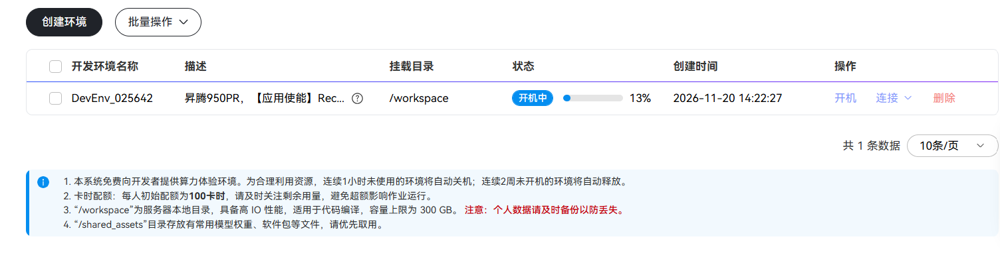
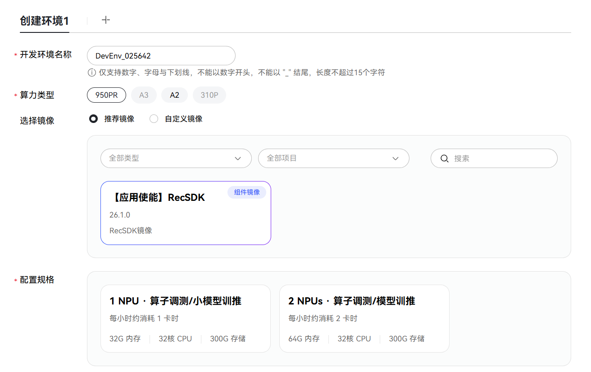
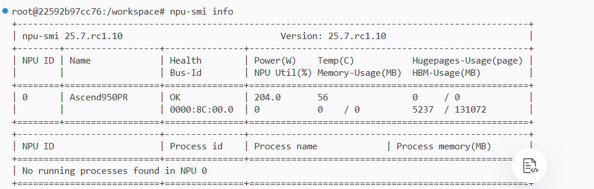
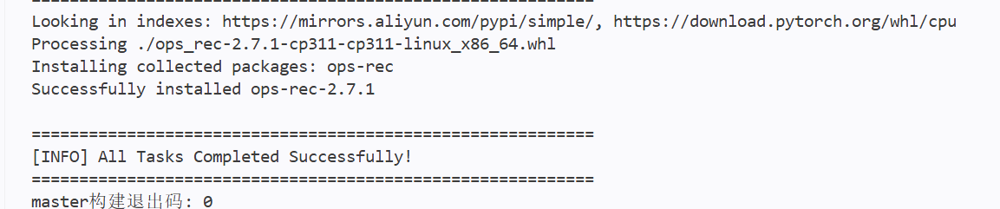
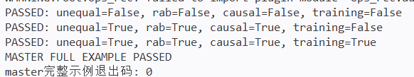
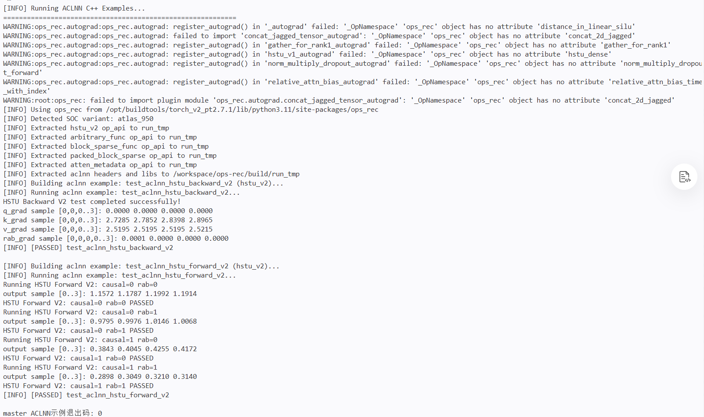

# HSTU 算子编译运行总结报告

> 一句话结论：在 HiDevLab Ascend 950PR 单卡、RecSDK 26.1.0 镜像中，完成 ops-rec master 固定提交的 HSTU 编译安装和官方用例运行；补齐平台查询接口、修正示例设备编号并加入反向预热后验证通过；CI 为 67 passed、0 failed、1190 deselected。

## 1 文档信息

| 项目 | 内容 |
| --- | --- |
| 文档类型 | 验证报告 |
| 提交人 | GitCode ID：2504_93929948 |
| 文档版本 / 日期 | v1 / 2026-11-20 |
| 任务名称 | 生成式推荐核心 attention 算子 HSTU 的编译运行 |
| 操作文档 | [ops-rec master HSTU V2 README](https://gitcode.com/Ascend/ops-rec/blob/master/ascendc/attention/hstu_v2/README.md) |
| 实测源码提交 | b514c98985b4239a56d2719fe568a14e7dd824ee（master，固定提交） |
| CATLASS 提交 | 75f0c438f6b8b12b4f1d088b91fb401e05eec8c8 |

## 2 任务背景与目标

- 任务目标：按任务书在指定设备和镜像内完成 HSTU 算子编译、安装和用例运行，保留截图与过程日志。
- 任务结果：编译安装退出码 0；PyTorch 前向与自动求导示例 3 组通过；独立反向示例通过；ACLNN 反向示例和前向 4 种 causal/RAB 组合通过；CI 前向精度 32 项、自动求导 35 项通过。
- 运行条件：使用官方 runtime 源码补编译平台查询接口；ACLNN 反向示例设备 ID 从 5 改为 0；包含平方损失的自动求导示例在同一进程内先执行基础反向预热。HSTU 算子计算实现及官方测试断言未修改。

## 3 环境准备

### 3.1 环境创建步骤

**步骤 1：创建算力环境。** 使用白名单账号进入 HiDevLab，创建 `DevEnv_025642`，选择 Ascend 950PR 单卡；设备报告 HBM 总量 131072 MB。



**步骤 2：选择镜像。** 选择推荐镜像“【应用使能】RecSDK”，版本 26.1.0。



**步骤 3：确认实际规格。** 实际环境为 1 NPU、32G 内存、32 核 CPU、300G 存储。


**步骤 4：连接 WebIDE 并验证设备。** 容器内执行 `npu-smi info`，设备 0 为 Ascend950PR，Health 为 OK。



### 3.2 软件与源码

| 项目 | 实际配置 |
| --- | --- |
| OS / Python | Ubuntu 22.04 / Python 3.11.0 |
| 驱动查询工具 | npu-smi 25.7.rc1.10 |
| CANN | /usr/local/Ascend/cann-9.1.0-beta.3 |
| Python 环境 | /opt/buildtools/torch_v2_pt2.7.1 |
| PyTorch / torch_npu | 2.7.1+cpu / 2.7.1.post4 |
| Git / CMake | 2.34.1 / 3.22.6 |
| 测试记录依赖 | openpyxl 3.1.5、et_xmlfile 2.0.0 |

```bash
source /opt/buildtools/torch_v2_pt2.7.1/bin/activate
source /usr/local/Ascend/ascend-toolkit/set_env.sh
export PYTHONPATH="${PYTHONPATH%:}"
```

## 4 编译安装与运行结果

### 4.1 补齐环境依赖

镜像缺少 `acl/acl_platform.h`，已有运行库也未导出 `aclplatformGetDeviceInfo`。从 [CANN runtime 官方源码](https://gitcode.com/cann/runtime/tree/1954820a5a0c87f2a1c81eb65313225da221ec71)取得头文件及 `src/platform/acl_platform.cpp`，链接镜像已有 `libplatform` 和 `libc_sec`，编译独立的 `libhstu_acl_platform.so`，不替换系统 CANN 库。

完整编译命令见 [平台接口构建脚本](reproduce/build_platform.sh)，该脚本整理了本次实测使用的下载与编译命令。头文件放入 `/workspace/hstu_platform/include/acl/`，独立库放入 `/workspace/hstu_platform/lib/`，通过 [环境配置](reproduce/env.sh)提供头文件和预加载路径。实测平台查询返回 UB=253952、L2=134217728、L0_A=L0_B=65536、L0_C=262144、L1=524288，六项状态均为 0。

仓库占位目录 `triton/` 与 Python 模块同名，且 CANN 设置的 `PYTHONPATH` 末尾空项会加入当前目录。构建和示例脚本执行期间临时将占位目录改名，结束后恢复；不对整个构建设置 `PYTHONSAFEPATH`，以免 CANN 工具失去其脚本目录。

### 4.2 编译安装

在上述 Python/CANN 环境和补充配置下，在仓库根目录执行：

```bash
source /workspace/hstu_platform/env.sh
bash build.sh --socs atlas_950 \
  --ops hstu_v2,arbitrary_func,block_sparse_func,packed_block_sparse,atten_metadata \
  --install
```

结果：`All Tasks Completed Successfully!`，安装 `ops-rec-2.7.1`，退出码 0。包版本号跟随 PyTorch；源码版本以本报告所列提交为准。



### 4.3 PyTorch 官方示例

在 `/workspace` 执行官方 `test_torch_hstu_forward_v2.py`。同一进程先运行 [基础反向预热与校验](reproduce/repro_pow.py)，然后以 `runpy.run_path(..., run_name="__main__")` 执行未修改的示例。等长无偏置前向、不等长有偏置因果前向、自动反向传播三组均 PASSED；前向均保留 CPU FP32 参考值比较，训练调用保留梯度存在性和有限值检查，进程退出码 0。

```python
import runpy
runpy.run_path("/workspace/hstu_platform/repro_pow.py")
runpy.run_path(
    "/workspace/ops-rec/ascendc/attention/hstu_v2/examples/torch/test_torch_hstu_forward_v2.py",
    run_name="__main__",
)
```



独立 `test_torch_hstu_backward_v2.py` 也显示 PASSED、退出码 0，梯度形状为 Q/K/V `[200,4,64]`、RAB `[2,4,128,128]`。

### 4.4 ACLNN 官方示例

反向示例中 `deviceId=5` 不符合单卡设备 0 配置，修改为 0，完整补丁见 [设备编号修正](reproduce/aclnn_device_0.patch)。

```bash
bash run_examples.sh --type aclnn --ops hstu_v2
```

结果：反向示例通过；前向 causal=0/1 与 rab=0/1 的四组组合全部通过，保留示例的 CPU 参考值检查；总退出码 0。



### 4.5 CI 用例结果

同一 Python 进程完成基础反向预热后，通过 `pytest.main` 执行下面两个官方文件，参数为 `-m ci -v -x --tb=short`，同时输出 JUnit XML。

- `ascendc/attention/hstu_v2/test/pytest/test_forward_precision.py`
- `ascendc/attention/hstu_v2/test/pytest/test_hstu_autograd.py`

| 项目 | 结果 |
| --- | --- |
| 前向精度 | 32 passed |
| 自动求导 | 35 passed |
| 合计 | 67 passed，0 failed，0 errors，0 skipped |
| 未被 ci 标记选中 | 1190 deselected |
| 进程退出码 | 0 |


统计依据为原始 JUnit XML；`deselected` 不计入通过数。选择范围为官方 CI 子集。

## 5 已提交的问题与优化建议

已提交 [Issue #1457：【MeetUp】HSTU ACLNN反向示例硬编码设备5导致单卡环境初始化失败](https://gitcode.com/Ascend/RecSDK/issues/1457)。

`test_aclnn_hstu_backward_v2.cpp` 默认设备5，在仅有逻辑设备0的单卡环境中设置设备失败（107001）；只改为0后，ACLNN前后向示例通过。建议默认设备0，并允许通过 `ASCEND_DEVICE_ID` 选择和校验设备。问题单已附修改补丁、成功截图及运行日志。

本报告中的平台接口补编译、Python路径整理和反向预热属于实测环境配置与运行条件，不将尚未确认根因的现象归为产品缺陷。

## 6 附件索引

| 内容 | 文件 |
| --- | --- |
| 设备检查日志 | [03_npu_info.log](logs/03_npu_info.log) |
| master 完整构建日志（gzip 无损压缩） | [13_master_build.log.gz](logs/13_master_build.log.gz) |
| PyTorch 前向与训练示例日志 | [23_master_full_example.log](logs/23_master_full_example.log) |
| ACLNN 前后向日志 | [26_master_aclnn_retry.log](logs/26_master_aclnn_retry.log) |
| CI 测试日志 | [28_master_ci_tests.log](logs/28_master_ci_tests.log) |
| CI 原始结构化结果 | [28_master_ci_results.xml](logs/28_master_ci_results.xml) |
| 单卡示例修改 | [aclnn_device_0.patch](reproduce/aclnn_device_0.patch) |
| 平台接口环境配置 | [env.sh](reproduce/env.sh) |
| 官方平台接口编译命令 | [build_platform.sh](reproduce/build_platform.sh) |
| 基础反向预热及数值校验 | [repro_pow.py](reproduce/repro_pow.py) |

gzip 日志解压后为原始完整日志；未删改其中警告或错误。补充平台接口的官方源码通过固定提交链接提供，未将额外 runtime 二进制加入本次文档提交。
