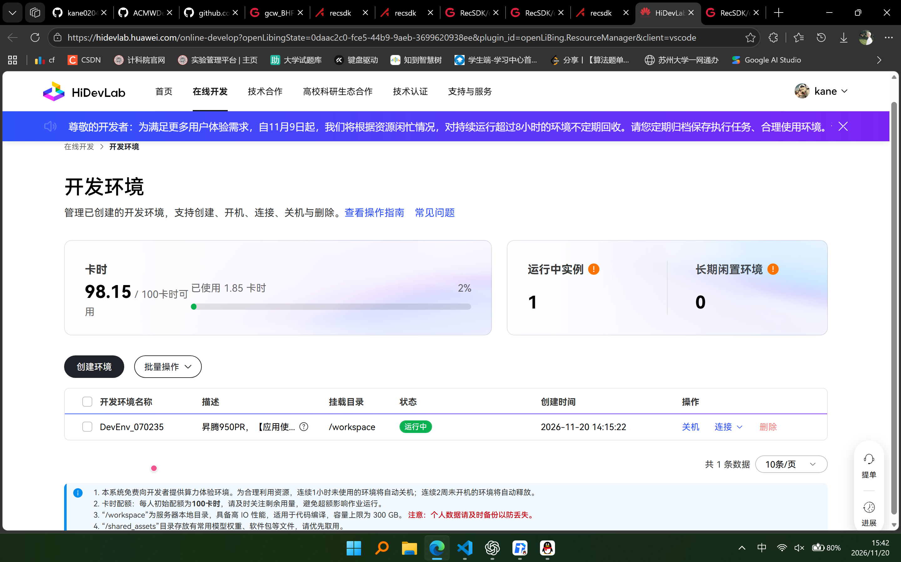
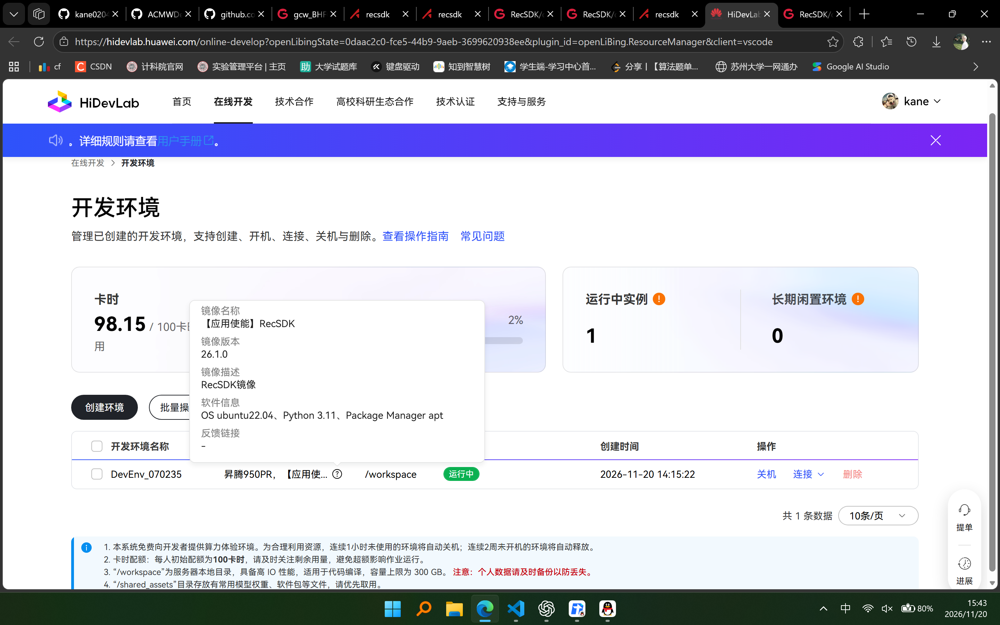
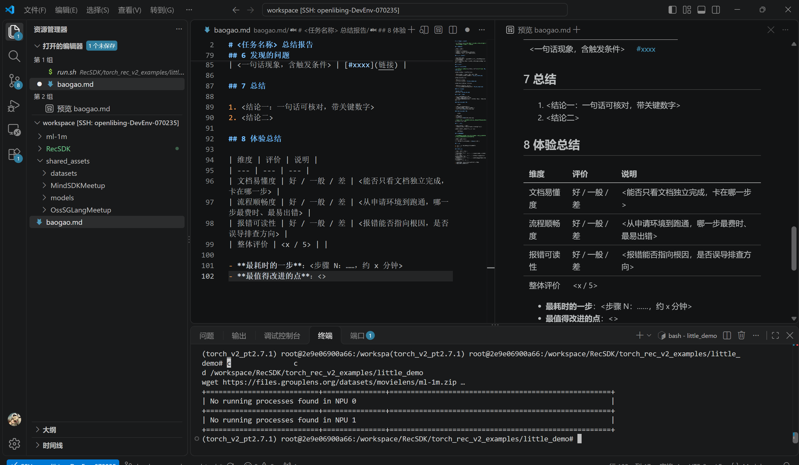
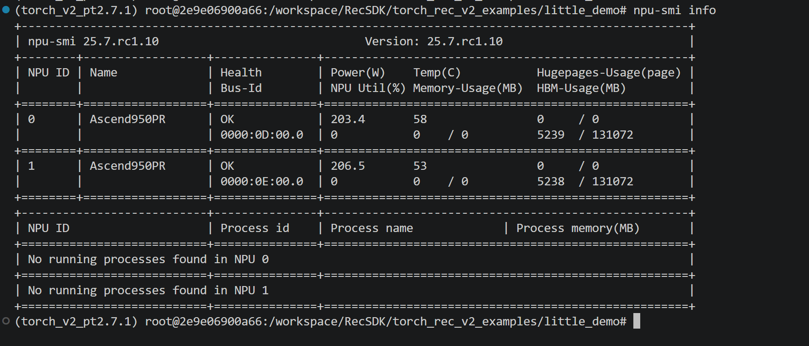
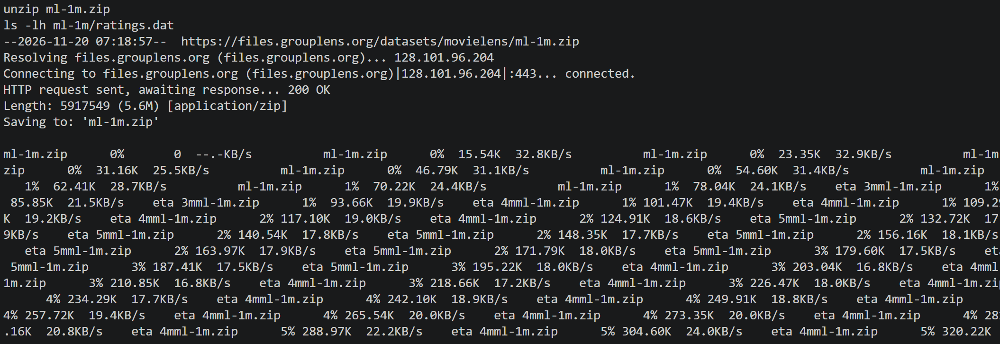
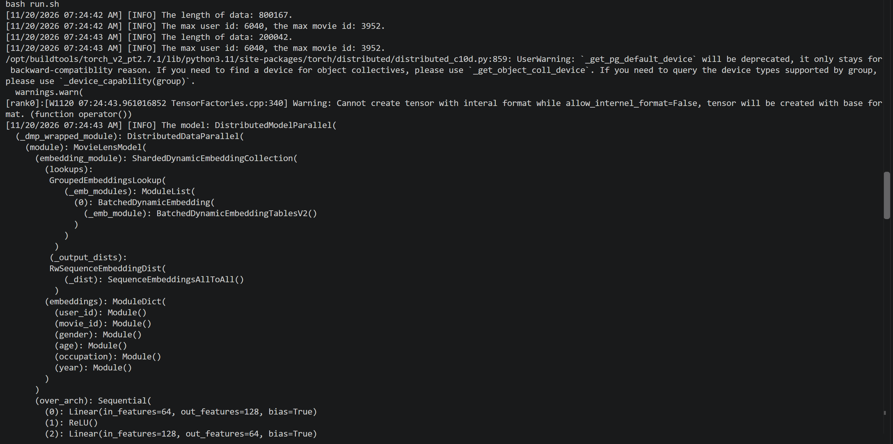
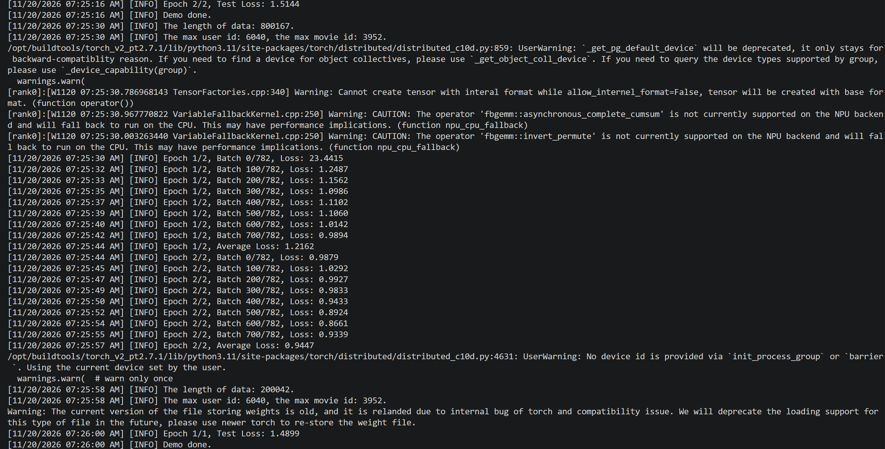

# RecSDK little_demo 模型样例验证报告

> **一句话结论**：达成目标；关键阻塞点：无；关键指标：2 张 Ascend 950PR 均健康，日志中两次输出 `Demo done`，两次可见的 `Test Loss` 分别为 1.5144 和 1.4899，口径为 `little_demo/run.sh` 运行日志中的测试结果。

## 1 文档信息

| 项目 | 内容 |
| --- | --- |
| 文档类型 | 验证报告 |
| 提交人 | GitCode ID：gcw_BHF0x88x |
| 文档版本 / 日期 | v1 / 2026-11-20 |

## 2 任务背景与目标

- **任务目标**：参考 RecSDK 文档，基于指定的版本镜像，使用 RecSDK 跑通相关模型、算子样例。
- **任务结果**：达成目标；关键阻塞点：无；关键指标：2 张 Ascend 950PR 均健康，日志中两次输出 `Demo done`，两次可见的 `Test Loss` 分别为 1.5144 和 1.4899，口径为 `little_demo/run.sh` 运行日志中的测试结果。

## 3 环境准备

### 3.1 环境创建步骤

> 按实际创建顺序记录，**每步必须配截图**，截图命名 `NN_内容.png`。

**步骤 1：申请 / 创建算力环境**

- 操作：使用 HiDevLab 创建开发环境 `DevEnv_070235`，配置 2 张 Ascend 950PR，单卡 HBM 为 131072 MB。
- 截图：平台创建页或实例列表 → `01_env_create.png`



**步骤 2：选择镜像**

- 操作：选择 `[应用使能] RecSDK` 镜像，版本为 26.1.0；软件环境为 Ubuntu 22.04、Python 3.11、Package Manager 为 apt。
- 截图：镜像选择页 → `02_env_image.png`



**步骤 3：启动并登录开发环境**

- 操作：通过 VSCode Remote SSH 连接 `workspace [SSH: openlibing-DevEnv-070235]`，进入容器终端并确认 Python 环境提示符正常显示。
- 截图：登录成功后的终端提示符 → `03_env_login.png`



### 3.2 环境信息

`npu-smi info`

**截图**：`04_npu_smi.png`



检测到 NPU 0 和 NPU 1 两张 Ascend 950PR，健康状态均为 `OK`，单卡 HBM 为 131072 MB。

## 4 实际执行步骤

- **任务入口文档**：[RecSDK README](../../README.md)
- **样例 / 代码路径**：`/workspace/RecSDK/torch_rec_v2_examples/little_demo`；[little_demo 样例](../../torch_rec_v2_examples/little_demo/)
- **是否修改样例代码**：否

### 步骤 1：准备 MovieLens 1M 数据集

```text
wget https://files.grouplens.org/datasets/movielens/ml-1m.zip
unzip ml-1m.zip
ls -lh ml-1m/ratings.dat
```

- **预期**：下载并解压 MovieLens 1M 数据集，生成 `./ml-1m/ratings.dat`，后续训练能够读取数据。
- **实际**：成功；`run.sh` 日志显示数据集能够正常读取，训练集和测试集数据长度分别为 800167 和 200042。
- **截图**：

### 步骤 2：执行 run.sh 启动 little_demo

```text
bash run.sh
```

- **预期**：完成数据加载和模型初始化并开始训练，日志输出 `Demo done`，无中断异常。
- **实际**：成功；模型结构正常打印，`Epoch 1/2 Average Loss: 1.2162`，`Epoch 2/2 Average Loss: 0.9447`，最终测试损失为 `1.4899`，日志输出 `Demo done`。
- **截图**：

> 步骤按实际执行顺序编号，命令保持原样、不改写、不美化；**每步必须配截图**。

## 5 执行结果

- **结论**：通过
- **判据**：`bash run.sh` 正常完成模型初始化、训练和测试，日志输出 `Demo done`，未出现导致任务中断的异常栈。

关键输出（日志原文或截图，二选一）：

```text
[11/20/2026 07:25:44 AM] [INFO] Epoch 1/2, Average Loss: 1.2162
[11/20/2026 07:25:57 AM] [INFO] Epoch 2/2, Average Loss: 0.9447
[11/20/2026 07:26:00 AM] [INFO] Epoch 1/1, Test Loss: 1.4899
[11/20/2026 07:26:00 AM] [INFO] Demo done.
```



## 6 发现的问题

本次未发现问题。

验证覆盖了 `torch_rec_v2_examples/little_demo` 的环境初始化、MovieLens 数据读取、模型构建、`run.sh` 执行、训练和测试过程。运行日志中虽有部分算子回退到 CPU 的性能提示，但未造成程序中断，不影响本次样例跑通结果。

## 7 总结

1. 使用 RecSDK 26.1.0 镜像，在 2 张 Ascend 950PR 环境中成功跑通 `little_demo`，日志两次输出 `Demo done`，任务目标已达成。
2. `npu-smi info` 显示两张 NPU 的健康状态均为 `OK`，单卡 HBM 为 131072 MB；日志中的训练集和测试集数据长度分别为 800167 和 200042。
3. 日志中两次可见的测试损失分别为 `Epoch 2/2 Test Loss: 1.5144` 和 `Epoch 1/1 Test Loss: 1.4899`，训练正常结束，无异常中断。
4. 本次验证未发现影响功能跑通的缺陷；部分算子回退到 CPU 仅涉及性能，不影响样例结果。

## 8 体验总结

| 维度 | 评价 | 说明 |
| --- | --- | --- |
| 文档易懂度 | 好 | 代码路径、运行入口和训练输出较明确，能够独立完成环境准备、数据准备和 `run.sh` 执行。 |
| 流程顺畅度 | 好 | 环境启动后可通过单个脚本跑通样例，训练过程稳定，训练、测试和 `Demo done` 均正常完成。 |
| 报错可读性 | 好 | 日志能够直接显示动态库、数据路径及算子兼容性信息，便于判断问题位置。 |
| 整体评价 | 5 / 5 | 功能验证成功，执行结果完整，日志具备可追溯性。 |

- **最耗时的一步**：数据下载与准备，约 6 分钟；
- **最值得改进的点**：可在快速开始文档中补充数据集下载和路径配置提示，以减少首次运行前的准备步骤。
