# 完成RecSDK TorchRec-V2环境配置与基础验证 总结报告

> **一句话结论**：在 HiDevLab 昇腾950PR 单卡、RecSDK 26.1.0 镜像上跑通官方 Little Demo；训练与保存加载验证共出现 2 次 `Demo done.`，完整启动命令退出码为 0。环境切换脚本路径与入口文档存在差异，已使用镜像内实际脚本完成配置；问题反馈已发布，见第6节。

## 1 文档信息

| 项目 | 内容 |
| --- | --- |
| 文档类型 | 环境与样例功能验证报告 |
| 提交人 | GitCode ID：gcw_PHMOi25Z |
| 文档版本 / 日期 | v2 / 2026-11-21 |
| 验证方式 | 通过浏览器 WebIDE 连接既有云端容器并执行官方样例 |
| 提交目标 | Ascend/RecSDK 的 experimental 分支下 experimental 目录 |

## 2 任务背景与目标

- **任务目标**：在昇腾950PR环境启用 RecSDK TorchRec-V2 配套组件，运行官方 Little Demo，完成训练、模型保存、加载及推理验证，并留存截图、原始日志和体验总结。
- **任务结果**：样例功能验证通过。官方 `run.sh` 未修改，采用默认参数运行；两个子流程均输出 `Demo done.`。
- **关键指标**：MovieLens-1M 原始评分记录 1,000,209 条；样例日志中的训练集 800,167 条、测试集 200,042 条；首个训练流程第2轮平均训练损失 0.9454，测试损失 1.5389；保存后加载流程的测试损失 1.5067。这些数值用于记录本次运行，不作为业务精度验收指标。
- **范围**：本次覆盖950PR单卡、默认 Adam 优化器和默认2轮训练；未覆盖多卡、950DT、其他优化器或吞吐性能评测。

## 3 环境准备

### 3.1 环境创建与接入步骤

**步骤 1：回查已创建的算力环境**

实例由开发者于2026-11-20创建，本次接手继续使用。实例名 `DevEnv_508636`，平台显示昇腾950PR、1NPU、32G内存、32核CPU、300G存储，挂载目录 `/workspace`。本次没有重新创建实例。

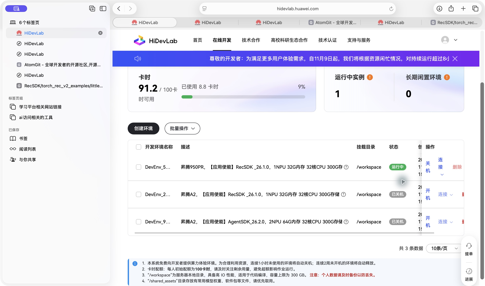

**步骤 2：核对已选择镜像**

实例列表显示镜像为 `【应用使能】RecSDK _26.1.0`。下图为开发者提供的操作前截图，作为既有镜像配置证据；未保留首次创建时的镜像选择弹窗。

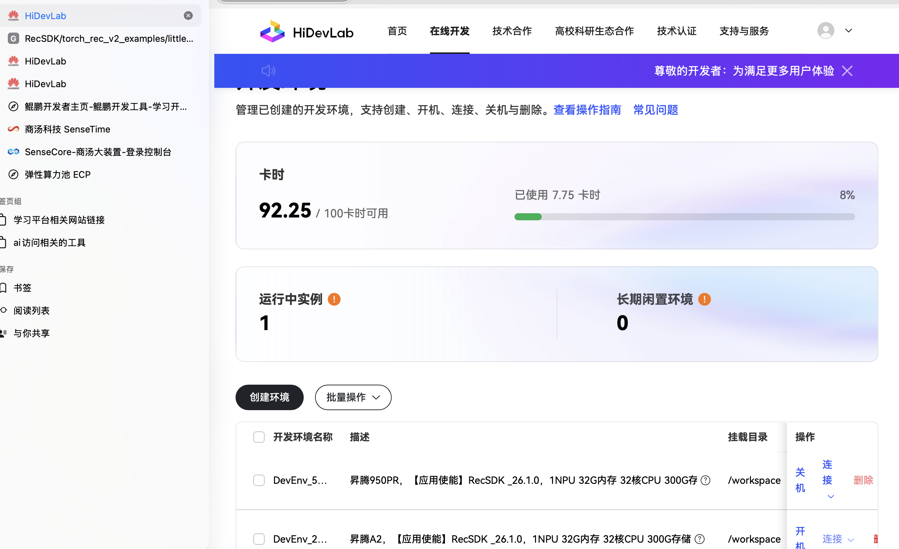

**步骤 3：通过浏览器启动并登录开发环境**

在对应实例“连接”菜单选择 WebIDE。Safari 首次拦截弹出窗口后，点击地址栏的被拦截窗口按钮打开开发页，在开发工具内新建终端。登录后能够运行命令，后续进入样例目录。

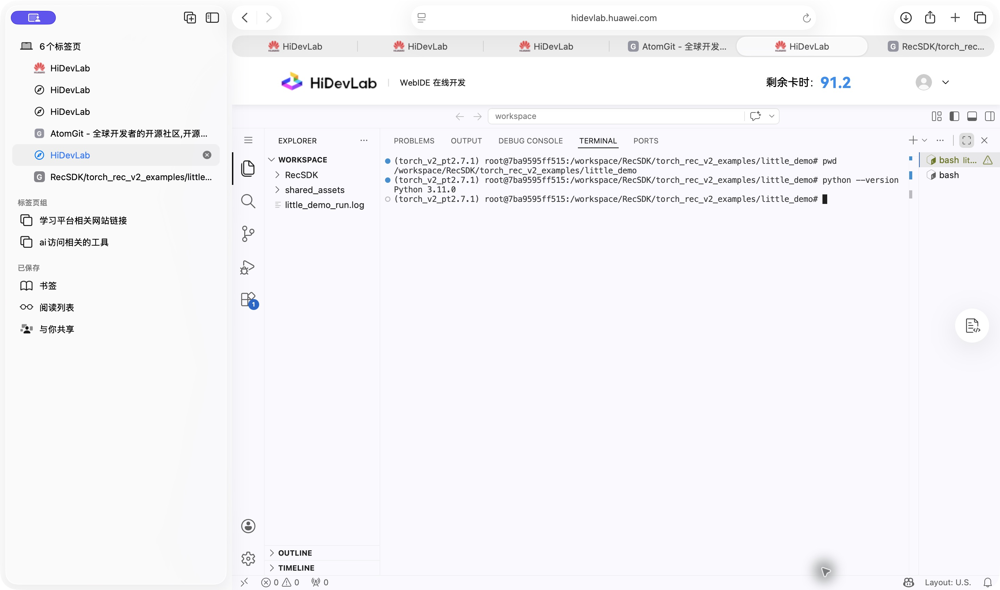

截图说明：终端截图均来自真实云端页面；登录、版本、代码及数据核对截图包含运行完成后的回查，设备截图为训练期间复核。操作前截图与本次截图分别标明，未将回查截图表述为首次创建记录。

### 3.2 环境信息

先执行以下命令确认设备可用，训练期间再次复核：

```bash
npu-smi info
```

实际显示 `Ascend950PR`、健康状态 `OK`、设备编号0。截图中的 Python 计算进程为训练期间的设备使用证据。设备工具显示 HBM 总量131072 MB；这与平台配置中的“32G内存”属于不同字段，分别记录。

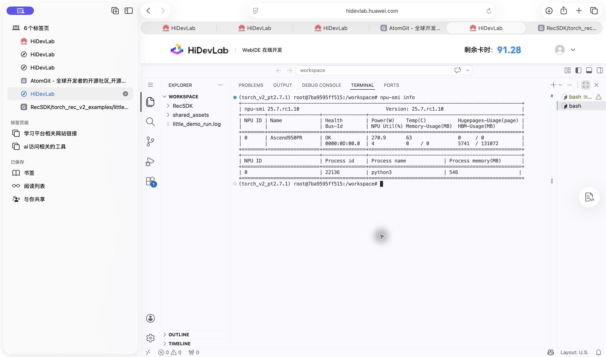

| 项目 | 本次实际值 |
| --- | --- |
| 容器系统 | Ubuntu 22.04.5 LTS，x86_64 |
| 芯片 / 使用数量 | Ascend950PR / 1 |
| npu-smi 版本 | 25.7.rc1.10 |
| CANN目录 | `/usr/local/Ascend/cann-9.1.0-beta.3` |
| Python | 3.11.0 |
| Python虚拟环境 | `/opt/buildtools/torch_v2_pt2.7.1` |
| torch | 2.7.1+cpu |
| torch_npu | 2.7.1.post4 |
| torch-rec-v2 | 26.1.0 |
| fbgemm-ascend / fbgemm_gpu | 1.2.0 / 1.2.0+cpu |
| numpy | 2.4.6 |

`torch`版本中的`+cpu`是本次安装包版本标识；本次同时加载了`torch_npu`，芯片可用性检查返回`True`，且训练期间设备上出现Python进程，不能仅凭版本后缀判断运行设备。

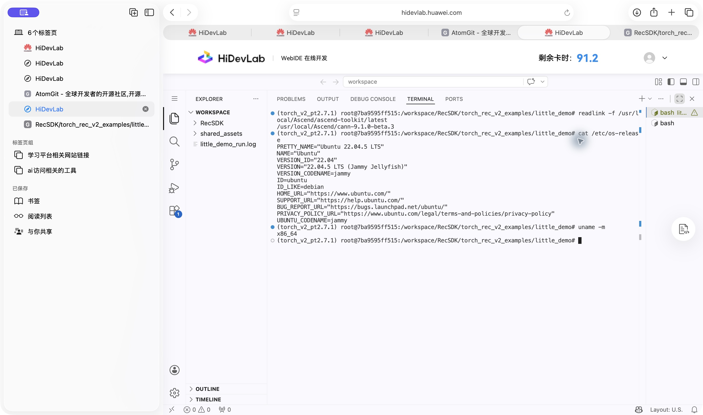

## 4 实际执行步骤

- **任务入口文档**：[TorchRec-V2快速入门](https://gitcode.com/Ascend/RecSDK/blob/develop/docs/zh/torch/torch_rec_v2/03_quick_start/quick_start.md)
- **平台参考**：[使用HiDevLab进行RecSDK开发](https://gitcode.com/Ascend/RecSDK/wiki/使用HiDevLab进行RecSDK开发.md)
- **样例路径**：[Little Demo](https://gitcode.com/Ascend/RecSDK/tree/develop_examples_and_tools/torch_rec_v2_examples/little_demo)
- **样例分支**：`develop_examples_and_tools`
- **实际提交版本**：`80cead5c7f770c887de012ad5a41e3f9e0329cce`
- **是否修改样例代码**：否；`git diff --stat`无输出。下载数据和日志属于运行产物。

### 步骤 1 配置运行环境

入口文档中的以下命令实际报错，提示文件不存在：

```bash
source /usr/local/set_cann_env.sh a5
```

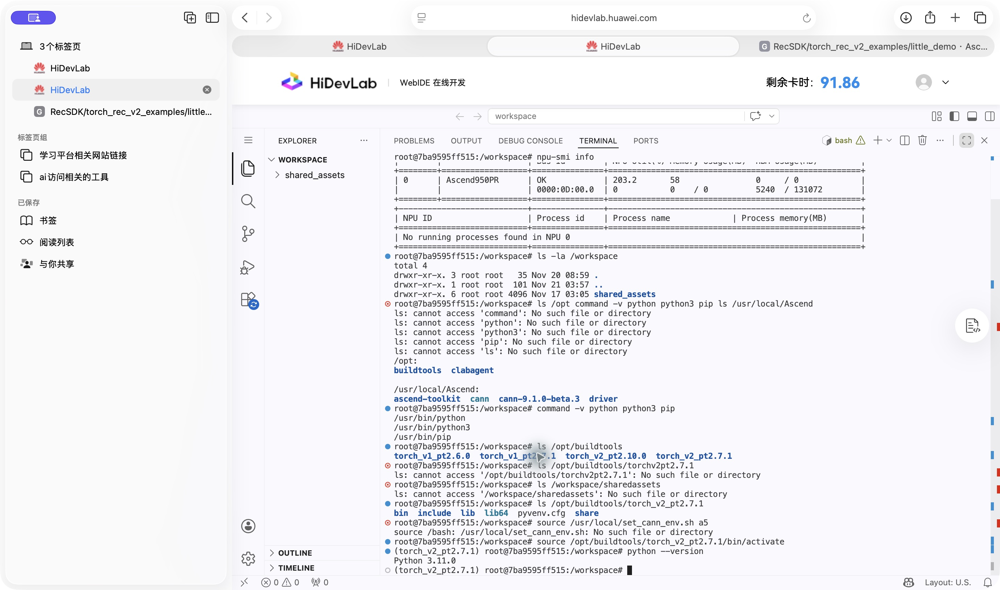

检查实际安装目录后，使用镜像已有脚本，并启用配套虚拟环境：

```bash
source /usr/local/Ascend/ascend-toolkit/set_env.sh
source /opt/buildtools/torch_v2_pt2.7.1/bin/activate
python --version
pip list | grep -Ei "torch|fbgemm|numpy"
```

- **预期**：工具链生效，解释器和推荐组件可使用。
- **实际**：环境启用成功，Python为3.11.0，版本列表见截图；未重新安装或升级镜像内组件。
- **处理说明**：此处是26.1.0镜像与当前入口文档之间的路径差异，不据此推断其他镜像也存在相同问题。

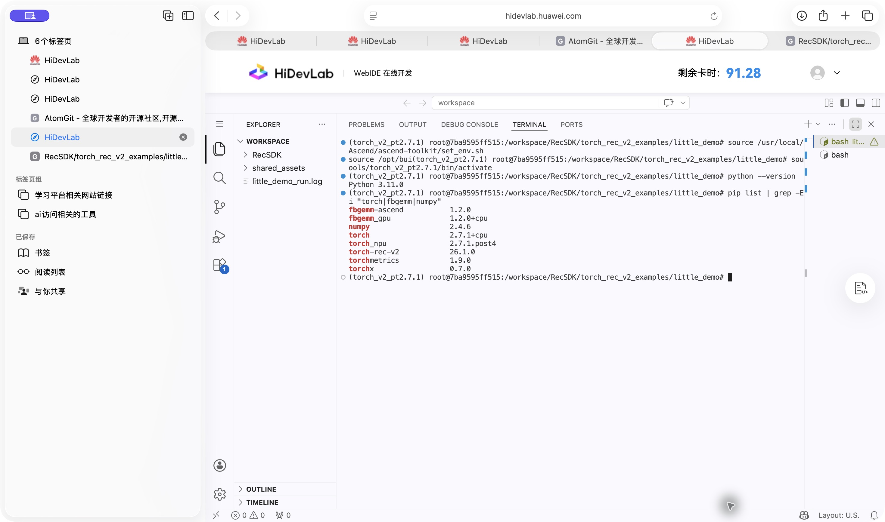

### 步骤 2 获取并核对官方样例

在`/workspace`执行：

```bash
git clone --depth 1 -b develop_examples_and_tools https://gitcode.com/Ascend/RecSDK.git
cd /workspace/RecSDK/torch_rec_v2_examples/little_demo
```

运行完成后回查：

```bash
git -C /workspace/RecSDK branch --show-current
git -C /workspace/RecSDK rev-parse HEAD
git -C /workspace/RecSDK diff --stat
```

- **预期**：取得官方示例分支，并记录可复查版本。
- **实际**：下载成功，分支和完整提交号与上文一致，样例受版本控制文件未修改。

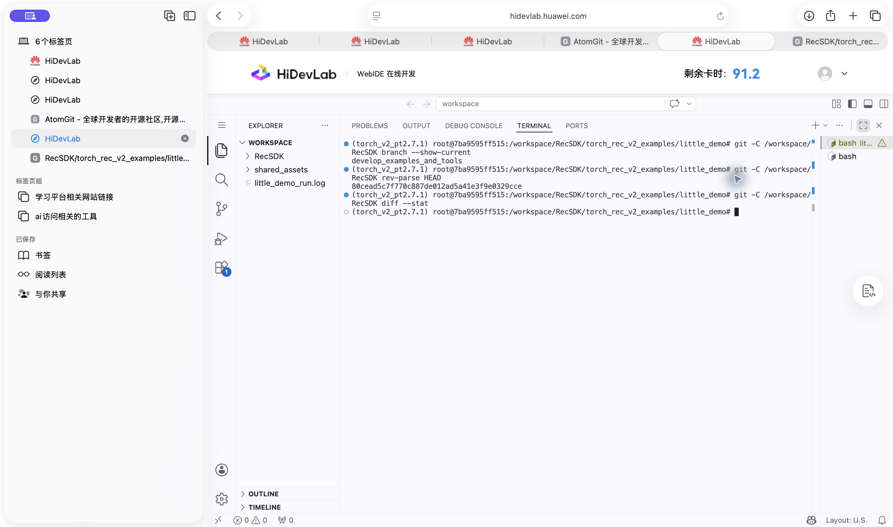

### 步骤 3 下载并解压MovieLens数据

```bash
curl -fL --retry 2 -o ml-1m.zip https://files.grouplens.org/datasets/movielens/ml-1m.zip
unzip -q ml-1m.zip
```

完成后核对数据：

```bash
wc -l ml-1m/ratings.dat
sha256sum ml-1m.zip
```

- **预期**：当前目录下出现`ml-1m`数据目录。
- **实际**：下载和解压成功，评分文件1,000,209行。下载界面显示耗时4分39秒。
- **压缩包SHA256**：`a6898adb50b9ca05aa231689da44c217cb524e7ebd39d264c56e2832f2c54e20`

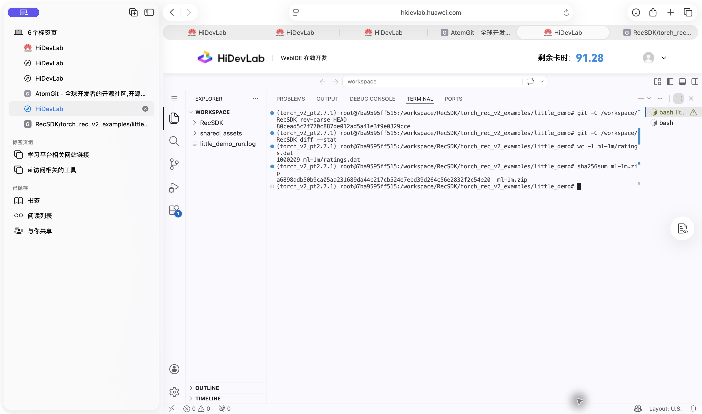

### 步骤 4 检查组件导入及设备可用性

在单独检查终端启用同一工具链和虚拟环境后，直接导入`dynamic_emb`时提示找不到`libdynamic_emb_op_npu.so`。实际文件存在，补齐官方`run.sh`所使用的动态库搜索目录后成功：

```bash
export LD_LIBRARY_PATH=/opt/buildtools/torch_v2_pt2.7.1/lib/python3.11/site-packages:/opt/buildtools/torch_v2_pt2.7.1/lib/python3.11/site-packages/rec_sdk_common/lib:$LD_LIBRARY_PATH
python -c "import torch, torch_npu, dynamic_emb; print(torch.__version__); print(torch.npu.is_available())"
```

- **预期**：组件可导入，设备可用性返回真。
- **实际**：输出`2.7.1+cpu`和`True`。
- **说明**：此项为独立导入检查。正式样例运行使用原版`run.sh`，它自行设置`PYTHONPATH`和`LD_LIBRARY_PATH`；本次没有因这条独立检查而修改样例脚本。

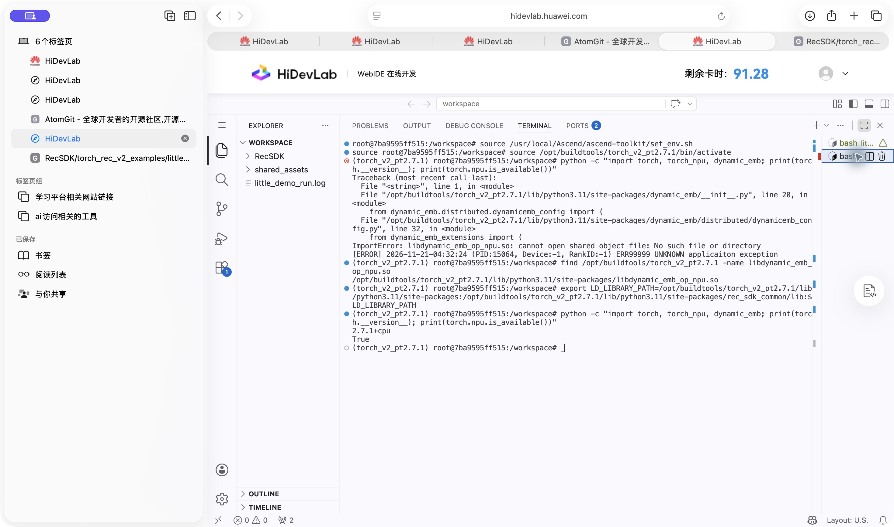

### 步骤 5 运行完整示例并保存日志

在样例目录执行：

```bash
set -o pipefail
bash run.sh 2>&1 | tee /workspace/little_demo_run.log
```

- **预期**：完成训练，以及训练后保存、加载、推理的完整流程，显示`Demo done.`。
- **实际**：两个阶段均完成，各输出一次`Demo done.`；使用默认参数，每个训练阶段2轮，批大小1024，单进程单卡，默认Adam。
- **日志**：[原始完整运行日志](little_demo_run.log)。文件保留云端原始时间戳和告警内容；时间戳采用云端时钟，不改写为本地时间。

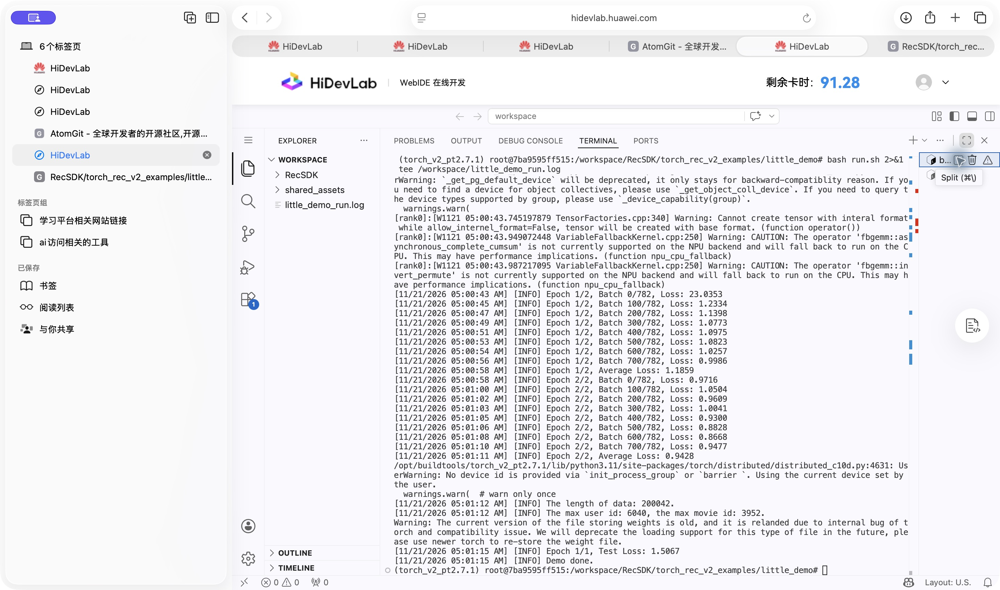

### 步骤 6 核对退出状态和完成标记

运行结束后执行：

```bash
echo RUN_EXIT_CODE=$?
grep -E "Demo done|Average Loss|Test Loss|Traceback|ERROR" /workspace/little_demo_run.log
```

- **预期**：退出码为0，两个流程结束，日志无异常栈或错误级输出。
- **实际**：`RUN_EXIT_CODE=0`；检出2次`Demo done.`；完整日志中未出现`Traceback`或`ERROR`。日志包含告警，详见第6节。

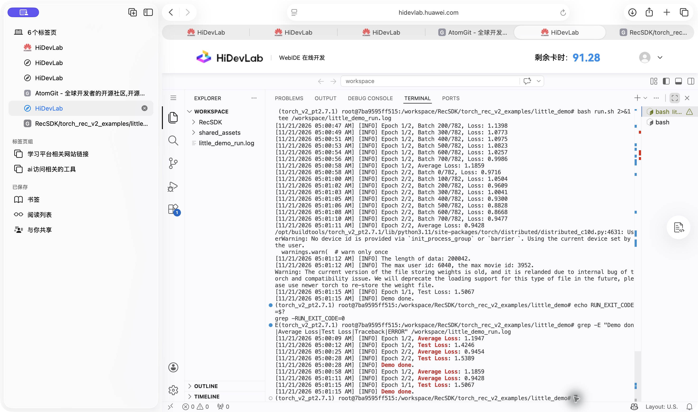

## 5 执行结果

**结论：环境与样例功能验证通过。**

判据为官方启动脚本实际运行、两个子流程完成、完整命令退出码0。日志首条信息到最后完成标记的时间间隔为81秒（04:59:54至05:01:15，云端原始时间）；该间隔不包含环境接入、数据下载，也不等同于严格测量的程序总耗时或吞吐性能。

| 流程 | 训练轮次 | 最后一轮平均训练损失 | 最后测试损失 | 完成标记 |
| --- | --- | --- | --- | --- |
| 训练及测试 | 2 | 0.9454 | 1.5389 | Demo done. |
| 训练 保存 加载 测试 | 2 | 0.9428 | 1.5067 | Demo done. |

关键输出原文节选：

```text
[11/21/2026 05:00:25 AM] [INFO] Epoch 2/2, Average Loss: 0.9454
[11/21/2026 05:00:28 AM] [INFO] Epoch 2/2, Test Loss: 1.5389
[11/21/2026 05:00:28 AM] [INFO] Demo done.
[11/21/2026 05:01:11 AM] [INFO] Epoch 2/2, Average Loss: 0.9428
[11/21/2026 05:01:15 AM] [INFO] Epoch 1/1, Test Loss: 1.5067
[11/21/2026 05:01:15 AM] [INFO] Demo done.
```

首个流程的测试损失从第1轮1.4246增加至第2轮1.5389。本任务验收的是环境和功能完整性，不将训练损失下降解释为泛化能力或推荐效果达标。

## 6 发现的问题

本次实际问题及文档改进建议已在官方仓库发布，链接如下。问题反馈用于请维护者确认和改进文档，本报告未修改产品源码或宣称已修复这些问题。

| 问题 | 处理或建议 | 提交issue |
| --- | --- | --- |
| 当前快速入门要求的`/usr/local/set_cann_env.sh a5`在本次26.1.0镜像不存在 | 使用镜像内`/usr/local/Ascend/ascend-toolkit/set_env.sh`后成功；建议按镜像版本列出路径，并在命令前增加存在性检查 | [问题单 #1465](https://gitcode.com/Ascend/RecSDK/issues/1465) |
| 成功运行仍输出CPU回退及权重格式兼容告警，新手难以判断是否通过 | 建议文档解释预期告警与失败判据，并说明回退的性能含义；当前功能验证通过，不推断性能无影响 | [问题单 #1466](https://gitcode.com/Ascend/RecSDK/issues/1466) |

日志中`fbgemm::asynchronous_complete_cumsum`和`fbgemm::invert_permute`提示回退到CPU；此外有接口弃用、张量格式和权重文件格式兼容提示。它们没有中止本次流程。本次未测量告警的性能影响，也未将告警直接判定为算法缺陷。

独立导入时的动态库搜索路径问题可通过官方`run.sh`的路径配置解决，作为操作说明保留，不单独认定为组件缺失。

## 7 总结

1. 在HiDevLab昇腾950PR单卡上，通过RecSDK 26.1.0镜像完成默认Little Demo验证，真实获得2次完成标记和退出码0。
2. 原版样例代码未修改，保留完整提交号、数据校验值、原始日志及对应截图，可按命令复查。
3. 主要文档差异已有可用处理方式；两份问题反馈已发布并补齐链接，本报告提交到官方实验分支供维护者审阅。

## 8 体验总结

| 维度 | 评价 | 说明 |
| --- | --- | --- |
| 文档易懂度 | 一般 | 入口给出示例与虚拟环境路径，但当前镜像的CANN脚本位置与文档不同；连接方式和成功告警的解释对新手不足 |
| 流程顺畅度 | 一般 | 预置软件可直接使用；Safari弹窗和终端剪贴板限制增加接入成本，命令需确认输入法及符号完整性 |
| 报错可读性 | 一般 | 缺失路径和动态库名称较明确，但对新手不易区分“未安装”与“未配置搜索位置” |
| 整体评价 | 3 / 5 | 本次操作体验评价，供文档优化参考 |

- **最耗时的一步**：网页接入与终端输入适配，包含弹窗拦截、剪贴板和输入法符号排查；没有独立计时，不估算精确分钟数。可直接量化的数据下载耗时为4分39秒。
- **最值得改进的点**：为HiDevLab预置镜像提供按版本维护的一页式指引，明确连接方式、环境启用命令、数据准备、两个成功标记以及常见告警。
- **新手操作经验**：交流可以用中文，命令必须保留原始字符；输入命令时使用英文输入状态，并逐条核对目录名中的下划线、引号及管道符。
