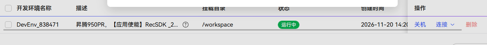
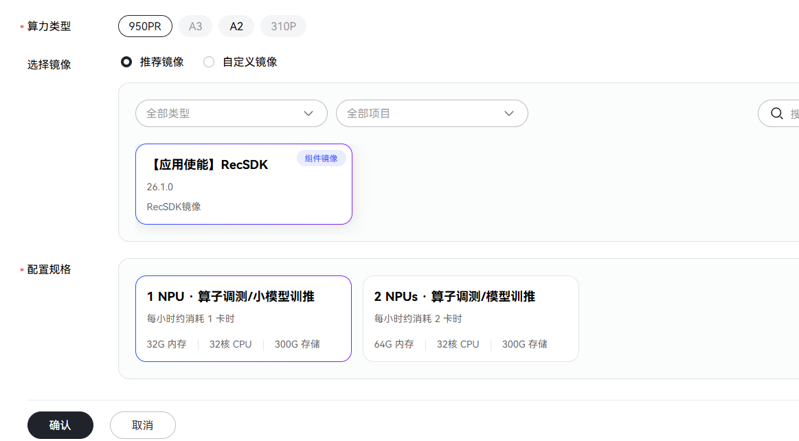
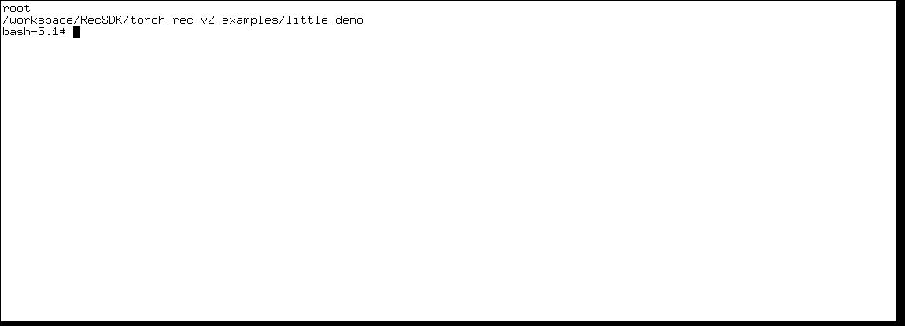
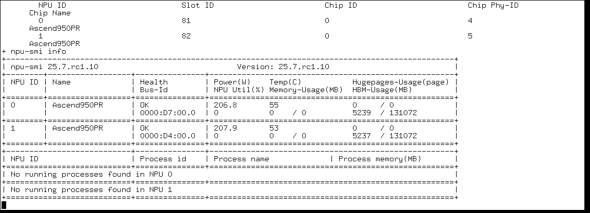
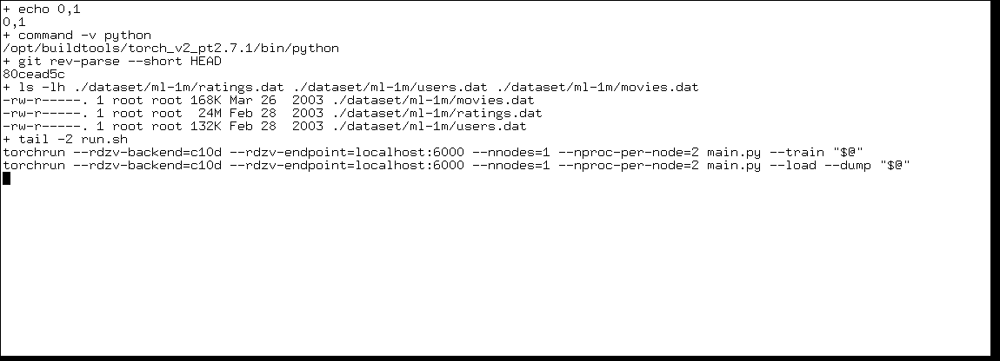
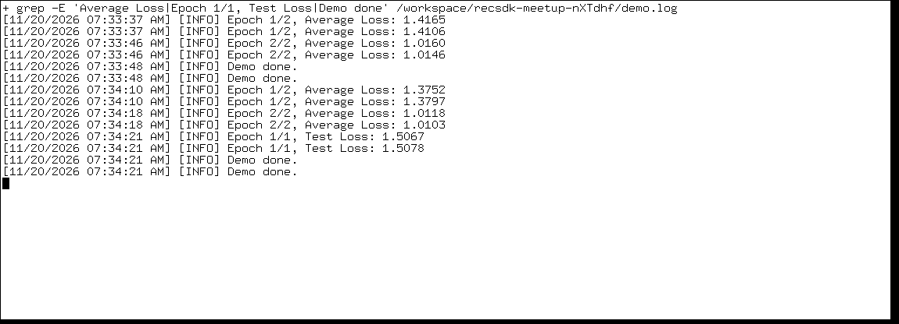

# 完成RecSDK TorchRec-V2环境配置与基础验证 总结报告

> **一句话结论**：双卡 Little Demo 功能验证通过，最终加载测试的两条 Test Loss 为 1.5067 和 1.5078，脚本退出码为 0。单卡运行阻塞在 HCCL 初始化。已附平台与终端截图、运行日志及两条 Issue。

## 1 文档信息

| 项目 | 内容 |
| --- | --- |
| 文档类型 | 验证报告 |
| 提交人 | GitCode ID：huayuanhaoge |
| 文档版本 / 日期 | v1 / 2026-11-20 |

## 2 任务背景与目标

- **任务目标**：在 HiDevLab 昇腾 950PR 环境按官方 Quick Start 运行 MovieLens-1M 样例，完成训练、保存、加载和测试，记录完成标记并提交运行证据。
- **任务结果**：两张 NPU、每卡一个进程时通过。同一容器分别隔离单卡运行时，首次通信同步报错 19。最终测试数据集长度为 200042，两个进程分别打印完成标记。

## 3 环境准备

### 3.1 环境创建步骤

1. **申请 / 创建算力环境**。平台为 HiDevLab。容器中可见 2 张 Ascend 950PR，`npu-smi info` 显示每张卡 HBM 总量 131072 MB。实例列表显示 `DevEnv_838471` 运行中，挂载目录为 `/workspace`。


2. **选择镜像**。任务指定「【应用使能】RecSDK」。容器内实测 RecSDK 26.1.0、Ubuntu 22.04.5。镜像选择页显示 950PR 和「【应用使能】RecSDK」26.1.0，截图中高亮规格为 1 NPU；成功复跑的实际设备数见 3.2 的设备截图。这里将两者分别记录。


3. **启动并登录开发环境**。通过平台跳板机以 SSH 登录已启动的容器，进入样例目录。下图为本次验收期间补采的当前会话终端。



### 3.2 环境信息

```bash
npu-smi info -m
npu-smi info
```

逻辑卡 0、1 对应物理卡 4、5。驱动为 25.7.rc1.10，CANN 为 9.1.0-beta.3，Python 为 3.11，PyTorch 为 2.7.1。



## 4 实际执行步骤

- **任务入口文档**：[RecSDK TorchRec-V2 快速入门](https://gitcode.com/Ascend/RecSDK/blob/develop/docs/zh/torch/torch_rec_v2/03_quick_start/quick_start.md)
- **样例 / 代码路径**：[torch_rec_v2_examples/little_demo](https://gitcode.com/Ascend/RecSDK/tree/develop_examples_and_tools/torch_rec_v2_examples/little_demo)，本次提交 80cead5c。
- **是否修改样例代码**：是。运行前 run.sh 中训练和加载两条 torchrun 命令均已从 `--nproc-per-node=1` 改为 `--nproc-per-node=2`，以便在两张可见卡上各启动一个进程。将两处参数改回 1 可回退。模型源码未作本次运行所需的修改。

### 步骤 1：定位样例，加载环境并选择两张卡

工作目录为 `/workspace/RecSDK/torch_rec_v2_examples/little_demo`。仓库已检出，MovieLens-1M 已解压至 `./dataset/ml-1m`。复跑时，以下是启动命令前实际执行的准备部分：

```bash
proof=$(mktemp -d /workspace/recsdk-meetup-XXXXXX); echo "$proof"; source /usr/local/Ascend/cann/set_env.sh && source /opt/buildtools/torch_v2_pt2.7.1/bin/activate && export ASCEND_RT_VISIBLE_DEVICES=0,1
```

**预期**：Python 来自镜像内的 TorchRec-V2 环境，数据文件可读，两张卡可见。**实际**：工作目录下有 ratings.dat、users.dat、movies.dat，两个 torchrun 阶段均使用两个进程。下图为复核时的输出。



### 步骤 2：运行样例并记录退出码

以下为上一步准备成功后执行的子命令，保留了当时的脚本参数、日志位置及退出码检查。

```bash
(set -o pipefail; bash -e run.sh --data_path ./dataset/ml-1m --save_dir "$proof/checkpoints" 2>&1 | tee "$proof/demo.log"; echo "RUN_EXIT=$?")
```

**预期**：训练与加载阶段完成，最终输出 `Demo done.`，退出码为 0。**实际**：终端输出 `RUN_EXIT=0`。截图为在容器终端从本次运行日志提取的损失和完成标记。



## 5 执行结果

**结论**：双卡功能验证通过。判据为两个启动阶段执行成功，加载后的测试输出损失与完成标记。下列时间取自容器日志，数值按出现顺序记录。完整输出见 [demo.log](evidence/demo.log)。

```text
[11/20/2026 07:34:21 AM] [INFO] Epoch 1/1, Test Loss: 1.5067
[11/20/2026 07:34:21 AM] [INFO] Epoch 1/1, Test Loss: 1.5078
[11/20/2026 07:34:21 AM] [INFO] Demo done.
[11/20/2026 07:34:21 AM] [INFO] Demo done.
```

## 6 发现的问题

| 问题 | 提交 Issue |
| --- | --- |
| 两张卡分别隔离运行时，单卡首次 HCCL barrier 返回错误 19，底层虚拟网卡查询返回 128303 | [#1451](https://gitcode.com/Ascend/RecSDK/issues/1451) |
| 当前 HiDevLab 镜像未提供文档示例的 /usr/local/set_cann_env.sh，实际通过 /usr/local/Ascend/cann/set_env.sh 加载成功 | [#1452](https://gitcode.com/Ascend/RecSDK/issues/1452) |

运行日志还提示三个 FBGEMM 算子回退至 CPU，并提示基础张量格式、当前设备选择和旧权重格式。此次验证未测量这些提示对性能的影响。

## 7 总结

1. 两进程配置完成 2 个训练 epoch，最终加载测试的两条损失读数均有对应完成标记。
2. 单卡测试在读取训练批次前即失败，两张卡分别复现；双卡运行成功的结果可与两份单卡日志对照。

## 8 体验总结

| 维度 | 评价 | 说明 |
| --- | --- | --- |
| 文档易懂度 | 一般 | 数据集路径和成功判据清楚；环境脚本需按镜像调整。 |
| 流程顺畅度 | 一般 | 单卡通信初始化需单独排查，双卡复跑可按样例脚本完成。 |
| 报错可读性 | 一般 | Python 错误栈定位到 barrier，进一步判断需要关联同进程的 plog。 |
| 整体评价 | 3 / 5 | 按本次实际体验评定。主流程可验证，环境与通信排查说明仍可改善。 |

- **最耗时的一步**：步骤 2 的单卡故障排查。容器记录从首次错误 06:46 到两张卡分别隔离复核结束 06:55，跨度约 9 分钟，含两次测试之间的排查间隔。双卡成功复跑从 07:33:19 启动日志至 07:34:21 最终测试约 62 秒。
- **最值得改进的点**：在设备识别与运行样例之间加入最小 HCCL 同步检查，说明如何核对镜像脚本、逻辑卡映射和对应进程的 plog。
