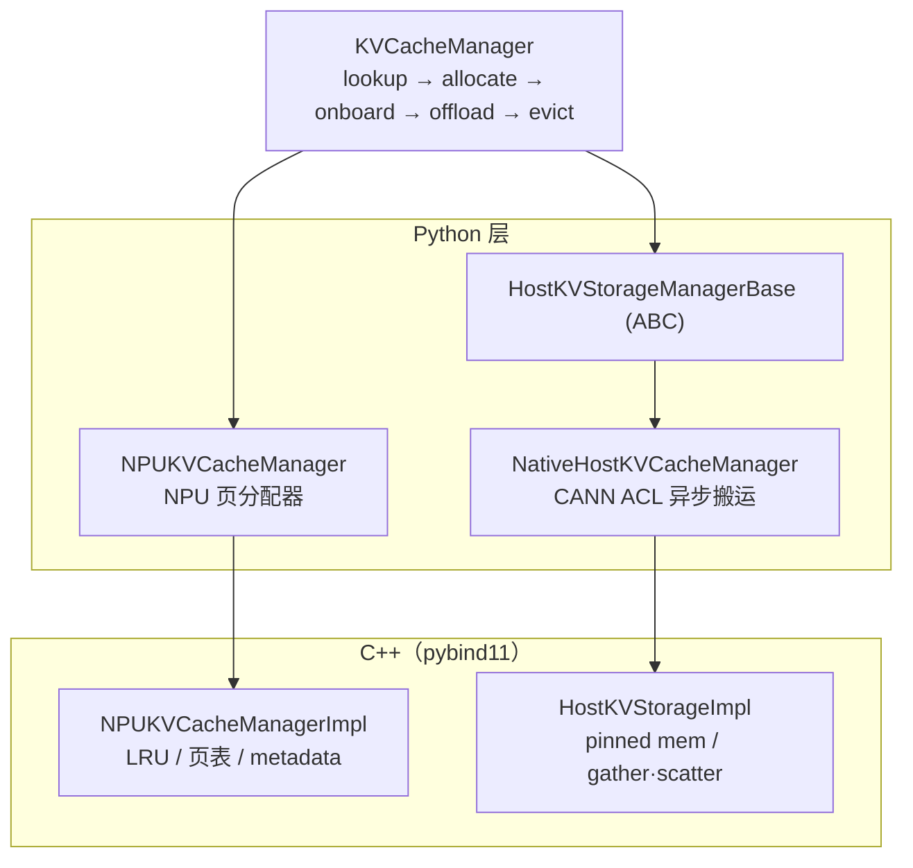

# recsys_kvcache_manager

本组件是 Ascend 950PR 系列产品上面向生成式推荐模型（如 HSTU）推理场景的 KV cache 管理器，兼容 LLM 的 paged KV cache 格式，提供 KV 数据的缓存、存储与查询能力。组件以推荐系统 user ID 为粒度管理 KV cache，支持同一用户的历史 KV 跨请求复用。

组件基于 PyTorch 生态，将 KV 数据组织在 NPU 显存与主机锁页内存两级存储中：NPU 显存保存当前推理可直接读取的分页缓存，主机内存保存可换入的历史前缀，显存不足时按 LRU 回收。主要能力有：

- `lookup`：查询用户已有的 KV 缓存
- `allocate`：为新增 token 分配 NPU 页
- `onboard` / `offload`：在主机存储与 NPU 之间异步搬运
- `evict`：按 user ID 或全量回收

## 架构概览



## 代码结构

```text
inference/kvcache_manager/
├── recsys_kvcache_manager/            # Python 接口层
│   ├── kvcache_manager.py             # 顶层 KVCacheManager
│   ├── npu_kvcache_manager.py         # NPU 侧页分配器
│   ├── native_host_kvcache_manager.py # Host 侧存储后端
│   ├── host_kvstorage_manager.py      # Host 后端抽象基类与公共类型
│   └── kvcache_{config,metadata,utils}.py
├── src/                               # C++ 扩展（pybind11 + AscendC）
│   ├── pybind.cpp
│   ├── npu_kvcache_manager_impl.{h,cpp}
│   ├── native_host_kvcache_manager_impl.{h,cpp}
│   ├── kvcache_npu_utils.h            # ACL RAII 工具（Stream/Event/HostMem）
│   └── kernels/                       # append / gather / scatter 等算子
├── test/                              # 单元测试与集成测试
├── docs/                              # 设计文档、代码导读与接口文档
├── CMakeLists.txt
└── setup.py
```

## 功能模块

| 模块 | 职责 |
| --- | --- |
| `KVCacheManager` | 顶层协调：`lookup → allocate → onboard → offload → evict` |
| `NPUKVCacheManager` | NPU 页分配、LRU 回收、offload 页锁定 |
| `HostKVStorageManagerBase` | Host 后端接口契约（抽象基类） |
| `NativeHostKVCacheManager` | 基于 CANN ACL 的 Host 存储与异步搬运，4 条 stream |
| `KVCacheOffloadMode` | offload 触发模式枚举，当前实现 `lazy`（按需 offload） |
| `KVCacheConfig` | 统一配置，`from_config()` 一键构建 |

C++ 侧由 `NPUKVCacheManagerImpl`（页表 / LRU / metadata buffer）与 `HostKVStorageImpl`（pinned 内存 / D2H·H2D / gather·scatter）实现，底层调用 AscendC 算子：`append_paged_kvcache`、`gather_paged_kvcache`、`scatter_paged_kvcache`、`get_paged_batch_indices_positions`。

## 编译安装

**环境要求：**

Python 版本要求：Python >= 3.9，推荐 3.11。

| 昇腾硬件 | CANN | Python | PyTorch | TorchNPU | pybind11 |
| --- | --- | --- | --- | --- | --- |
| Ascend 950PR | 9.2.0 | 3.11 | 2.10.0+cpu | 2.10.0 | 2.10.3 |

`setup.py` 依赖 `torch.utils.cpp_extension`，编译前请确认当前环境可 `import torch` 与 `import torch_npu`。

**安装方式：**

```shell
export ASCEND_HOME=/usr/local/Ascend/ascend-toolkit/latest
export LD_LIBRARY_PATH=$ASCEND_HOME/lib64:$LD_LIBRARY_PATH

# 方式一：基于 whl 包安装
pip3 install recsys_kvcache_manager_npu-*.whl

# 方式二：基于源码直接安装（一条命令完成编译与安装）
pip3 install --no-build-isolation .

# 方式三：基于源码编译出 whl 再安装（产物可分发）
rm -rf build dist
python3 setup.py bdist_wheel
pip3 install dist/recsys_kvcache_manager_npu-*.whl
```

**验证：**

```shell
SP=$(python3 -c "import sysconfig; print(sysconfig.get_paths()['purelib'])")
export LD_LIBRARY_PATH=$SP:$LD_LIBRARY_PATH

python3 -c "import torch, kvcache_npu_cpp; print('cpp ext ok')"
python3 -c "from recsys_kvcache_manager import KVCacheManager; print('py wrapper ok')"
```

`kvcache_npu_cpp` 链接了 torch 的符号，必须先 `import torch`，否则会因符号未解析导致导入失败。

## 快速上手

```python
import torch
from recsys_kvcache_manager import KVCacheManager, KVCacheConfig

config = KVCacheConfig(
    num_layers=3, num_heads=4, head_dim=128,
    page_size=32, offload_chunksize=128,
    num_primary_cache_pages=1024, num_buffer_pages=64,
    host_capacity_per_layer=1024 * 128 * 4 * 128 * 2,  # bytes
    max_batch_size=32, max_seq_len=4096,
    dtype=torch.bfloat16, device=0,
)
mgr = KVCacheManager.from_config(config)

# 推理生命周期
index_meta, lookup = mgr.lookup_kvcache(user_ids, seq_lengths)
metadata = mgr.allocate_kvcache(index_meta, lookup)
mgr.onboard_launch(index_meta, lookup, metadata)   # Host -> NPU
# ... 模型写入新 token 的 KV ...
mgr.offload_launch(index_meta, metadata)           # NPU -> Host
mgr.offload_try_wait()
```

公开 API：

```python
from recsys_kvcache_manager import (
    KVCacheManager,           # 顶层协调
    NPUKVCacheManager,        # NPU 侧页分配器
    NativeHostKVCacheManager, # Host 侧存储后端
    HostKVStorageManagerBase, # Host 侧抽象基类
    KVCacheConfig,            # 配置数据类
    KVCacheOffloadMode,       # offload 模式枚举
)
```

各接口的参数、返回值、约束与示例，以及 `append_kvcache` 等算子的接口说明，参见 [接口文档](docs/api.md)。
